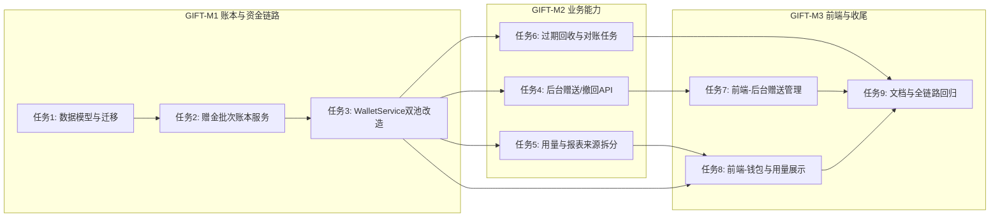

# AI 编码任务拆分（赠送余额专项）

| 项目 | 内容 |
| --- | --- |
| 文档名称 | LLM Gateway 赠送余额（双资金池）AI 编码任务拆分 |
| 输入依据 | `docs/prd/wallet.md`（赠送余额一节）、`docs/prd/billing.md`、`docs/prd/database.md`、`docs/prd/api.md`、`docs/prd/admin.md`、`docs/prd/risks.md`（D4–D7） |
| 版本 | v0.1 |
| 前置条件 | 一期任务 1–10、二期任务 1–15、知识库专项已完成；`wallet_service` 的 hold/capture/release 链路与 `reconcile_holds` 任务在线 |

---

## 1. 使用原则

本专项**直接改造资金主链路**，风险高于知识库专项。除延续既有原则外，额外强制：

- 每个任务开始前先读 `docs/prd/wallet.md#赠送余额gift-credit` 与 `docs/prd/billing.md#赠送余额抵扣与收入口径`。
- **既有测试全绿是每个任务的硬门槛**，尤其 `backend/tests/test_wallet_billing.py`、`test_org_wallet.py`、`test_org_gateway_billing.py`、`test_kb_embed.py`。任何一个红灯都不算完成。
- 金额一律整数（最小货币单位），禁止 float，禁止按比例分摊后取整——跨池拆分只用整数加减。
- 两个资金池的所有变更必须在**同一次 `SELECT ... FOR UPDATE` 事务内**完成，不引入第二把锁、不改变现有事务边界（`WalletService` 不自行 commit）。
- 幂等沿用现有约定：`(wallet_id, ref_request_id, type)` 部分唯一索引。新增的 `gift_*` 流水类型同样走这套。
- **不允许自动发放赠金**（防薅羊毛）：本专项只做后台人工发放，不做注册赠送、活动自动发放、领取码。
- 不允许把赠送余额做成可退款/可提现/可转移的资金。
- 中文文案与文档遵守 `docs/CODING_CONVENTIONS.md`：全程 UTF-8，改完抽查中文未被破坏。
- 每个任务必须留下可重复执行的验证（pytest 用例或 curl 序列）。

### 术语对齐（写代码前先统一）

| 词 | 代码标识 | 含义 |
| --- | --- | --- |
| 现金池 | `wallet.balance` / `wallet.held` | 充值与调账所得，可退可提。**语义收窄，不再是「全部余额」** |
| 赠送池 | `wallet.gift_balance` / `wallet.gift_held` | 平台赠送，不可退不可提，有有效期 |
| 赠送批次 | `gift_grants` | 一次发放的账本记录，按 `expires_at` FIFO 消耗 |
| 总可用额 | `gift_balance + balance + credit_limit` | 402 判定与前端展示都用这个 |

---

## 2. 推荐任务顺序



任务 1→2→3 **严格串行**，是全部资金正确性的地基；任务 4、5、6 在任务 3 完成后可并行；任务 7 依赖 4，任务 8 依赖 3+5；任务 9 收尾。

**建议在任务 3 之后设一个人工检查点**：主链路改完先跑一轮全量回归 + 手工对账，确认无误再铺开 M2。

---

## 3. 任务 1：数据模型与 Alembic 迁移

### 目标

落地赠送池全部表结构与字段扩展，产出可在存量库上执行的迁移。**不写任何业务逻辑**。

### 建议提示词

```text
基于 docs/prd/database.md（wallets / gift_grants / wallet_transactions / usage_logs 章节），
实现赠送余额专项的数据模型与 Alembic 迁移（下一个版本号 013）。

1. backend/app/db/models/wallet.py：
   - Wallet 增加 gift_balance、gift_held（BigInteger，非空，默认 0），
     并补 CheckConstraint gift_balance >= 0、gift_held >= 0。
     注释写明 balance/held 语义已收窄为「现金池」。
   - WalletTransaction 增加：
     gift_amount（BigInteger 非空默认 0，符号与 amount 一致，表示其中赠送池部分）、
     gift_balance_after、gift_held_after（BigInteger 非空默认 0）、
     gift_grant_id（可空 FK -> gift_grants.id）。
     type 注释补充新增值 gift_grant / gift_revoke / gift_expire。
2. 新建 GiftGrant 模型（表 gift_grants），字段见 docs/prd/database.md：
   wallet_id FK、amount、remaining、reason、expires_at（可空=永久）、status、
   granted_by FK users、revoked_by 可空 FK users、revoked_at 可空、
   idempotency_key、remark。
   约束：CHECK remaining >= 0 AND remaining <= amount；
        CHECK reason IN ('promotion','compensation','internal','partnership','other')；
        CHECK status IN ('active','used_up','expired','revoked')；
        UniqueConstraint(wallet_id, idempotency_key)；
        Index(wallet_id, status, expires_at) 支撑 FIFO 取用与过期扫描。
3. backend/app/db/models/log.py 的 UsageLog 增加 gift_charge_amount、cash_charge_amount
   （BigInteger 非空默认 0）。
4. backend/app/db/models/usage_daily.py 的日汇总表增加 gift_revenue_amount、
   cash_revenue_amount（BigInteger 非空默认 0）。
5. 迁移中回填存量数据：
   - usage_logs：cash_charge_amount = charge_amount，gift_charge_amount = 0。
   - usage_daily_summary：cash_revenue_amount = revenue_amount，gift_revenue_amount = 0。
   - wallet_transactions：gift_balance_after = 0、gift_held_after = 0、gift_amount = 0。
   回填用一次性 UPDATE，不要逐行 Python 循环。
   downgrade 必须能干净回滚（删列删表）。

先更新 docs/DATABASE_DESIGN.md 再写代码。
不要改 wallet_service、不要写任何 API、不要改前端。
完成后给出迁移与回滚命令，并提供模型层测试（建表、约束触发、默认值）。
```

### 交付物

- `Wallet` / `WalletTransaction` / `UsageLog` / 日汇总表字段扩展
- 新模型 `GiftGrant` 与 `backend/app/db/models/__init__.py` 注册
- `alembic/versions/013_gift_credit.py`（含存量回填与可回滚 downgrade）
- `docs/DATABASE_DESIGN.md` 更新
- 模型与约束测试

### 验收标准

- 迁移可在含一期/二期/知识库数据的库上执行成功，并可 `downgrade` 回滚。
- 回填后 `SELECT count(*) FROM usage_logs WHERE gift_charge_amount + cash_charge_amount <> charge_amount` 结果为 0。
- 违反 `remaining <= amount`、非法 `reason` / `status` 时数据库直接报错。
- 既有测试全部通过（此任务不应改变任何行为）。

---

## 4. 任务 2：赠金批次账本服务（GiftLedgerService）

### 目标

实现赠金批次的发放、撤回、过期与 **FIFO 消耗**四个原语，维护 `wallets.gift_balance` 与账本不变式。纯服务层 + 单元测试，**不碰 hold/capture、不写 API**。

### 建议提示词

```text
基于 docs/prd/wallet.md「赠送余额」一节，新建 backend/app/services/gift_service.py，
实现 GiftLedgerService（模块级单例 gift_service，风格对齐 wallet_service：
调用方负责事务边界，本服务不 commit）。

先在 wallet_service.py 增加流水类型常量：
TX_GIFT_GRANT = "gift_grant" / TX_GIFT_REVOKE = "gift_revoke" / TX_GIFT_EXPIRE = "gift_expire"，
并把 WalletService._append_transaction 扩展为支持 gift_amount / gift_grant_id 参数，
自动写入 gift_balance_after 与 gift_held_after（默认 0，保持既有调用方行为不变）。

GiftLedgerService 方法：
1. grant(session, *, wallet_id, amount, reason, expires_at, idempotency_key,
         granted_by, remark) -> GiftGrant
   - amount > 0 校验；锁钱包行（复用 WalletService 的行锁工具）；
   - 幂等：先按 (wallet_id, idempotency_key) 查，命中直接返回已存在批次，不重复发放，
     并发下 IntegrityError 也按幂等处理；
   - wallet.gift_balance += amount，写 type=gift_grant 流水
     （amount 与 gift_amount 均为 +amount，ref_request_id = f"gift:{idempotency_key}"，
      operator_user_id = granted_by，gift_grant_id 指向该批次）。
2. revoke(session, *, grant_id, revoked_by, remark) -> GiftGrant
   - 仅 status=active 且 remaining > 0 可撤回，否则抛 ConflictError（对应 409）；
   - 只扣 remaining，已消耗部分不追回；
   - wallet.gift_balance -= remaining（若 gift_balance 不足以扣减，说明账本不一致，
     抛错并记 error 日志，不要静默改成 0）；
   - remaining=0、status=revoked、revoked_at/revoked_by 落库，
     写 type=gift_revoke 流水（负数，ref_request_id = f"gift_revoke:{grant_id}"）。
3. expire(session, *, grant_id) -> GiftGrant：同 revoke 的账务处理，status=expired，
   流水 type=gift_expire，ref_request_id = f"gift_expire:{grant_id}"。
4. consume(session, *, wallet, amount) -> list[tuple[grant_id, consumed_amount]]
   - **不改 wallet.gift_balance**（由调用方在跨池分摊里统一维护），只核销批次 remaining；
   - 按 status='active' AND remaining > 0 的批次，ORDER BY expires_at ASC NULLS LAST,
     created_at ASC（先过期的先花，永久有效排最后）加 FOR UPDATE 取用；
   - 依次扣减 remaining 直到 amount 用尽；remaining 归零的批次置 status='used_up'；
   - 若可核销总额小于 amount，抛错（说明 gift_balance 与账本不一致）。
5. list_grants(session, *, wallet_id, status?, limit, offset)：批次查询，供后续 API 使用。
6. find_expired_grant_ids(session, *, now, limit)：返回 status='active' AND remaining > 0
   AND expires_at IS NOT NULL AND expires_at <= now 的批次 ID，供任务 6 使用。

约定：gift_grants 的所有变更都必须在持有对应 wallet 行锁的事务内进行，
在模块 docstring 里写明这条约定。

不要修改 hold/capture/release，不要写 API，不要写定时任务。
提供单元测试：发放幂等（含并发重复提交）、撤回只退未消耗部分、撤回已耗尽报 409、
FIFO 顺序（构造 3 个不同 expires_at 的批次含一个永久有效）、跨批次消耗、
消耗后 status 流转、账本不变式
Σ(active/used_up 批次已消耗) 与流水一致。
```

### 交付物

- `backend/app/services/gift_service.py`（`GiftLedgerService` + 单例）
- `WalletService._append_transaction` 扩展与三个新流水类型常量
- 批次账本单元测试

### 验收标准

- 同一 `idempotency_key` 重复 `grant` 只产生一个批次、一条流水，`gift_balance` 只加一次。
- FIFO 严格按 `expires_at` 升序、永久有效批次最后消耗；跨批次消耗金额精确无误差。
- `revoke` 只扣 `remaining`，已消耗部分不动；对已耗尽批次抛 `ConflictError`。
- 不变式成立：`Σ active 批次 remaining == wallets.gift_balance`（此任务阶段 `gift_held` 恒为 0）。
- 既有测试全部通过。

---

## 5. 任务 3：WalletService 双资金池改造（核心资金任务）

### 目标

改造 `hold` / `capture` / `release` 支持跨池分摊，`available` 计入赠送池。**这是全专项风险最高的任务，独立执行、独立回归。**

### 建议提示词

```text
基于 docs/prd/wallet.md「扣减优先级」「预扣（Hold）与实扣（Capture）的跨池分摊」，
改造 backend/app/services/wallet_service.py。

核心约束：**不改变 hold/capture/release 的方法签名**，5 个调用方
（api/v1/chat.py、api/v1/embeddings.py、services/embedding_gateway.py、
services/kb_ingest_service.py、tasks/reconcile_holds.py）不需要任何改动。

1. hold(wallet_id, amount, request_id, operator_user_id)：
   - 可用额判定改为 available = wallet.gift_balance + wallet.balance + wallet.credit_limit，
     不足仍抛 InsufficientBalanceError（错误信息带上两池明细，便于排查）；
   - 按优先级顺序拆分：gift_hold = min(amount, wallet.gift_balance)，
     cash_hold = amount - gift_hold（纯整数减法，不做比例分摊）；
   - wallet.gift_balance -= gift_hold; wallet.gift_held += gift_hold;
     wallet.balance -= cash_hold; wallet.held += cash_hold;
   - hold 流水记录 amount = -amount、gift_amount = -gift_hold，
     以及两池的 *_after 快照。**这条流水就是后续分摊的唯一依据。**
   - 本阶段不核销 gift_grants.remaining（见 PRD「简化取舍」），只动 wallet.gift_balance。

2. capture(wallet_id, hold_amount, actual_amount, request_id, operator_user_id)：
   - 先按 (wallet_id, request_id, type=hold) 查出 hold 流水，取 gift_hold = -tx.gift_amount；
     查不到（无 hold 直接结算的场景）则 gift_hold = 0，退化为现有纯现金行为；
   - actual_amount <= hold_amount：
     退还 release_amount = hold_amount - actual_amount，**按占用逆序退**——
     先退现金部分 cash_release = min(release_amount, cash_hold)，
     剩余再退赠送部分 gift_release = release_amount - cash_release。
     结果等价于「用 actual_amount 按 赠送→现金 顺序重新分摊」，务必在测试里断言这个等价性。
   - actual_amount > hold_amount：超出部分 extra 再按 赠送 → 现金 → 授信 顺序补扣；
     可用额不足时沿用现有「尽力扣到底线不透支」策略，两池都不能变负。
   - 先归还 gift_held / held，再落各池实扣金额；
     capture 流水 amount = -(实扣总额)、gift_amount = -(赠送实扣额)；
     差额 release 流水同样带 gift_amount。
   - 赠送实扣额 > 0 时调用 gift_service.consume(session, wallet=wallet, amount=赠送实扣额)
     核销批次 remaining，并把首个批次 ID 写入 capture 流水的 gift_grant_id（仅作溯源）。

3. release(wallet_id, hold_amount, request_id, operator_user_id)：
   - 同样从 hold 流水取拆分，gift_hold 与 cash_hold 各自原路退回对应池；
   - 不核销任何批次。

4. 新增只读方法 get_charge_split(session, *, wallet_id, request_id) -> tuple[int, int]：
   读 capture 流水返回 (gift_charge, cash_charge)，供任务 5 写 usage_logs 使用；
   无 capture 流水返回 (0, 0)。

5. get_or_create_personal_wallet / get_or_create_org_wallet 初始化 gift_balance=gift_held=0。

不要改 recharge / adjust（它们只作用于现金池，符合「赠送必须走赠送接口」的设计）。
不要写 API、不要写定时任务、不要动前端。

测试要求（新增 backend/tests/test_gift_billing.py）：
- 纯现金钱包的 hold/capture/release 行为与改造前逐字节一致（回归保护）。
- 纯赠金钱包：预扣实扣全部走赠送池，现金池不动。
- 跨池：PRD 示例——赠送池 30、现金池 1000，预扣 100 → gift_held=30/held=70；
  实扣 60 → 最终 gift 实扣 30、cash 实扣 30，gift_balance=0、balance=970。
- 等价性断言：对同一组 (gift_balance, balance, hold, actual) 参数，
  「hold 后 capture」的两池终态 == 「直接按优先级扣 actual」的两池终态。用参数化测试覆盖多组边界
  （actual=0、actual=hold、actual 略大于 hold、赠金刚好够、赠金为 0）。
- 失败释放：release 后两池精确复原。
- 幂等：重复 capture / release 不二次变动两池。
- 并发：两个协程同时 hold 同一钱包，总扣减不超过总可用额（沿用既有并发测试写法）。
- 批次核销：capture 后 gift_grants.remaining 减少且不变式
  Σ(active 批次 remaining) == gift_balance + gift_held 成立。

完成后必须跑全量 pytest 并贴出结果，test_wallet_billing.py / test_org_wallet.py /
test_org_gateway_billing.py / test_kb_embed.py 一条都不能红。
```

### 交付物

- `WalletService` 三个资金方法的双池改造 + `get_charge_split`
- `backend/tests/test_gift_billing.py`（含等价性参数化测试）
- 全量回归结果

### 验收标准

- **5 个调用方源码零改动**，既有资金测试全绿。
- `gift_balance = 0` 的钱包，所有行为与改造前完全一致。
- 跨池示例数值精确匹配 PRD；等价性参数化测试全部通过。
- 任意时刻两池的 4 个金额字段均 ≥ 0，数据库 CHECK 从未被触发。
- 不变式 `Σ active 批次 remaining == gift_balance + gift_held` 在每个测试用例结束时成立。

---

## 6. 任务 4：后台赠送 / 撤回 API（含风控与审计）

### 目标

实现管理端赠送、撤回、批次查询接口，接入权限、单笔与日累计上限、幂等和审计日志。

### 建议提示词

```text
基于 docs/prd/api.md「赠送余额」与 docs/prd/wallet.md「后台赠送操作」，
在 backend/app/api/admin/wallets.py 增加赠送相关接口（沿用该文件现有的管理员鉴权依赖）：

POST /admin/wallets/users/{user_id}/gifts    # 个人钱包赠送
POST /admin/wallets/orgs/{org_id}/gifts      # 组织钱包赠送
GET  /admin/wallets/{wallet_id}/gifts        # 批次列表（分页 + status 过滤）
POST /admin/gifts/{grant_id}/revoke          # 撤回未消耗部分

请求体（backend/app/schemas/admin.py 新增 GiftGrantCreate / GiftGrantOut / GiftRevoke）：
- amount: int > 0，最小货币单位
- expires_in_days: int | None 与 expires_at: datetime | None 二选一；
  都不传时必须显式 never_expires=true，否则 422（防误发永久赠金）
- reason: 枚举 promotion/compensation/internal/partnership/other，必填
- remark: str | None
- idempotency_key: str，必填

实现要点：
1. 到期时间换算：expires_in_days 按业务时区（settings 新增 business_timezone，默认 Asia/Shanghai）
   当日 23:59:59 再转 UTC 存储，避免跨时区提前失效。复用 app/core/datetime_utils.py 的工具，
   不要新造时间处理函数。
2. 风控（settings 新增配置项，给出默认值并写进 .env.example 与 DEPLOYMENT.md）：
   - gift_max_amount_per_grant：单笔上限
   - gift_max_amount_per_operator_daily：单操作人当日累计上限
   超限返回 422 + 业务码 gift_amount_exceeds_limit，并打 warning 日志。
   日累计按 gift_grants.granted_by + created_at 落在业务时区当日 统计（不含已撤回的批次）。
3. 权限：仅超级管理员 / 财务角色可调用赠送与撤回（沿用 api/admin/deps.py 现有角色依赖，
   若无财务角色则复用超管依赖并在 TODO 注明）。
4. 审计：调用 services/audit_service.py 写 action=wallet.gift_grant / wallet.gift_revoke，
   detail 含 wallet_id、amount、reason、expires_at、grant_id。
5. 撤回已耗尽批次返回 409 + 业务码 gift_already_consumed。
6. 前台只读接口：backend/app/api/wallets.py 增加 GET /wallets/me/gifts，
   返回当前用户 active 批次（金额、剩余、到期时间、原因），不暴露操作人信息。
7. 钱包查询响应（个人 /wallets/me、组织、以及 admin 的 WalletOut）增加
   gift_balance、gift_held、total_available = gift_balance + balance + credit_limit。
   balance 字段保持不变（现在语义是现金池），不要改名。

不要动 hold/capture/release，不要写前端。
测试覆盖：赠送成功后 gift_balance 增加、重复 idempotency_key 不重复发放（返回同一 grant_id）、
超单笔上限 422、超日累计上限 422、非管理员 403、撤回未消耗部分成功、撤回已耗尽 409、
审计日志落库、组织钱包赠送、never_expires 未显式确认时 422。
```

### 交付物

- 4 个管理端接口 + 1 个前台只读接口
- `schemas/admin.py` 赠送相关 Schema 与钱包响应扩展
- 风控配置项、`.env.example` 与部署文档更新
- 审计接入
- 接口测试

### 验收标准

- 后台可完成「赠送 → 用户 `gift_balance` 增加 → 调用优先扣赠金 → 撤回剩余」完整闭环。
- 重复提交同一幂等键不会重复发放（这是防资损的关键项，必须有测试）。
- 超限、越权、撤回冲突各返回约定的错误码。
- 每次赠送/撤回都有对应审计记录，可追溯到操作人。

---

## 7. 任务 5：用量与报表的资金来源拆分

### 目标

把赠送/现金拆分写进 `usage_logs` 与日汇总，并**修正平台收入与毛利口径**。

### 建议提示词

```text
基于 docs/prd/billing.md「赠送余额抵扣与收入口径」（D6），实现用量与报表的资金来源拆分。

1. backend/app/services/usage_service.py 的 write_usage_log：
   写入 gift_charge_amount / cash_charge_amount，取值来自
   wallet_service.get_charge_split(session, wallet_id=..., request_id=...)；
   拿不到拆分（未走钱包、免费调用等）时回退 cash_charge_amount = charge_amount、
   gift_charge_amount = 0。写入前断言两者之和等于 charge_amount，不等则记 error 日志并按回退值写入
   （宁可口径保守，也不能写出自相矛盾的账）。
   注意调用顺序：必须在 capture 之后再写 usage_log；若现有链路顺序相反，调整顺序而不是猜测拆分。
2. backend/app/services/usage_daily_service.py 聚合时同步累加
   gift_revenue_amount / cash_revenue_amount。
3. backend/app/services/report_service.py 与 backend/app/schemas/report.py：
   - **平台收入口径改为 cash_revenue_amount**；
   - 毛利改为 cash_revenue_amount - cost_amount（会出现负值，属预期）；
   - 新增指标：gift_consumed（赠金消耗）、gift_cost（赠金消费对应的上游成本）；
   - 原 revenue_amount 字段保留为「计费总额」并在 schema 注释与 API 文档里写明口径变更，
     不要静默改变同名字段的含义。
4. backend/app/api/usage.py 的用量明细与 /usage/daily 返回新增
   gift_charge_amount / cash_charge_amount，并支持按资金来源筛选
   （fund_source=gift/cash/mixed，mixed 表示两者都 > 0）。
5. backend/app/api/admin/reports.py 与 admin/usage.py 暴露新指标；
   对账接口增加校验项：Σ usage_logs.gift_charge_amount 与赠送池 capture 流水
   Σ(-gift_amount) 是否一致，不一致在响应里标红。

不要改钱包扣费逻辑，不要写前端。
测试：混合支付调用后 usage_log 拆分正确且和等于 charge_amount、
纯现金与纯赠金两种极端、日汇总累加正确、
报表毛利用现金口径（构造一笔纯赠金消费，断言毛利为负且等于 -cost_amount）、
资金来源筛选、对账不一致时能被检出。
```

### 交付物

- `usage_service` / `usage_daily_service` 拆分写入
- `report_service` 收入与毛利口径修正 + 赠金指标
- 用量与报表 API 扩展（含 `fund_source` 筛选）
- 对账校验项
- 口径测试

### 验收标准

- 任一条 `usage_logs` 满足 `gift_charge_amount + cash_charge_amount = charge_amount`。
- 纯赠金消费的毛利等于 `-cost_amount`，不再虚报为正。
- 日汇总的两个收入字段之和等于原 `revenue_amount`。
- 对账接口能检出人为制造的拆分不一致。

---

## 8. 任务 6：过期回收定时任务与账本对账

### 目标

实现赠金到期作废任务与每日账本一致性校验，补齐监控指标。

### 建议提示词

```text
基于 docs/prd/wallet.md「过期回收」，新建 backend/app/tasks/expire_gifts.py，
风格完全对齐现有 backend/app/tasks/reconcile_holds.py（argparse CLI + asyncio +
python -m app.tasks.expire_gifts 可执行 + --dry-run + 返回统计 dataclass）。

1. 扫描：gift_service.find_expired_grant_ids(now=utc_now(), limit=批大小)。
2. **跳过规则**：按 wallet_id 分组处理；处理前锁钱包行，若 wallet.gift_held > 0
   （该钱包有请求正在进行）则跳过整个钱包、计入 skipped，下一轮再收。
   在代码里加 ponytail: 注释说明这是刻意的简化——上限是过期最长延迟一个任务周期，
   升级路径是 hold 阶段就核销批次。
3. 回收：对每个批次调 gift_service.expire()，写 gift_expire 流水。
4. 幂等：ref_request_id = f"gift_expire:{grant_id}" 天然幂等，重复执行不重复回收。
5. 指标：backend/app/core/metrics.py 新增
   GIFT_OPS（labels: op=grant/revoke/expire/consume, result）、
   GIFT_BALANCE_TOTAL（全平台未消耗赠金敞口，由对账任务刷新）。

同时新建 backend/app/tasks/reconcile_gifts.py（或并入上面同一文件的子命令）做每日对账：
- 校验 Σ(status='active' 批次 remaining) == Σ(wallets.gift_balance + wallets.gift_held)，
  按钱包粒度找出不一致的行；
- 校验 Σ usage_logs.gift_charge_amount == Σ 赠送池 capture 流水的 -gift_amount；
- 不一致只告警与输出报告，**不要自动修数**（资金问题必须人工确认）。

更新 docs/DEPLOYMENT.md 的 cron 配置示例（与 reconcile_holds、aggregate_usage_daily 并列），
说明建议执行频率（过期回收每小时一次，对账每日一次）。

测试：到期批次被回收且 gift_balance 精确减少、未到期与永久有效批次不受影响、
gift_held > 0 的钱包被跳过且下一轮可正常回收、重复执行幂等、
--dry-run 不产生任何写入、对账能检出人为制造的不一致。
```

### 交付物

- `backend/app/tasks/expire_gifts.py`（含 `--dry-run`）
- 赠金账本对账任务
- Prometheus 赠金指标
- `DEPLOYMENT.md` cron 示例
- 任务测试

### 验收标准

- 到期赠金在一个任务周期内被回收，`gift_balance` 与批次 `remaining` 同步归零。
- 有进行中请求（`gift_held > 0`）的钱包本轮被跳过，请求结束后下一轮正常回收，期间该笔赠金仍可被使用。
- 重复执行不产生重复流水。
- 对账任务能发现不一致且不会自动改数。

---

## 9. 任务 7：前端——后台赠送管理

### 目标

在管理后台钱包页接入赠送、撤回、批次查看，并补赠金看板。

### 建议提示词

```text
基于任务 4 的后端接口，改造 frontend/src/pages/admin/WalletsPage.tsx 与
frontend/src/api/admin.ts（沿用现有请求封装与 Ant Design 组件风格）：

1. 钱包详情弹窗：余额区改为分开展示「充值余额」「赠送余额」「冻结中（现金/赠送）」
   「总可用额」四组数字，赠送余额下方加灰色说明「不可退款 / 不可提现」。
2. 新增「赠送」按钮与表单弹窗：金额、有效期（30天/90天/自定义日期/永久有效——
   选永久时弹二次确认）、原因分类（下拉，必填）、备注。
   提交时前端生成 idempotency_key（uuid）并在整个弹窗生命周期内复用，
   提交按钮提交中禁用——防止重复点击造成重复赠送。
3. 新增「赠送批次」Tab：列表展示金额、剩余、原因、到期时间、状态、操作人、发放时间；
   active 且 remaining > 0 的行显示「撤回」按钮（二次确认，文案写明只撤回未消耗部分）。
   状态与原因用 Tag 展示，沿用文件顶部现有的类型映射写法新增 GIFT_STATUS_MAP / GIFT_REASON_MAP。
4. 流水列表的类型映射补充 gift_grant / gift_revoke / gift_expire 三种中文标签，
   并在流水行展示 gift_amount（有值时标注「含赠金 x」）。
5. frontend/src/pages/admin/ReportsPage.tsx 补赠金看板卡片：
   赠金余额敞口、当日发放/撤回/过期、当日赠金消耗、赠金对应上游成本、核销率。
   收入相关卡片的口径改为现金收入，标题或 tooltip 注明「不含赠金消耗」。

所有中文文案 UTF-8（见 docs/CODING_CONVENTIONS.md），改完抽查页面中文未变成 ??。
不要改后端。
```

### 交付物

- 管理端钱包页赠送/撤回/批次 Tab
- 流水类型与赠金金额展示
- 管理端报表赠金看板与收入口径标注
- API 封装扩展

### 验收标准

- 管理员可在 UI 完成赠送与撤回全流程，无需接触 API。
- 重复点击提交按钮只产生一个批次。
- 选择「永久有效」必须过二次确认。
- 页面中文完整无乱码。

---

## 10. 任务 8：前端——用户端钱包与用量展示

### 目标

用户侧透明呈现两个资金池与每笔调用的资金来源。

### 建议提示词

```text
基于任务 4/5 的后端接口，改造前台页面（frontend/src/，Vite + React + TS + Ant Design）：

1. frontend/src/pages/WalletPage.tsx：
   - 余额区拆为「充值余额」「赠送余额」「总可用额」；
   - 赠送余额下展开批次列表（金额、剩余、到期时间），最近到期的批次高亮，
     7 天内到期给出提示；
   - 明确标注赠送余额不可退款、不可提现；
   - 流水类型映射补 gift_grant / gift_revoke / gift_expire 中文标签。
2. frontend/src/pages/OrgsPage.tsx 组织钱包区做同样的两池展示（Owner/Admin 可见）。
3. frontend/src/pages/UsagePage.tsx：
   - 明细表新增「赠金抵扣」「现金支付」两列；
   - 筛选区新增资金来源（全部/赠金/现金/混合），对应后端 fund_source 参数。
4. frontend/src/pages/ReportsPage.tsx 个人报表区分现金消费与赠金消费。
5. 余额不足提示：所有依据余额的前端判断改用 total_available（赠送 + 充值 + 授信），
   避免充值余额为 0 但赠送余额充足时误提示「余额不足」。全局搜一遍 balance 的使用点，
   逐个确认语义（现在 balance 只是现金池），不要漏改。
6. frontend/src/pages/RechargePage.tsx 充值成功文案确认只涉及充值余额，不要误导为赠送。

所有中文文案 UTF-8，改完抽查中文完整。
不要改后端。
```

### 交付物

- 用户钱包页两池展示与批次到期提示
- 组织钱包页两池展示
- 用量页资金来源列与筛选
- 全局 `balance` 语义排查记录

### 验收标准

- 充值余额为 0、赠送余额充足时，用户可正常发起调用，前端不出现「余额不足」误报。
- 用量明细能看出每次调用花了多少赠金、多少现金。
- 赠送批次到期时间可见，7 天内到期有提示。
- 页面中文完整无乱码。

---

## 11. 任务 9：文档与全链路回归

### 目标

补齐契约与验证文档，做资金链路端到端回归。

### 建议提示词

```text
赠送余额专项收尾：
1. 更新 docs/API_CONTRACT.md：赠送/撤回/批次查询/前台批次查询全部接口的请求响应与错误码
   （gift_already_consumed 409、gift_amount_exceeds_limit 422），
   以及钱包响应与用量响应的新增字段、report 口径变更说明。
2. 更新 docs/DEPLOYMENT.md 与 README：新增环境变量
   （business_timezone、gift_max_amount_per_grant、gift_max_amount_per_operator_daily）、
   expire_gifts 与 reconcile_gifts 的 cron 配置。
3. 更新 docs/VALIDATION_PLAN.md：按 docs/prd/wallet.md 与 billing.md 补赠送余额验证用例。
4. 更新 docs/MVP_SCOPE.md / PHASE2_SCOPE.md 中与钱包相关的描述（如涉及）。
5. 全量回归 pytest 全绿，并手工走一遍端到端：
   后台赠送 100 元(有效期30天) → 用户发起 chat 调用 → 查 usage_logs 拆分 →
   查钱包流水 hold/capture 的 gift_amount → 赠金用尽后自动转现金支付 →
   后台撤回剩余 → 触发过期任务 → 对账任务无差异。
   记录每一步的实际数值与预期数值对照表。
6. 抽查所有新增/修改的中文文档与前端文案：UTF-8 严格解码 + 关键中文关键词存在性检查。
7. 输出一份「口径变更影响说明」，列出 balance 语义收窄与收入口径变更对下游
   （对外文档、财务报表、已有 BI 查询）的影响与迁移建议。
```

### 交付物

- `API_CONTRACT.md`、`DEPLOYMENT.md`、`README`、`VALIDATION_PLAN.md` 更新
- 端到端回归记录（含数值对照表）
- 口径变更影响说明
- 中文完整性检查结果

### 验收标准

- 新开发者可按文档配齐环境变量与两个新 cron 任务。
- 端到端回归每一步实际值与预期值一致。
- 全量测试通过，`docs/prd/wallet.md` 与 `billing.md` 的规则逐条可验证。

---

## 12. 每批任务的固定验收模板

沿用既有模板，每次任务要求 AI 按以下格式回复：

```text
完成内容：
- ...

修改文件：
- ...

验证命令：
- ...

验证结果：
- ...

未完成/风险：
- ...
```

资金相关任务（1/2/3/4/6）额外要求附上：

```text
账本不变式校验：
- Σ(active 批次 remaining) == Σ(gift_balance + gift_held)：通过 / 不通过
- 既有资金测试（test_wallet_billing / test_org_wallet / test_org_gateway_billing / test_kb_embed）：全绿 / 有红灯
```

---

## 13. 不应交给 AI 一次性完成的任务

以下提示词风险较高，不建议使用：

```text
实现赠送余额功能，后台能赠送，调用时优先扣赠金，用量能区分。
```

```text
把双资金池改造和赠送 API、前端展示一起做完。
```

```text
先把 gift_balance 字段加上，扣费顺序后面再调。
```

```text
顺便把 recharge 也改成能选择充进赠送池。
```

原因：

- 跨池分摊改的是 `hold/capture/release` 主链路，一旦分摊逻辑写错会造成**真实资损且难以事后追溯**，必须独立成任务并以「既有资金测试全绿 + 等价性参数化测试」双重门槛验收。
- 批次账本（任务 2）是纯新增代码，先独立用单测锁定 FIFO 与幂等行为，任务 3 才能放心复用；混在一起会让分摊 bug 与账本 bug 互相掩盖。
- 「先加字段，顺序后面调」会产出一个**看起来能用但会算错账**的中间态，一旦上线就要做资金修数，成本远高于多拆一个任务。
- 让 `recharge` 能充进赠送池会直接破坏 D5（赠金不可退不可提）——充值与赠送的资金性质不同，必须走不同入口、留不同审计。
- 收入口径变更（任务 5）会改变对外报表数字，需要单独评审与通知，不能夹带在功能任务里。
