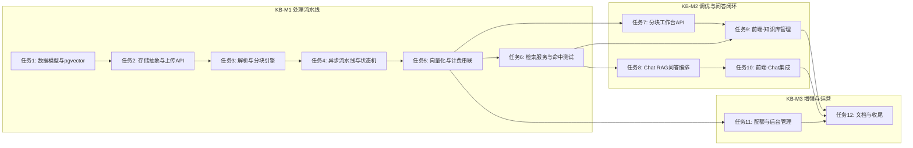

# AI 编码任务拆分（知识库专项）

| 项目 | 内容 |
| --- | --- |
| 文档名称 | LLM Gateway 知识库（RAG 问答）AI 编码任务拆分 |
| 输入依据 | `docs/prd/knowledge-base.md`、`docs/prd/chat.md`、`docs/PRD.md`（索引）、`docs/TECH_DESIGN.md`、`docs/DATABASE_DESIGN.md` |
| 版本 | v0.1 |
| 前置条件 | 一期任务 1–10、二期任务 1–15 已完成（见 `AI_TASK_BREAKDOWN.md` / `AI_TASK_BREAKDOWN_PHASE2.md`），`/v1/embeddings` 与适配器注册表可用 |

---

## 1. 使用原则

延续一、二期原则：小批次推进，每次任务只实现一个明确阶段，并要求 AI 同时提供测试或验证方式。

通用要求：

- 每个任务开始前先阅读 `docs/prd/knowledge-base.md` 对应章节（重点：功能设计、状态机、数据库概览、历史功能优化清单）。
- 不允许提前实现暂缓能力：组织共享知识库、OCR/多模态解析、网页抓取、GraphRAG/父子分块、`/v1` 对外 `kb_ids` 扩展、知识库公开分享。
- 向量化/检索的 embedding 调用**必须复用现有网关内部链路**（路由、适配器、计费、用量日志），不允许绕过计费直连上游。
- 所有金额计算禁止使用 float；向量化预扣/实扣/释放复用现有钱包链路并保证 `request_id` 幂等。
- 处理任务（解析/分块/向量化）必须幂等：同文档同版本重复执行不重复计费、不产生重复分块。
- 知识库数据严格按用户隔离：所有 API 必须校验归属，越权返回 403。
- 文件内容含大量中文，遵守 `docs/CODING_CONVENTIONS.md`：读写一律 UTF-8，禁止错误编码往返。
- 不破坏既有行为：所有改造完成后，一、二期既有测试必须全部通过。
- 每批任务必须有测试、curl 示例或其他可重复验证方式。

---

## 2. 推荐任务顺序



任务 1–6 严格串行（核心流水线）；任务 7、8 在其依赖完成后可并行；任务 11 可在任务 5 后随时插入；前端任务 9、10 分别依赖对应后端；任务 12 收尾。

---

## 3. 任务 1：知识库数据模型与 pgvector 迁移

### 目标

实现知识库域全部新表和既有表的字段扩展，启用 pgvector 扩展，产出 Alembic 迁移。不实现任何业务 API。

### 建议提示词

```text
基于 docs/prd/knowledge-base.md 的「数据库设计概览」，实现知识库域数据模型和 Alembic 迁移。
新增表：
- knowledge_bases：owner_user_id、名称、描述、embedding 模型 ID、embedding 维度、
  默认分块参数（chunk_size/chunk_overlap/separators）、默认检索参数（top_k/score_threshold）、
  统计冗余字段（文档数/分块数/存储字节数）、状态（active/disabled）。
- kb_documents：所属库、文件名、文件类型、大小、存储地址、分块参数快照、
  状态机字段（uploaded/parsing/chunking/pending_embedding/insufficient_balance/embedding/ready/partial/failed）、
  错误信息、token 统计、时间戳。
- kb_chunks：所属文档/库、序号、内容、token 数、来源位置（页码/标题路径）、启用状态、
  人工编辑标记、embedding 向量列（pgvector，维度取库配置）、向量化状态。
- kb_ingest_jobs：类型（parse/chunk/embed/rechunk）、状态、进度、关联文档、
  关联预扣 hold_id、幂等键、错误信息、重试次数。
修改表：
- usage_logs、request_logs 增加 source 字段（chat/api/kb_ingest/kb_query，存量默认 api，可空兼容）。
- 角色配置增加知识库配额字段组：最大知识库数、单库最大文档数、存储上限字节、单文件上限字节。
迁移中启用 pgvector 扩展（CREATE EXTENSION IF NOT EXISTS vector），并为 kb_chunks 向量列建 HNSW 索引（cosine）。
金额字段使用整数最小单位。先更新 docs/DATABASE_DESIGN.md 再写代码。
不要实现任何 API、解析器或向量化逻辑。
完成后提供迁移命令和模型测试；说明本地/CI 环境安装 pgvector 的方式并更新 docs/DEPLOYMENT.md。
```

### 交付物

- 知识库域 SQLAlchemy models（4 张新表）
- 既有表 `source` 字段与角色配额字段扩展
- Alembic 迁移（含 pgvector 扩展与 HNSW 索引，可在含一、二期数据的库上执行）
- `DATABASE_DESIGN.md`、`DEPLOYMENT.md` 更新
- 基础模型测试

### 验收标准

- 迁移可在已有一、二期数据的库上执行成功且可回滚。
- `kb_chunks` 可写入并按 cosine 相似度查询向量。
- 存量 `usage_logs` 数据不受 `source` 字段影响，一、二期既有测试全部通过。

---

## 4. 任务 2：文件存储抽象与知识库/文档 API

### 目标

实现文件存储抽象（本地磁盘起步）、知识库 CRUD 和文档上传/查询/删除 API，含配额与文件校验。不触发任何解析处理。

### 建议提示词

```text
基于 docs/prd/knowledge-base.md「知识库管理」「文档上传与解析」两节，实现：
1. FileStorage 抽象接口（save/open/delete/exists），先实现 LocalFileStorage（根目录走配置），
   接口签名兼容后续 S3/OSS 实现；存储路径使用随机不可预测标识，不使用原始文件名。
2. 知识库 CRUD API（JWT 鉴权，严格按 owner_user_id 隔离）：
   - POST/GET/PATCH/DELETE /kb；创建时 embedding 模型默认取系统配置的默认嵌入模型，
     校验该模型 model_type='embedding' 且当前用户有权使用、已配置计费规则；创建后不可更换。
   - 删除知识库需级联删除文档、分块和原文件。
3. 文档 API：
   - POST /kb/{id}/documents（multipart 批量上传）：真实类型嗅探（不只看扩展名）、
     单文件大小与批量数量限制、配额校验（库数/文档数/存储量，读取角色配额字段）；
     上传成功落 kb_documents（状态 uploaded）并更新库统计冗余。
   - GET /kb/{id}/documents（分页）、GET /kb/documents/{doc_id}、DELETE /kb/documents/{doc_id}。
支持类型：txt/md/pdf/docx/html/csv/xlsx，其余明确报 unsupported_file_type。
不要实现解析、分块、向量化，不要实现管理端 API。
提供归属校验（403）、配额超限、类型/大小校验的测试。
```

### 交付物

- `FileStorage` 抽象 + `LocalFileStorage`
- `KnowledgeBaseService` 与知识库 CRUD API
- 文档上传/列表/详情/删除 API
- 配额与文件校验逻辑
- 隔离与校验测试

### 验收标准

- 用户 A 访问用户 B 的知识库/文档一律 403。
- 伪造扩展名的文件（如 exe 改名 pdf）被拒绝。
- 超配额（库数/文档数/存储/单文件）返回明确错误码，且不写库不存文件。
- 删除知识库后原文件与记录全部清理。

---

## 5. 任务 3：文档解析与分块引擎

### 目标

实现 6 类文件的文本解析器和「结构优先 + 长度约束」分块器。纯函数库 + 单元测试，不接流水线、不写库。

### 建议提示词

```text
基于 docs/prd/knowledge-base.md「文档上传与解析」「分块」两节，实现解析与分块引擎（纯逻辑层，不依赖 DB）。
1. 解析器：统一接口 parse(file_bytes, file_type) -> ParsedDocument（结构化元素列表：
   标题层级/段落/表格行，附页码或位置信息）。
   - txt：编码自动识别（UTF-8 优先，兼容 GBK 读入后统一转 UTF-8）。
   - md：保留标题层级结构。
   - pdf：文本层提取（推荐 pypdf 或 pdfplumber）；无文本层的扫描件抛 UnparsableDocumentError，
     错误信息注明「扫描件暂不支持」。
   - docx：正文 + 标题层级（python-docx）。
   - html：去标签提取正文（保留标题结构）。
   - csv/xlsx：表头 + 行值拼接为文本行。
2. 分块器：chunk(parsed_doc, chunk_size, chunk_overlap, separators) -> list[Chunk]。
   策略：先按标题/段落结构切分，超过 chunk_size（token 数）再按句子二次切分，相邻分块保留 overlap；
   每个分块产出：序号、内容、token 数（用与计费一致的分词估算）、来源位置（页码/标题路径）。
   参数边界：chunk_size 100–2000，overlap 0–200 且小于 chunk_size。
新依赖写入 requirements 并说明选型理由。
提供每种文件类型的最小样例文件（含中文内容）作为测试夹具，覆盖：正常解析、空文档、
损坏文件、扫描件 PDF、参数边界。
注意 docs/CODING_CONVENTIONS.md：中文内容全程 UTF-8，测试断言中文不被破坏。
```

### 交付物

- 6 类解析器 + 统一接口与错误类型
- 结构优先分块器
- 中文样例测试夹具与单元测试
- 依赖清单更新

### 验收标准

- 各类型样例文件解析出的中文内容完整无乱码。
- 同一输入 + 同一参数分块结果确定（可重复）。
- 分块 token 数不超过 chunk_size 上限，重叠区符合 overlap 设置。
- 损坏/空/扫描件文件抛出可区分的明确错误。

---

## 6. 任务 4：异步处理流水线与状态机

### 目标

实现 `kb_ingest_jobs` 后台 worker，把「解析 → 分块」串成异步流水线，落实文档状态机、进度查询和失败重试。本任务分块落库但**不做向量化**（停在 `pending_embedding`）。

### 建议提示词

```text
基于 docs/prd/knowledge-base.md「文档处理状态机」，实现异步处理流水线。
1. Worker：python -m app.tasks.kb_worker，DB 拉取待处理 kb_ingest_jobs（SELECT ... FOR UPDATE SKIP LOCKED），
   复用现有 tasks 框架风格；支持多实例并行不重复消费；任务失败记录错误并支持有限重试。
2. 流水线：文档上传成功后创建 parse job → 解析成功流转 chunking 并写 kb_chunks（向量列为空）→
   完成后文档状态置 pending_embedding。严格按 PRD 状态机流转，非法流转拒绝并报错。
3. 幂等：job 带幂等键（文档 ID + 类型 + 版本），重复执行先清理本阶段产物再重做，不产生重复分块。
4. 进度与重试 API：文档详情返回状态、进度百分比、错误信息；POST /kb/documents/{doc_id}/retry
   仅对 failed 状态有效，重建对应 job。
5. 用户级并发控制：同一用户同时处理中的文档数上限（默认 2，配置项），超出的排队。
不要实现向量化和检索。
提供状态机流转测试（含失败重试、重复执行幂等、并发上限）。
```

### 交付物

- `kb_worker` 后台任务与 job 消费框架
- 解析/分块流水线与状态机流转
- 进度查询与重试 API
- 幂等与并发控制
- 状态机测试

### 验收标准

- 上传 6 类样例文件后全部到达 `pending_embedding`，分块数量与引擎单测一致。
- 解析失败的文档状态为 `failed` 且错误可见，retry 后可重新处理。
- 同一 job 重复执行不产生重复分块。
- 两个 worker 实例并行消费不重复处理同一 job。

---

## 7. 任务 5：向量化与计费串联

### 目标

实现向量化阶段：复用网关内部链路批量调用 embedding 模型，接入预扣/实扣/释放，文档到达 `ready`。这是本专项资金相关的核心任务。

### 建议提示词

```text
基于 docs/prd/knowledge-base.md「向量化与索引」「计费与配额」两节，实现向量化阶段。
1. 内部调用方标识：为服务内部发起的 embedding 调用增加 internal caller 身份
   （不占用用户 API Key，跳过 Key 级限流，但计费主体为文档所属用户的个人钱包），
   复用现有模型解析、路由、适配器、usage 记录链路；usage_logs.source 落 kb_ingest。
2. 计费：pending_embedding 时按分块 token 总量估算预扣（hold）；余额不足则文档状态置
   insufficient_balance（不报错、可在充值后 retry）；向量化按批完成后按实际用量实扣（capture），
   多余释放（release）；全部失败全额释放；以文档级幂等键保证重复执行不重复扣费。
3. 批量与限速：分块按批合并请求（每批条数走配置，默认 16）；向量化流量使用低优先级
   （并发上限配置，避免与在线 chat 争抢渠道 Key 的 RPM/TPM 预算）。
4. 状态：全部分块成功 → ready；部分失败 → partial（记录失败分块，可重试失败部分）；
   写入 kb_chunks 向量列并确认走 HNSW 索引。
5. 提供单分块重嵌入函数 re_embed_chunk(chunk_id)（内容变更后调用，增量计费），供任务 7 使用。
使用 Mock embedding 上游做集成测试，覆盖：成功、余额不足、部分失败重试、重复执行幂等、
钱包流水与 usage 对账。
不要实现检索和分块编辑 API。
```

### 交付物

- 内部调用方身份与网关内部复用改造
- 向量化 job（批量、低优先级、并发控制）
- hold/capture/release 串联与幂等
- `re_embed_chunk` 增量重嵌入函数
- 资金与状态集成测试

### 验收标准

- 文档向量化完成后：状态 `ready`，产生 `source=kb_ingest` 的 usage log 和 hold/capture 流水，实扣金额与分块 token 总量按 embedding 计费规则一致。
- 余额不足时文档停在 `insufficient_balance`，无任何扣费；充值后 retry 可继续。
- 同一文档重复触发向量化不重复扣费、不重复写向量。
- `partial` 状态可只重试失败分块，成功分块不重复计费。
- 在线 `/v1/chat/completions` 的既有测试不受内部调用方改造影响。

---

## 8. 任务 6：检索服务与命中测试

### 目标

实现向量检索服务（单库/多库合并）和命中测试 API，为分块工作台和 Chat 问答提供基础。

### 建议提示词

```text
基于 docs/prd/knowledge-base.md「检索与命中测试」，实现检索服务。
1. RetrievalService.search(user, kb_ids, query, top_k, score_threshold) -> list[RetrievedChunk]：
   - query 走内部 embedding 链路向量化（计费主体为查询用户，usage_logs.source=kb_query）；
   - pgvector cosine 相似度检索，只检索启用且已向量化的分块，过滤 disabled 文档/知识库；
   - 多知识库时各库检索后按分数合并排序取全局 top_k；
   - 返回：分块内容、分数、所属文档与位置信息；
   - kb_ids 全部做归属校验，含他人库直接 403。
2. 命中测试 API：POST /kb/{id}/hit-test {query, top_k?, score_threshold?}，
   参数缺省取库默认检索参数；响应含每条命中的分数与文档定位，并返回本次 query 向量化的预估费用。
使用 Mock embedding 上游测试；用固定向量夹具验证排序与阈值过滤的正确性
（直接向 kb_chunks 写入构造向量，避免依赖真实模型）。
不要实现 Chat 编排、rerank、关键词混合检索。
```

### 交付物

- `RetrievalService`（多库合并、阈值过滤、禁用过滤）
- 命中测试 API
- `source=kb_query` 计费串联
- 排序/阈值/隔离测试

### 验收标准

- 构造向量夹具下，返回顺序与 cosine 分数严格一致，低于阈值的不返回。
- 禁用的分块、`failed` 文档的分块不出现在结果中。
- 命中测试产生 `source=kb_query` 的 usage log 并从查询用户钱包扣费。
- `kb_ids` 含他人知识库时 403 且不产生任何向量化调用。

---

## 9. 任务 7：分块工作台 API

### 目标

实现分块的浏览、搜索、编辑、启用/禁用、删除、手动新增、批量操作和文档重新分块。

### 建议提示词

```text
基于 docs/prd/knowledge-base.md「分块管理与人工调整」，实现分块工作台 API：
1. GET /kb/documents/{doc_id}/chunks：分页 + 关键词过滤（内容 ILIKE），返回序号、内容、
   token 数、启用状态、人工编辑标记、向量化状态。
2. PATCH /kb/chunks/{chunk_id}：编辑内容（重算 token 数、标记人工编辑、调用任务 5 的
   re_embed_chunk 重新向量化并增量计费）；或切换启用/禁用（不触发重嵌入）。
3. DELETE /kb/chunks/{chunk_id}：物理删除分块与向量。
4. POST /kb/documents/{doc_id}/chunks：在指定序号位置手动新增分块（内容必填，
   后续序号顺延），新增后走向量化。
5. 批量操作：POST /kb/chunks/batch {chunk_ids, action: enable/disable/delete}。
6. POST /kb/documents/{doc_id}/rechunk {chunk_size?, chunk_overlap?, separators?}：
   仅 ready/partial/failed 状态可执行；请求需带 confirm=true（语义：删除现有分块含人工编辑，
   重新分块并重新计费向量化）；执行为创建 rechunk job 走任务 4/5 流水线。
所有接口严格校验归属；更新库/文档统计冗余。
提供编辑后重嵌入计费、禁用后不可检索（结合任务 6）、rechunk 覆盖人工编辑的测试。
```

### 交付物

- 分块查询/编辑/启禁/删除/新增/批量 API
- `rechunk` 流程（复用流水线）
- 统计冗余维护
- 工作台行为测试

### 验收标准

- 编辑分块后产生一次增量 embedding 扣费，检索按新内容命中。
- 禁用分块立即从命中测试结果消失，启用后恢复。
- `rechunk` 未带 `confirm=true` 时拒绝执行；执行后旧分块（含人工编辑）全部清理，新分块按新参数生成并重新计费。
- 手动新增的分块可被检索命中。

---

## 10. 任务 8：Chat RAG 问答编排

### 目标

实现会话挂载知识库、RAG 检索编排、上下文预算、引用来源和未命中策略，接入现有 Chat 会话链路。**不改动对外 `/v1/chat/completions` 协议。**

### 建议提示词

```text
基于 docs/prd/knowledge-base.md「Chat 知识库问答」和 docs/prd/chat.md，实现 RAG 问答编排。
1. 迁移：chat_sessions 增加挂载知识库 ID 列表、未命中策略（strict/fallback，默认 fallback）、
   检索参数覆盖（可空）；消息记录增加引用分块快照（JSON：chunk_id、文档名、内容摘要、分数）。
2. 会话设置 API：会话可挂载/卸载 1..N 个本人知识库（校验归属与库状态），设置随会话持久化。
3. 编排服务（前台 BFF 层，位于现有 Chat 会话发送链路内，不改 /v1/* 协议）：
   用户提问 → RetrievalService 检索（任务 6）→ 命中时按上下文预算截断
   （注入分块总 token ≤ min(模型上下文 × 40%, 4000)，按分数取舍）→
   系统提示词模板拼装（知识内容 + 引用编号说明 + 对话历史 + 问题）→ 走现有 chat 调用链路流式返回；
   未命中时按策略：strict 直接返回固定文案「知识库中未找到相关内容」（不调用模型），
   fallback 走普通对话并标注未引用知识库。
4. 响应扩展：流式结束后返回引用来源列表（文档名、分块摘要、分数、chunk_id）；
   引用快照随消息持久化，历史会话可回看。
提示词模板放配置/常量文件，中文文案 UTF-8。
使用 Mock 上游测试：命中（带引用）、未命中 strict、未命中 fallback、上下文预算截断、
挂载他人知识库 403、卸载后回退普通对话。
```

### 交付物

- `chat_sessions` / 消息表迁移
- 会话知识库挂载 API
- RAG 编排服务（检索 → 预算 → 拼装 → 流式）
- 引用来源返回与持久化
- 编排行为测试

### 验收标准

- 挂载知识库后提问，回答基于命中分块且引用列表可定位到分块。
- strict 模式提问库外问题：返回固定文案且无模型调用、无 chat 扣费（仅 query 向量化费用）。
- 注入分块 token 总量不超过预算，超出部分按分数舍弃。
- 引用随会话历史持久化，重新打开会话可见。
- 未挂载知识库的会话行为与现状完全一致（既有 Chat 测试通过）。

---

## 11. 任务 9：前端——知识库管理页面

### 目标

实现前台知识库管理全部页面：库列表、文档上传与进度、分块工作台、命中测试。

### 建议提示词

```text
基于已实现的知识库后端 API（任务 2/4/6/7），在 frontend/（Vite + React + TS + Ant Design）
实现前台「知识库」菜单：
1. 知识库列表页：卡片/表格展示（文档数、分块数、存储占用、状态），创建/编辑/删除
   （删除二次确认，说明级联清理）；创建表单含 embedding 模型（默认值即可用）与分块参数（折叠为高级选项）。
2. 知识库详情-文档列表：拖拽批量上传（类型/大小前端预校验）、文档状态与进度展示
   （轮询刷新，处理中每 3s）、失败原因展示与重试按钮、余额不足状态给出充值引导链接。
3. 文档详情-分块工作台：分页列表 + 关键词搜索；行内展开编辑分块内容（保存提示会产生少量
   向量化费用）；启用/禁用开关；删除；指定位置手动新增；多选批量操作；
   重新分块入口（弹窗改参数 + 明确警告将覆盖人工编辑并重新计费）。
4. 命中测试页（库级 Tab）：输入问题 → 展示 Top-K 命中卡片（分数、文档名、内容高亮），
   可调 top_k 与阈值。
遵守现有前端路由/请求封装/中文文案约定；所有中文文案 UTF-8，完成后抽查页面中文完整。
```

### 交付物

- 知识库列表/详情/文档/工作台/命中测试页面
- 上传与进度交互
- 前端路由与菜单接入
- 中文文案完整性确认

### 验收标准

- 用户可在 UI 完成：建库 → 传 PDF → 看进度到就绪 → 浏览分块 → 编辑/禁用分块 → 命中测试验证改善，全流程无需接触 API。
- 处理中文档的进度自动刷新，失败/余额不足有明确引导。
- 重新分块弹窗有覆盖警告与二次确认。

---

## 12. 任务 10：前端——Chat 集成与用量来源

### 目标

Chat 页接入知识库问答（选择器、引用展示、未命中策略），用量页增加来源筛选。

### 建议提示词

```text
基于任务 8 的后端能力，改造前台 Chat 页与用量页：
1. Chat 会话设置区新增「知识库」选择器：多选本人 ready 状态的知识库，挂载状态随会话保存并回显；
   未命中策略开关（严格/允许模型自答）收纳进会话设置面板（与模型参数统一布局）。
2. 回答气泡下方展示引用来源：可折叠的引用列表（文档名 + 分块摘要 + 分数），
   点击跳转到对应文档的分块工作台并定位该分块；历史消息的引用可回看。
3. strict 模式未命中的固定文案样式区分于普通回答（浅色提示样式）。
4. 用量页：明细与筛选增加来源维度（对话/API 调用/知识库处理/知识库检索），
   对应后端 usage source 字段。
不改动现有普通对话交互；所有中文文案 UTF-8。
```

### 交付物

- Chat 知识库选择器与会话设置面板改造
- 引用来源展示与跳转定位
- 用量页来源筛选
- 中文文案完整性确认

### 验收标准

- 会话挂载知识库后提问，UI 展示带引用的回答；点击引用能定位到分块。
- 切换会话后挂载状态正确回显；卸载知识库回到普通对话。
- 用量页可按「知识库处理」筛出向量化费用明细。

---

## 13. 任务 11：配额与后台知识库管理

### 目标

实现角色级知识库配额的后台配置、管理端知识库管理 API 与页面、审计和运营指标。

### 建议提示词

```text
基于 docs/prd/knowledge-base.md「计费与配额」「权限」和「对历史功能的优化与改动」，实现后台管理能力：
1. 全局配置（管理端 API + 页面）：系统默认 embedding 模型（校验 model_type 与计费规则）、
   单文件大小上限、批量上传数量上限、向量化并发/批大小参数。
2. 角色配额管理：角色编辑页增加知识库配额字段组（库数/单库文档数/存储上限/单文件上限），
   任务 2 的配额校验读取此配置；未配置角色使用系统默认值。
3. 管理端知识库管理：GET /admin/kb（按用户/状态筛选，展示元数据与统计，不返回文档正文与分块内容）、
   POST /admin/kb/{id}/disable|enable（禁用后该库不可检索不可上传，前台明确提示）；
   用户维度汇总：库数/文档数/存储量/向量化累计用量。
4. 审计：后台禁用/启用、全局配置变更、配额变更写审计日志。
5. 指标：Prometheus 新增文档处理时长/失败率、向量化 token 吞吐、检索延迟、问答命中率
   （有命中的 RAG 问答占比）。
提供配额生效、禁用库不可检索、审计落库的测试。
```

### 交付物

- 全局配置与角色配额管理（API + 后台页面）
- 管理端知识库列表/禁用 API 与页面
- 审计日志接入
- Prometheus 指标
- 管控测试

### 验收标准

- 调低角色配额后，超出配额的用户新建/上传被拒绝（存量不受影响）。
- 后台禁用知识库后：命中测试与 Chat 检索均不再返回该库内容，前台提示已被禁用。
- 管理端接口不泄露文档正文与分块内容。
- `/metrics` 可见新增指标。

---

## 14. 任务 12：文档与收尾

### 目标

补齐 API 契约、部署与验证文档，做全链路回归。

### 建议提示词

```text
知识库专项收尾：
1. 更新 docs/API_CONTRACT.md：知识库/文档/分块/命中测试/会话挂载全部接口的请求响应与错误码。
2. 更新 docs/DEPLOYMENT.md 与 README：pgvector 安装、kb_worker 进程、文件存储目录配置、
   新增环境变量（存储根目录、向量化并发、默认 embedding 模型等）。
3. 更新 docs/VALIDATION_PLAN.md：按 docs/prd/knowledge-base.md「验收口径」补充知识库验证用例。
4. 全量回归：pytest 全绿；按验收口径手工走一遍
   「上传 6 类文件 → 就绪 → 调整分块 → 命中测试 → Chat 带引用问答 → 用量对账」并记录结果。
5. 抽查所有新增/修改的中文文档与前端文案无乱码（UTF-8 严格解码 + 关键词检查）。
```

### 交付物

- `API_CONTRACT.md`、`DEPLOYMENT.md`、`README`、`VALIDATION_PLAN.md` 更新
- 全量回归记录
- 中文完整性检查结果

### 验收标准

- 新开发者可按文档启动含 pgvector 与 kb_worker 的完整环境。
- `docs/prd/knowledge-base.md`「验收口径」逐条通过。
- 一、二期与知识库全部测试通过。

---

## 15. 每批任务的固定验收模板

沿用一、二期模板，每次任务要求 AI 按以下格式回复：

```text
完成内容：
- ...

修改文件：
- ...

验证命令：
- ...

验证结果：
- ...

未完成/风险：
- ...
```

---

## 16. 不应交给 AI 一次性完成的任务

以下提示词风险较高，不建议使用：

```text
一次性实现知识库上传、解析、分块、向量化和检索。
```

```text
把向量化计费和 Chat RAG 编排一起接入，顺便重构任务框架。
```

```text
先把知识库所有表和 API 骨架建出来，处理逻辑后面再补。
```

原因：

- 向量化涉及资金链路（预扣/实扣/幂等），必须在解析分块稳定后独立验证，混入大任务极易漏测重复扣费场景。
- 解析与分块是纯逻辑，独立成任务才能用单元测试锁定行为，供后续流水线放心复用。
- RAG 编排依赖检索质量，检索必须先用构造向量夹具独立验证排序与过滤正确性。
- 内部调用方身份改造触碰网关主链路，必须以「一、二期测试全绿」为硬门槛单独回归。
