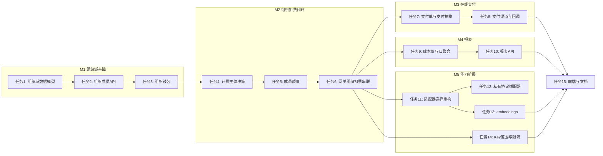

# AI 编码任务拆分（二期）

| 项目 | 内容 |
| --- | --- |
| 文档名称 | LLM Gateway 二期 AI 编码任务拆分 |
| 输入依据 | `docs/PHASE2_SCOPE.md`、`docs/PRD.md`（索引）/`docs/prd/`、`docs/TECH_DESIGN.md`、`docs/DATABASE_DESIGN.md` |
| 版本 | v0.1 |
| 前置条件 | 一期任务 1–10 已完成（见 `AI_TASK_BREAKDOWN.md`） |

---

## 1. 使用原则

延续一期原则：小批次推进，每次任务只实现一个明确阶段，并要求 AI 同时提供测试或验证方式。

通用要求：

- 每个任务开始前先阅读 `docs/PHASE2_SCOPE.md` 对应章节和 `docs/prd/` 相关子文档（重点：`organizations.md`、`wallet.md`、`billing.md`）。
- 不允许提前实现三期能力，尤其是智能路由、授信透支、自动充值、多租户隔离、语义缓存。
- 所有金额计算禁止使用 float。
- 钱包流水只追加；组织钱包流水必须记录实际发起成员。
- 支付回调必须幂等：同一支付单重复回调只允许产生一次钱包流水。
- 组织余额与成员额度的扣减必须使用行级锁或原子更新，保证并发下不超扣。
- 不破坏一期行为：所有改造完成后，一期既有测试必须全部通过。
- 每批任务必须有测试、curl 示例或其他可重复验证方式。

---

## 2. 推荐任务顺序



任务 1–6 严格串行；任务 7–8（支付）、9–10（报表）、11–14（能力扩展）三条线在任务 6 完成后可并行；任务 15 收尾。

---

## 3. 任务 1：组织域数据模型与迁移

### 目标

实现组织域新表和既有表的字段扩展，产出 Alembic 迁移。不实现任何业务 API。

### 建议提示词

```text
基于 docs/PHASE2_SCOPE.md 第 5 节和 docs/prd/organizations.md，实现二期组织域数据模型和 Alembic 迁移。
新增表：orgs、org_members、member_quotas。
修改表：wallets 启用 owner_type='org'（owner_id 指向 orgs）；
request_logs、usage_logs、wallet_transactions 增加 org_id 和发起成员字段（可空，兼容一期数据）。
金额字段使用整数最小单位。先更新 docs/DATABASE_DESIGN.md 再写代码。
不要实现支付表和报表表，不要实现任何 API。
完成后提供迁移命令和模型测试。
```

### 交付物

- `orgs`、`org_members`、`member_quotas` SQLAlchemy models
- 既有表字段扩展
- Alembic 迁移（可在含一期数据的库上执行）
- `DATABASE_DESIGN.md` 更新
- 基础模型测试

### 验收标准

- 迁移可在已有一期数据的库上执行成功且可回滚。
- `org_members(org_id, user_id)` 唯一；一个组织一个钱包的约束成立。
- 一期既有测试全部通过。

---

## 4. 任务 2：组织与成员管理 API

### 目标

实现组织 CRUD、成员邀请/移除、组织角色（Owner/Admin/Member）和组织内权限校验。

### 建议提示词

```text
基于 docs/prd/organizations.md，实现组织与成员管理 API。
用户端：创建组织（创建者自动成为 Owner）、编辑组织、邀请/移除成员、设置组织角色、查看我的组织。
管理端：组织列表、详情、停用。
实现组织内权限依赖函数：Owner 可做资金和成员操作，Admin 可做成员/额度操作，Member 只读。
组织敏感操作（成员变更、角色变更）写入审计日志。
不要实现组织钱包和额度逻辑。
```

### 交付物

- `OrgService`
- 用户端组织 API（`/orgs/*`）
- 管理端组织 API（`/admin/orgs/*`）
- 组织权限依赖函数
- 权限矩阵测试

### 验收标准

- 创建组织后创建者为 Owner。
- Member 调用成员管理接口返回 403。
- 移除成员后其无法再访问组织资源，历史数据不受影响。
- 停用组织后组织接口拒绝写操作。

---

## 5. 任务 3：组织钱包

### 目标

启用 `owner_type='org'` 的钱包，复用一期 hold/capture/release 链路，支持后台手工充值和组织流水查询。

### 建议提示词

```text
基于 docs/prd/wallet.md，为组织启用钱包。
创建组织时自动创建组织钱包。
复用现有 WalletService 的 hold/capture/release/recharge/adjust，扩展支持 owner_type='org'。
组织钱包流水增加发起成员字段。
用户端：组织 Owner/Admin 可查组织余额和流水；管理端：可对组织钱包充值/调账。
不要实现扣费主体决策和成员额度。
提供组织钱包并发 hold 测试。
```

### 交付物

- `WalletService` 组织钱包扩展
- 组织钱包查询 API（用户端 + 管理端）
- 管理端组织充值/调账 API
- 并发与幂等测试

### 验收标准

- 创建组织自动生成组织钱包。
- 组织钱包 hold/capture/release 行为与个人钱包一致，重复结算同一 request_id 不重复扣费。
- Member 查询组织流水返回 403（按组织角色控制）。
- 并发 hold 不导致组织余额为负。

---

## 6. 任务 4：计费主体决策服务

### 目标

实现扣费主体选择：Key 绑定默认主体、请求头 `X-Billing-Subject` 覆盖、账户默认策略、回退规则。本任务只做决策与校验，不改网关主链路。

### 建议提示词

```text
基于 docs/prd/wallet.md 的扣费主体决策流程图，实现 BillingSubjectService。
优先级：请求头 X-Billing-Subject（org:{id} / user:{id}）> Key 绑定主体 > 账户默认策略。
api_keys 增加默认计费主体字段（迁移）。
校验规则：指定组织时必须是该组织成员且消费开关打开；指定他人主体返回 403。
输出为一个明确的 BillingSubject 结果对象（主体类型、钱包、发起成员），供网关调用。
不要接入 /v1/chat/completions，不要实现额度累计。
提供决策矩阵的单元测试（覆盖流程图所有分支）。
```

### 交付物

- `BillingSubjectService`
- `api_keys` 默认主体字段迁移
- Key 管理 API 支持设置默认主体
- 决策分支单元测试

### 验收标准

- 流程图每个分支都有对应测试。
- 非成员指定 `org:{id}` 返回 403。
- 未指定时按 Key 绑定主体，Key 未绑定时按个人。

---

## 7. 任务 5：成员额度

### 目标

实现成员额度的配置、校验、消费累计和周期重置。

### 建议提示词

```text
基于 docs/prd/organizations.md，实现成员额度。
支持两种额度：总额度、周期额度（每月，UTC 周期锚点），按金额计量。
Owner/Admin 可设置成员消费开关和额度上限。
提供 quota_check（与组织余额取更严者）和 quota_consume（capture 时累计）接口，保证并发下不超限。
周期重置通过惰性判断（读取时按周期锚点计算）或定时任务实现，二选一并说明理由。
接入 BillingSubjectService：额度不足时按组织回退策略返回回退个人或拒绝。
不要改网关主链路。
```

### 交付物

- 额度配置 API（组织端）
- `quota_check` / `quota_consume` 逻辑
- 周期重置机制
- 并发超限测试

### 验收标准

- 额度耗尽后 `quota_check` 失败，按策略回退个人或 402。
- 周期额度跨周期后自动归零重新累计。
- 并发消费不会超过额度上限。
- 关闭消费开关后成员立即无法使用组织余额。

---

## 8. 任务 6：网关组织扣费串联

### 目标

把计费主体决策、组织钱包、成员额度接入 `/v1/chat/completions`（流式 + 非流式）完整链路，补齐日志字段。

### 建议提示词

```text
把 BillingSubjectService、组织钱包、成员额度串联进 /v1/chat/completions。
请求受理：决策主体 → 组织主体时校验组织余额+成员额度（取更严）→ 对应钱包 hold。
结算：capture 对应钱包 + quota_consume；失败请求 release 且不累计额度。
流式 partial 结算沿用一期口径。
request_logs / usage_logs / wallet_transactions 落 org_id、billing_subject、发起成员。
hold 对账任务扩展支持组织钱包。
提供组织身份调用的集成测试（成功、额度不足回退、额度不足拒绝、上游失败释放、并发）。
```

### 交付物

- 网关链路改造
- 日志与流水字段落值
- 对账任务扩展
- 集成测试

### 验收标准

- 成员以组织身份调用成功后，组织钱包产生 hold/capture 流水且记录发起成员。
- 额度不足且不允许回退时返回 `402 insufficient_balance`，不调用上游。
- 上游失败释放组织钱包冻结，不累计成员额度。
- `X-Billing-Subject` 指定无权主体返回 403，无任何资金变动。
- 一期个人扣费链路行为完全不变（既有测试通过）。

---

## 9. 任务 7：支付单与支付服务抽象

### 目标

实现支付单模型、状态机和支付渠道抽象接口。不接真实支付渠道。

### 建议提示词

```text
基于 docs/PHASE2_SCOPE.md 4.3 节，实现支付单和支付服务抽象。
新增 payment_orders 表：订单号、用户、目标钱包（个人/组织）、金额、支付渠道、状态（created/paid/expired/failed）、外部单号、回调原文、时间戳。
定义 PaymentProvider 抽象接口：创建支付、验签回调、查询订单。
实现 PaymentService：创建支付单、处理回调（验签 → 状态机流转 → 幂等入账钱包）。
入账使用数据库唯一约束保证同一支付单只产生一次钱包流水。
提供 MockPaymentProvider 用于测试，不接真实渠道。
```

### 交付物

- `payment_orders` 模型与迁移
- `PaymentProvider` 抽象 + Mock 实现
- `PaymentService`
- 支付单创建/查询 API（用户端 + 管理端）
- 状态机与幂等测试

### 验收标准

- 状态机非法流转被拒绝（如 paid → created）。
- 同一支付单回调重复处理 3 次只入账 1 次。
- 支付单可入账到个人钱包或组织钱包（组织需 Owner 权限）。
- 过期订单回调不入账。

---

## 10. 任务 8：支付渠道接入与回调

### 目标

接入一个真实支付渠道（支付宝或 Stripe 沙箱），实现回调端点和对账任务。

### 建议提示词

```text
基于任务 7 的 PaymentProvider 抽象，接入 [支付宝/Stripe 二选一] 沙箱。
实现回调 webhook 端点：验签失败返回 4xx 且不入账；验签通过交给 PaymentService。
密钥通过环境变量配置，不落库不入代码。
实现支付对账任务：定时查询处于 created 且超时的订单，向渠道查单后补状态（复用一期对账任务框架）。
提供沙箱验证步骤文档和回调重放测试。
```

### 交付物

- [x] 具体 `PaymentProvider` 实现（Stripe Checkout）
- [x] 回调 webhook 端点（`POST /payments/callbacks/stripe`）
- [x] 支付对账任务（`python -m app.tasks.reconcile_payments`）
- [x] 沙箱验证文档（`docs/PAYMENT_STRIPE_SANDBOX.md`）
- [x] 回调验签与重放测试（`tests/test_payment_stripe.py`）

### 验收标准

- 沙箱完成支付 → 回调 → 钱包入账全链路。
- 伪造签名的回调被拒绝且无资金变动。
- 掉单（回调丢失）场景由对账任务补入账。

---

## 11. 任务 9：成本价配置与日聚合

### 目标

实现渠道成本价配置和日粒度用量预聚合，为报表提供数据。

### 建议提示词

```text
基于 docs/PHASE2_SCOPE.md 4.4 节，实现成本价配置和日聚合。
新增渠道成本价配置（渠道 × 上游模型维度，输入/输出 token 单价，整数最小单位，版本化生效）。
新增 usage_daily_summary 表：天 × 模型 × 用户 × 组织 × 渠道，聚合请求数、token、收入（计费金额）、成本（按成本价折算）。
实现日聚合定时任务：可重跑，重跑同一天结果幂等（先删后插或 upsert）。
不要实现报表查询 API。
```

### 交付物

- 成本价模型、迁移与管理 API
- `usage_daily_summary` 表与迁移
- 日聚合任务（可手动触发重跑）
- 聚合正确性测试

### 验收标准

- 聚合结果的收入合计与当日 capture 流水合计一致。
- 重跑同一天不产生重复数据。
- 未配置成本价的渠道成本记 0 并可识别（不阻塞聚合）。

---

## 12. 任务 10：报表 API 与运营看板数据

### 目标

基于日聚合表实现后台报表 API 和用户/组织自助用量 API。

### 建议提示词

```text
基于 usage_daily_summary，实现报表 API。
后台：收入/成本/毛利趋势（按天）、Top 用户/组织/模型排行、渠道成本占比，支持时间范围和维度筛选。
用户端：个人按天用量汇总；组织端：组织按天用量与成员分摊（Owner/Admin 可见）。
查询只读聚合表，不实时扫描明细日志。
不要实现前端页面。
```

### 交付物

- 后台报表 API（`/admin/reports/*`）
- 用户/组织自助报表 API
- 权限控制（组织数据隔离）
- 查询测试

### 验收标准

- 报表收入合计与钱包 capture 流水对账一致。
- 组织成员只能看到本组织数据，Member 看不到其他成员明细。
- 时间范围过滤正确（含时区口径说明）。

---

## 13. 任务 11：适配器选择机制重构

### 目标

移除网关对 `openai_compatible_adapter` 的硬绑定，改为按渠道 Provider 类型动态选择适配器。纯重构，不新增协议。

### 建议提示词

```text
重构适配器选择机制：/v1/chat/completions 当前硬绑定 openai_compatible_adapter，
改为根据路由选中渠道的 provider 协议类型，从适配器注册表选择对应 Adapter。
providers 表增加协议类型字段（迁移，存量数据默认 openai_compatible）。
保持 BaseAdapter 接口不变或最小化调整，说明调整理由。
这是纯重构任务：完成后所有一期测试必须通过，行为不变。
```

### 交付物

- 适配器注册表
- `providers` 协议类型字段迁移
- 网关调用点改造
- 回归测试

### 验收标准

- 一期全部测试通过，OpenAI-compatible 链路行为不变。
- 新增适配器只需注册，无需改网关代码。
- 未知协议类型返回明确配置错误而非 500。

---

## 14. 任务 12：私有协议适配器

### 目标

实现一个非 OpenAI-compatible 的私有协议适配器（建议 Anthropic Messages API），流式 + 非流式。

### 建议提示词

```text
基于任务 11 的适配器注册表，实现 AnthropicAdapter（Messages API 原生协议）。
职责：OpenAI 格式请求 → Anthropic 请求（messages/system/max_tokens 映射）；
Anthropic 响应/SSE 事件流 → OpenAI 兼容响应/chunk；usage 字段映射用于计费。
处理协议差异：system 消息位置、stop_reason 映射、流式事件类型。
使用 Mock 上游测试，不调用真实厂商。
不要实现 tool use 的完整映射，透传或明确报错并说明。
```

### 交付物

- `AnthropicAdapter`（含流式）
- 请求/响应映射与 usage 换算
- Mock 上游测试（流式 + 非流式 + 错误）

### 验收标准

- 通过平台调用 Anthropic 协议渠道，返回结构可被 OpenAI SDK 解析。
- 流式 chunk 连续且以 `[DONE]` 结束，usage 正确参与计费。
- 上游错误映射为平台标准错误结构。

---

## 15. 任务 13：/v1/embeddings

### 目标

实现 OpenAI 兼容 embeddings 端点，接入完整鉴权、计费链路。

### 建议提示词

```text
实现 POST /v1/embeddings（OpenAI 兼容）。
复用鉴权、权限、计费主体决策、hold/capture、路由、日志链路。
models.model_type='embedding' 的模型出现在 /v1/models 并可被授权。
计费按输入 token（复用 billing_rules，输出价为 0 或单独维度，与 docs/prd/billing.md 对齐）。
支持字符串和字符串数组输入。
使用 Mock 上游完成集成测试。
```

### 交付物

- `/v1/embeddings` 端点
- embedding 计费规则支持
- 路由/适配器复用改造
- 集成测试

### 验收标准

- 成功请求产生 request log、usage log、钱包流水。
- 组织身份调用 embeddings 同样受额度约束。
- 未授权 embedding 模型返回 403。
- 响应结构可被 OpenAI SDK `embeddings.create` 解析。

---

## 16. 任务 14：Key 级模型范围与限流

### 目标

实现平台 API Key 的模型范围、RPM/TPM 限额和过期时间，以及渠道 Key 限额纳入路由。

### 建议提示词

```text
基于 docs/PHASE2_SCOPE.md 4.6 节，实现 Key 级模型范围与限流。
api_keys 增加：允许模型列表（空=继承角色授权，非空=取与角色授权的交集）、rpm_limit、tpm_limit、expires_at（迁移）。
实现限流执行：Redis 滑动窗口，无 Redis 配置时降级为进程内限流并打日志警告。
超限返回 OpenAI 兼容 429 rate_limit_exceeded，带 Retry-After，不预扣、不调用上游。
channel_keys 的 rpm/tpm 限额纳入路由：打满的渠道 Key 本轮跳过。
Key 管理 API 和前端 Key 页面支持配置上述字段。
提供限流并发测试。
```

### 交付物

- `api_keys` 字段迁移与管理 API
- 限流中间件/依赖（Redis + 进程内降级）
- 渠道 Key 限额路由改造
- 429 错误结构
- 并发限流测试

### 验收标准

- 超过 RPM 的请求返回 429 且无资金变动、无上游调用。
- Key 模型范围外的模型返回 403，`/v1/models` 只返回交集。
- 过期 Key 返回 401。
- 渠道 Key 打满时路由自动切换其他 Key/渠道。

---

## 17. 任务 15：二期前端与文档收尾

### 目标

补齐二期前端页面和文档更新。

### 建议提示词

```text
基于已实现的二期后端 API，补充前端页面：
用户端：我的组织（成员/角色/额度）、组织钱包与流水、在线充值页（个人+组织）、按天用量报表。
管理端：组织管理、支付单查询、运营报表看板（收入/成本/毛利趋势、Top 排行）。
Key 管理页支持模型范围、限额、默认计费主体配置。
同时更新 README、API_CONTRACT.md 和部署文档（新增环境变量：支付密钥、Redis）。
```

### 交付物

- [x] 用户端组织/充值/报表页面
- [x] 管理端组织/支付/报表页面
- [x] Key 管理页扩展
- [x] `API_CONTRACT.md`、README、部署文档更新

### 验收标准

- 组织 Owner 可在 UI 完成：建组织 → 邀成员 → 充值 → 设额度 → 成员调用 → 看分摊报表全流程。
- 用户可在 UI 完成一次沙箱在线充值。
- 管理员可在 UI 查看收入/成本/毛利报表。
- 新开发者可按文档启动含 Redis 与支付沙箱配置的完整环境。

---

## 18. 每批任务的固定验收模板

沿用一期模板，每次任务要求 AI 按以下格式回复：

```text
完成内容：
- ...

修改文件：
- ...

验证命令：
- ...

验证结果：
- ...

未完成/风险：
- ...
```

---

## 19. 不应交给 AI 一次性完成的任务

以下提示词风险较高，不建议使用：

```text
一次性实现组织、组织钱包、成员额度和支付。
```

```text
把扣费主体、额度、限流一起接入网关并顺便重构适配器。
```

```text
先把二期所有表建出来，业务后面再补。
```

组织扣费涉及资金一致性，必须按「模型 → 组织 API → 组织钱包 → 主体决策 → 额度 → 网关串联」逐步验证；支付回调幂等和限流并发同样需要独立测试窗口，混在大任务里极易漏测。
