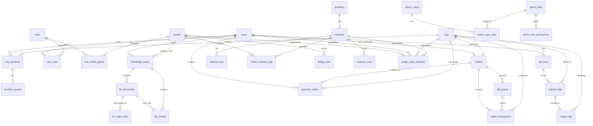

# 数据库落地设计

| 项目 | 内容 |
| --- | --- |
| 文档名称 | LLM Gateway 数据库落地设计 |
| 输入依据 | `docs/PRD.md`（索引）/`docs/prd/`、`docs/TECH_DESIGN.md` |
| 版本 | v0.5（新增后台 RBAC：`admin_users` / `admin_roles` 与前台 `users` / `roles` 隔离） |

---

## 1. 设计原则

- 数据库使用 PostgreSQL。
- 所有主键建议使用 UUID，便于后续分布式和数据迁移。
- 所有业务表包含 `created_at`、`updated_at`，需要软删除的表增加 `deleted_at` 或 `status`。
- 钱包和计费金额使用整数最小单位，禁止 float。
- 钱包流水只追加，不覆盖、不物理删除。
- 与扣费相关的写操作必须在事务中完成。
- request、usage、transaction 必须能通过 `request_id` 串联。

---

## 2. 表清单

| 表 | 阶段 | 说明 |
| --- | --- | --- |
| `users` | 一期 | 用户主体 |
| `roles` | 一期 | 角色 |
| `user_roles` | 一期 | 用户角色关系 |
| `role_model_grants` | 一期 | 角色模型授权矩阵 |
| `api_keys` | 一期 | 平台 API Key |
| `providers` | 一期 | 厂商类型 |
| `channels` | 一期 | 上游渠道 |
| `channel_keys` | 一期 | 上游 Key |
| `models` | 一期 | 对外模型别名 |
| `model_channel_map` | 一期 | 模型与渠道映射 |
| `billing_rules` | 一期 | 计费规则版本 |
| `wallets` | 一期 / 二期 / 赠送专项 | 个人与组织钱包（现金池 `balance`/`held` + 赠送池 `gift_balance`/`gift_held`） |
| `gift_grants` | 赠送专项 | 赠送批次账本（有效期、原因、FIFO 消耗、幂等键） |
| `wallet_transactions` | 一期 / 二期 / 赠送专项 | 钱包流水（含 `org_id` 与赠送池拆分快照） |
| `request_logs` | 一期 / 二期扩展 | 请求日志（含 `org_id` / 发起成员） |
| `usage_logs` | 一期 / 二期 / 赠送专项 | 用量费用明细（含资金来源拆分 `gift_charge_amount` / `cash_charge_amount`） |
| `audit_logs` | 一期 | 后台审计日志 |
| `chat_sessions` | 一期 | 用户 Chat 会话 |
| `chat_session_messages` | 一期 | 会话消息正文 |
| `orgs` | 二期 | 组织基本信息与扣费回退策略 |
| `org_members` | 二期 | 组织成员与组织内角色 |
| `member_quotas` | 二期 | 成员金额额度（总额 / 周期） |
| `payment_orders` | 二期 | 支付单（渠道、金额、状态、外部单号、回调原文） |
| `channel_costs` | 二期 | 渠道 × 上游模型成本单价（版本化） |
| `usage_daily_summary` | 二期 / 赠送专项 | 日粒度预聚合（含 `gift_revenue_amount` / `cash_revenue_amount`） |
| `knowledge_bases` | 知识库专项 | 知识库主表（owner、embedding 模型、默认分块/检索参数、统计冗余） |
| `kb_documents` | 知识库专项 | 知识库文档（文件元数据、分块参数快照、状态机） |
| `kb_chunks` | 知识库专项 | 文档分块（内容、来源位置、pgvector 向量列 + HNSW 索引） |
| `kb_ingest_jobs` | 知识库专项 | 处理任务（parse/chunk/embed/rechunk，幂等键、预扣关联） |
| `admin_users` | 后台 RBAC | 后台管理员账号（与前台 `users` 隔离） |
| `admin_roles` | 后台 RBAC | 后台角色（一组权限码） |
| `admin_user_roles` | 后台 RBAC | 管理员 ↔ 角色 |
| `admin_role_permissions` | 后台 RBAC | 角色被授予的权限码（码的目录在代码里，不入库） |

知识库专项对既有表的扩展：

- `usage_logs` / `request_logs`：新增 `source` 字段（`chat / api / kb_ingest / kb_query`），nullable + server default `'api'`，存量行不受影响。
- `roles`：新增知识库配额字段组（库数 / 单库文档数 / 存储上限 / 单文件上限），全部 nullable，NULL = 使用系统默认值。

赠送余额专项对既有表的扩展：

- `wallets`：新增 `gift_balance` / `gift_held`；原 `balance` / `held` 语义收窄为**现金池**（可退可提），不再表示全部余额。
- `wallet_transactions`：新增 `gift_amount`、`gift_balance_after`、`gift_held_after`、`gift_grant_id`；`type` 增补 `gift_grant` / `gift_revoke` / `gift_expire`。
- `usage_logs`：新增 `gift_charge_amount` / `cash_charge_amount`（存量回填：现金 = `charge_amount`，赠金 = 0）。
- `usage_daily_summary`：新增 `gift_revenue_amount` / `cash_revenue_amount`（存量回填：现金 = `revenue_amount`，赠金 = 0）。

后台 RBAC 专项（与前台 `users` / `roles` 完全隔离）：

- 前台角色管「能调哪些模型、配额多少」；后台角色管「能进哪些菜单、能做哪些操作」。共用一张表会让前台注册变成提权入口。
- 权限码目录由 `app.core.admin_permissions.ADMIN_RESOURCES` 维护，数据库只存授予关系。菜单不入库。
- 迁移不预置账号：`admin_users` 为空时，`.env` 的 `ADMIN_USERNAME` / `ADMIN_PASSWORD` 仍可登录为超管。

---

## 3. ER 概览



---

## 4. 关键表设计

### 4.1 `users`

| 字段 | 类型 | 约束 | 说明 |
| --- | --- | --- | --- |
| `id` | uuid | PK | 用户 ID |
| `email` | varchar | unique, not null | 登录邮箱 |
| `password_hash` | varchar | nullable | MVP 可后台初始化 |
| `nickname` | varchar | nullable | 昵称 |
| `status` | smallint | not null | 0 正常，1 禁用 |
| `default_billing_subject` | varchar | not null | MVP 固定 personal |

### 4.2 `api_keys`

| 字段 | 类型 | 约束 | 说明 |
| --- | --- | --- | --- |
| `id` | uuid | PK | Key ID |
| `user_id` | uuid | FK, not null | 所属用户 |
| `key_hash` | varchar | unique, not null | Key 哈希 |
| `key_prefix` | varchar | not null | 展示前缀 |
| `name` | varchar | not null | Key 名称 |
| `billing_subject` | varchar | not null | MVP 为 personal |
| `status` | smallint | not null | 0 启用，1 禁用 |
| `last_used_at` | timestamptz | nullable | 最后使用时间 |

索引：

- `unique(key_hash)`
- `index(user_id, status)`

### 4.3 `providers`

| 字段 | 类型 | 约束 | 说明 |
| --- | --- | --- | --- |
| `id` | uuid | PK | Provider ID |
| `name` | varchar | unique | 厂商名 |
| `adapter_type` | varchar | not null | 如 `openai_compatible` |
| `default_base_url` | varchar | nullable | 默认地址 |

### 4.4 `channels`

| 字段 | 类型 | 约束 | 说明 |
| --- | --- | --- | --- |
| `id` | uuid | PK | Channel ID |
| `provider_id` | uuid | FK | 所属 Provider |
| `name` | varchar | not null | 渠道名 |
| `base_url` | varchar | not null | 上游地址 |
| `adapter_type` | varchar | not null | 适配器类型 |
| `priority` | int | not null | 越大越优先 |
| `weight` | int | not null | 同优先级权重 |
| `status` | smallint | not null | 启用/禁用 |
| `health_status` | smallint | not null | 健康/熔断/半开 |
| `fail_count` | int | not null | 连续失败次数 |
| `timeout_ms` | int | not null | 超时 |
| `max_retries` | int | not null | 重试次数 |

索引：

- `index(provider_id)`
- `index(status, health_status, priority)`

### 4.5 `channel_keys`

| 字段 | 类型 | 约束 | 说明 |
| --- | --- | --- | --- |
| `id` | uuid | PK | 上游 Key ID |
| `channel_id` | uuid | FK | 所属渠道 |
| `api_key_encrypted` | bytea/text | not null | 上游 Key 密文 |
| `key_masked` | varchar | not null | 脱敏展示 |
| `weight` | int | not null | 权重 |
| `rpm_limit` | int | nullable | 请求限额 |
| `tpm_limit` | int | nullable | token 限额 |
| `status` | smallint | not null | 启用/禁用 |
| `health_status` | smallint | not null | 健康/熔断 |

### 4.6 `models`

| 字段 | 类型 | 约束 | 说明 |
| --- | --- | --- | --- |
| `id` | uuid | PK | 模型 ID |
| `alias` | varchar | unique, not null | 对外模型名 |
| `display_name` | varchar | not null | 展示名 |
| `model_type` | varchar | not null | chat/embedding 等 |
| `capabilities` | jsonb | not null | 能力描述 |
| `visibility` | varchar | not null | public/role_restricted |
| `status` | smallint | not null | 启用/禁用 |

### 4.7 `model_channel_map`

| 字段 | 类型 | 约束 | 说明 |
| --- | --- | --- | --- |
| `id` | uuid | PK | 映射 ID |
| `model_id` | uuid | FK | 对外模型 |
| `channel_id` | uuid | FK | 渠道 |
| `upstream_model_name` | varchar | not null | 上游真实模型名 |
| `weight` | int | not null | 映射权重 |
| `status` | smallint | not null | 启用/禁用 |

约束：

- `unique(model_id, channel_id, upstream_model_name)`

### 4.8 `billing_rules`

| 字段 | 类型 | 约束 | 说明 |
| --- | --- | --- | --- |
| `id` | uuid | PK | 规则 ID |
| `model_id` | uuid | FK | 模型 |
| `version` | int | not null | 版本 |
| `price_input` | bigint | not null | 输入单价，每 1M token |
| `price_output` | bigint | not null | 输出单价，每 1M token |
| `price_cached_input` | bigint | not null | 缓存输入单价 |
| `price_per_call` | bigint | not null | 按次价 |
| `cost_input` | bigint | not null | 成本输入单价 |
| `cost_output` | bigint | not null | 成本输出单价 |
| `multiplier` | numeric(8,3) | not null | 倍率 |
| `min_charge_unit` | bigint | not null | 最小计费单位 |
| `currency` | varchar | not null | 币种 |
| `effective_at` | timestamptz | not null | 生效时间 |
| `status` | smallint | not null | 启用/作废 |

约束：

- `unique(model_id, version)`
- `index(model_id, effective_at, status)`

### 4.9 `wallets`

| 字段 | 类型 | 约束 | 说明 |
| --- | --- | --- | --- |
| `id` | uuid | PK | 钱包 ID |
| `owner_type` | varchar | not null | `personal` / `org` |
| `owner_id` | uuid | not null | 用户 ID 或组织 ID（多态，无数据库 FK） |
| `balance` | bigint | not null | **现金池**可用余额（最小货币单位），可退可提。语义已收窄，不再表示全部余额 |
| `held` | bigint | not null | 现金池冻结额度 |
| `gift_balance` | bigint | not null, default 0 | **赠送池**可用余额，不可退不可提 |
| `gift_held` | bigint | not null, default 0 | 赠送池冻结额度 |
| `currency` | varchar | not null | 币种 |
| `credit_limit` | bigint | not null | 默认 0 |

约束：

- `unique(owner_type, owner_id)`（保证每用户 / 每组织至多一个钱包）
- `check(owner_type IN ('personal', 'org'))`
- `check(balance >= 0)` / `check(held >= 0)`
- `check(gift_balance >= 0)` / `check(gift_held >= 0)`

总可用额（402 判定与前端展示）：`gift_balance + balance + credit_limit`。

### 4.9.1 `gift_grants`

一次发放一条账本记录；多次赠送可有不同有效期，按 `expires_at` FIFO 消耗（先过期的先花，`expires_at IS NULL` 永久有效排最后）。

| 字段 | 类型 | 约束 | 说明 |
| --- | --- | --- | --- |
| `id` | uuid | PK | 批次 ID |
| `wallet_id` | uuid | FK → wallets, not null | 目标钱包（个人或组织） |
| `amount` | bigint | not null | 发放金额 |
| `remaining` | bigint | not null | 未消耗剩余 |
| `reason` | varchar(32) | not null | `promotion` / `compensation` / `internal` / `partnership` / `other` |
| `expires_at` | timestamptz | nullable | 到期时间；NULL = 永久有效 |
| `status` | varchar(32) | not null | `active` / `used_up` / `expired` / `revoked` |
| `granted_by` | uuid | FK → users, not null | 发放操作人 |
| `revoked_by` | uuid | FK → users, nullable | 撤回操作人 |
| `revoked_at` | timestamptz | nullable | 撤回时间 |
| `idempotency_key` | varchar(128) | not null | 发放幂等键 |
| `remark` | text | nullable | 备注 |

约束 / 索引：

- `check(remaining >= 0 AND remaining <= amount)`
- `check(reason IN ('promotion', 'compensation', 'internal', 'partnership', 'other'))`
- `check(status IN ('active', 'used_up', 'expired', 'revoked'))`
- `unique(wallet_id, idempotency_key)`
- `index(wallet_id, status, expires_at)`（FIFO 取用与过期扫描）

账本不变式（每日对账任务校验，本专项任务 6）：`Σ remaining (status='active') == wallets.gift_balance + wallets.gift_held`。

### 4.10 `wallet_transactions`

| 字段 | 类型 | 约束 | 说明 |
| --- | --- | --- | --- |
| `id` | uuid | PK | 流水 ID |
| `wallet_id` | uuid | FK | 钱包 |
| `type` | varchar | not null | recharge/hold/capture/release/refund/adjust/**gift_grant/gift_revoke/gift_expire** |
| `amount` | bigint | not null | 变动总额（正负） |
| `gift_amount` | bigint | not null, default 0 | 其中赠送池部分（符号与 `amount` 一致）；纯现金变动为 0 |
| `balance_after` | bigint | not null | 变动后现金池余额 |
| `held_after` | bigint | not null | 变动后现金池冻结 |
| `gift_balance_after` | bigint | not null, default 0 | 变动后赠送池余额 |
| `gift_held_after` | bigint | not null, default 0 | 变动后赠送池冻结 |
| `gift_grant_id` | uuid | FK → gift_grants, nullable | 关联赠送批次（`gift_*` 类型由业务层填写） |
| `ref_request_id` | varchar | nullable | 关联请求 / 幂等键 |
| `org_id` | uuid | FK nullable | 组织扣费归属（一期数据可空） |
| `operator_user_id` | uuid | FK nullable | 操作人或组织消费发起成员 |
| `remark` | text | nullable | 备注 |

索引：

- `index(wallet_id, created_at)`
- `index(ref_request_id)`
- `index(org_id, created_at)`
- 部分唯一索引 `(wallet_id, ref_request_id, type) WHERE ref_request_id IS NOT NULL`

### 4.11 `request_logs`

| 字段 | 类型 | 约束 | 说明 |
| --- | --- | --- | --- |
| `id` | uuid | PK | 日志 ID |
| `request_id` | varchar | unique | 追踪 ID |
| `api_key_id` | uuid | FK, nullable | 调用 Key；内部调用方（kb_ingest / kb_query）可为 NULL |
| `user_id` | uuid | FK | 调用用户 |
| `org_id` | uuid | FK nullable | 组织计费时的组织（一期数据可空） |
| `actor_user_id` | uuid | FK nullable | 组织消费发起成员（通常等于 user_id） |
| `billing_subject` | varchar | not null | `personal` / `personal:{user_id}` / `org:{org_id}` |
| `model_id` | uuid | FK | 模型 |
| `channel_id` | uuid | nullable | 实际渠道 |
| `status` | varchar | not null | success/failed/partial |
| `http_status` | int | not null | HTTP 状态 |
| `latency_ms` | int | nullable | 延迟 |
| `is_stream` | bool | not null | 是否流式 |
| `error_code` | varchar | nullable | 错误码 |

索引：

- `index(org_id, created_at)`
- `index(created_at)`

### 4.12 `usage_logs`

| 字段 | 类型 | 约束 | 说明 |
| --- | --- | --- | --- |
| `id` | uuid | PK | 用量 ID |
| `request_id` | varchar | FK/unique | 关联请求 |
| `org_id` | uuid | FK nullable | 组织归属（一期数据可空，便于按组织聚合） |
| `actor_user_id` | uuid | FK nullable | 发起成员（费用分摊） |
| `input_tokens` | int | not null | 输入 token |
| `output_tokens` | int | not null | 输出 token |
| `cached_tokens` | int | not null | 缓存 token |
| `billing_rule_version` | int | not null | 规则版本 |
| `cost_amount` | bigint | not null | 上游成本 |
| `charge_amount` | bigint | not null | 用户计费总额 |
| `gift_charge_amount` | bigint | not null, default 0 | 其中赠送池抵扣（**不计入平台收入**） |
| `cash_charge_amount` | bigint | not null, default 0 | 其中现金池支付（**真实收入**） |
| `is_estimated` | bool | not null | 是否估算 |

索引：

- `index(org_id, created_at)`
- `index(created_at)`

业务约定：`gift_charge_amount + cash_charge_amount = charge_amount`（由用量写入路径保证；存量迁移回填 `cash_charge_amount = charge_amount`、`gift_charge_amount = 0`）。本任务不在库层加该 CHECK，以免既有只写 `charge_amount` 的路径在任务 5 完成前无法落库。

### 4.13 `chat_sessions`

| 字段 | 类型 | 约束 | 说明 |
| --- | --- | --- | --- |
| `id` | uuid | PK | 会话 ID |
| `user_id` | uuid | FK, not null | 所属用户 |
| `title` | varchar | not null | 会话标题 |
| `model` | varchar | nullable | 最近使用模型 |
| `temperature` | float | nullable | 采样温度 |
| `max_tokens` | int | nullable | 最大输出 token |
| `kb_ids` | jsonb | not null, default `[]` | 会话挂载的知识库 ID 列表（UUID 字符串） |
| `miss_strategy` | varchar(16) | not null, default `fallback` | 未命中策略：`strict`（仅知识库）/ `fallback`（允许模型自答） |
| `retrieval_top_k` | int | nullable | 检索 Top-K 覆盖（空=用挂载库默认） |
| `retrieval_score_threshold` | float8 | nullable | 检索相似度阈值覆盖（空=用挂载库默认） |

索引：

- `index(user_id, updated_at)`

约束：

- `check(miss_strategy IN ('strict', 'fallback'))`

### 4.14 `chat_session_messages`

| 字段 | 类型 | 约束 | 说明 |
| --- | --- | --- | --- |
| `id` | uuid | PK | 消息 ID |
| `session_id` | uuid | FK, not null | 所属会话（级联删除） |
| `role` | varchar | not null | system / user / assistant |
| `content` | text | not null | 消息正文 |
| `seq` | int | not null | 会话内顺序 |
| `citations` | jsonb | nullable | RAG 引用来源快照（assistant 消息；元素含 chunk_id / document_name / content_summary / score 等） |

索引：

- `index(session_id, seq)`

---

## 5. 钱包事务

### 5.1 预扣

```sql
BEGIN;
SELECT id, balance, held, credit_limit
FROM wallets
WHERE id = :wallet_id
FOR UPDATE;

-- 应用层判断 balance + credit_limit >= estimate_amount
UPDATE wallets
SET balance = balance - :estimate_amount,
    held = held + :estimate_amount
WHERE id = :wallet_id;

INSERT INTO wallet_transactions
  (wallet_id, type, amount, balance_after, held_after, ref_request_id)
VALUES
  (:wallet_id, 'hold', -:estimate_amount, :balance_after, :held_after, :request_id);
COMMIT;
```

### 5.2 实扣

实扣必须先检查同一 `request_id` 是否已有 capture 流水。若已存在，直接返回已结算结果。

```text
release_amount = max(estimate_amount - actual_amount, 0)
extra_amount = max(actual_amount - estimate_amount, 0)

held -= estimate_amount
balance += release_amount
if extra_amount > 0:
  balance -= extra_amount
append capture transaction
append release transaction when release_amount > 0
```

### 5.3 释放

释放用于失败请求或异常请求：

```text
held -= estimate_amount
balance += estimate_amount
append release transaction
mark request_log.status = failed
```

---

## 6. 二期组织域与支付单表设计

> 报表聚合表不在本阶段落地。组织域与 `payment_orders` 可在含一期数据的库上迁移。

### 6.1 `orgs`

| 字段 | 类型 | 约束 | 说明 |
| --- | --- | --- | --- |
| `id` | uuid | PK | 组织 ID |
| `name` | varchar | not null | 组织名 |
| `owner_user_id` | uuid | FK → users | 创建者（初始 Owner） |
| `status` | smallint | not null | 0 正常，1 停用 |
| `billing_fallback` | varchar | not null | 组织余额/额度不足时策略：`personal` 回退个人钱包；`deny` 直接 402 |

索引：

- `index(owner_user_id)`
- `index(status)`

### 6.2 `org_members`

| 字段 | 类型 | 约束 | 说明 |
| --- | --- | --- | --- |
| `id` | uuid | PK | 成员关系 ID |
| `org_id` | uuid | FK → orgs | 组织 |
| `user_id` | uuid | FK → users | 用户 |
| `org_role` | varchar | not null | `owner` / `admin` / `member` |
| `can_consume_org_wallet` | bool | not null | 是否允许消费组织余额 |
| `status` | smallint | not null | 0 正常，1 移除/停用（历史流水保留） |

约束：

- `unique(org_id, user_id)`
- `check(org_role IN ('owner', 'admin', 'member'))`

索引：

- `index(user_id, status)`
- `index(org_id, status)`

### 6.3 `member_quotas`

| 字段 | 类型 | 约束 | 说明 |
| --- | --- | --- | --- |
| `id` | uuid | PK | 额度 ID |
| `org_member_id` | uuid | FK → org_members, unique | 成员（一对一） |
| `quota_period` | varchar | not null | `none` 总额度；`daily` / `monthly` 周期额度 |
| `quota_limit` | bigint | not null | 上限（最小货币单位；0 表示不限制需配合业务约定） |
| `quota_used` | bigint | not null | 当期已用金额 |
| `period_reset_at` | timestamptz | nullable | 下次重置时间（`none` 时可空） |

约束：

- `unique(org_member_id)`
- `check(quota_period IN ('none', 'daily', 'monthly'))`
- `check(quota_limit >= 0)`
- `check(quota_used >= 0)`

### 6.4 既有表兼容说明

- 一期个人钱包数据：`owner_type='personal'`，`owner_id` 仍为用户 ID；去掉 `owner_id → users` 的数据库 FK，改为应用层按 `owner_type` 解释。
- `request_logs` / `usage_logs` / `wallet_transactions` 新增的 `org_id`、发起成员字段均为 **nullable**，既有一期行保持 NULL，不影响回放与查询。
- 组织钱包创建后由 `unique(owner_type, owner_id)` 保证「一个组织一个钱包」。

### 6.5 `payment_orders`

| 字段 | 类型 | 约束 | 说明 |
| --- | --- | --- | --- |
| `id` | uuid | PK | 支付单 ID |
| `order_no` | varchar(64) | unique not null | 业务订单号 |
| `user_id` | uuid | FK → users | 发起用户 |
| `target_wallet_id` | uuid | FK → wallets | 入账目标钱包 |
| `target_type` | varchar | not null | `personal` / `org` |
| `org_id` | uuid | FK → orgs, nullable | 组织目标时填写 |
| `amount` | bigint | not null | 金额（最小货币单位，> 0） |
| `currency` | varchar | not null | 币种，默认 CNY |
| `provider` | varchar | not null | 渠道标识（如 `mock` / `alipay` / `stripe`） |
| `status` | varchar | not null | `created` / `paid` / `expired` / `failed` |
| `external_order_no` | varchar | nullable | 渠道侧外部单号 |
| `callback_payload` | text | nullable | 回调原文 |
| `paid_at` | timestamptz | nullable | 支付成功时间 |
| `expired_at` | timestamptz | nullable | 过期时间 |
| `fail_reason` | varchar | nullable | 失败原因 |

约束：

- `unique(order_no)`
- `check(status IN ('created', 'paid', 'expired', 'failed'))`
- `check(target_type IN ('personal', 'org'))`
- `check(amount > 0)`

索引：

- `index(user_id, created_at)`
- `index(status, created_at)`
- `index(target_wallet_id, created_at)`
- `index(org_id, created_at)`
- `index(external_order_no)`

入账幂等：

- 回调成功后以 `ref_request_id = 'payment:{order_no}'` 写 `wallet_transactions`（`type=recharge`），依赖既有部分唯一索引 `(wallet_id, ref_request_id, type)`。
- 状态机仅允许 `created → paid | expired | failed`；终态不可回退。过期订单回调不入账。

### 6.6 `channel_costs`

| 字段 | 类型 | 约束 | 说明 |
| --- | --- | --- | --- |
| `id` | uuid | PK | 成本价 ID |
| `channel_id` | uuid | FK → channels | 渠道 |
| `upstream_model_name` | varchar | not null | 上游真实模型名 |
| `version` | int | not null | 版本号（同渠道+上游模型递增） |
| `cost_input` | bigint | not null | 输入单价，每 1M token（最小货币单位） |
| `cost_output` | bigint | not null | 输出单价，每 1M token |
| `currency` | varchar | not null | 币种，默认 CNY |
| `effective_at` | timestamptz | not null | 生效时间 |
| `status` | smallint | not null | 0 启用，1 作废 |

约束：

- `unique(channel_id, upstream_model_name, version)`
- `index(channel_id, upstream_model_name, effective_at, status)`

生效选取：`status=0` 且 `effective_at <= as_of`，按 `effective_at desc, version desc` 取第一条。历史版本不覆盖。

### 6.7 `usage_daily_summary`

| 字段 | 类型 | 约束 | 说明 |
| --- | --- | --- | --- |
| `id` | uuid | PK | 聚合行 ID |
| `summary_date` | date | not null | UTC 日历日 |
| `model_id` | uuid | FK → models | 对外模型 |
| `user_id` | uuid | FK → users | 调用用户 |
| `org_id` | uuid | FK → orgs, nullable | 组织归属（个人计费可空） |
| `channel_id` | uuid | FK → channels, nullable | 实际渠道 |
| `request_count` | int | not null | 请求数 |
| `input_tokens` | int | not null | 输入 token 合计 |
| `output_tokens` | int | not null | 输出 token 合计 |
| `cached_tokens` | int | not null | 缓存 token 合计 |
| `revenue_amount` | bigint | not null | 计费总额（当日 capture 金额合计，含赠金） |
| `gift_revenue_amount` | bigint | not null, default 0 | 其中赠金消耗（不计平台收入） |
| `cash_revenue_amount` | bigint | not null, default 0 | 其中现金收入（报表收入/毛利口径） |
| `cost_amount` | bigint | not null | 成本（按 channel_costs 折算） |
| `cost_price_missing` | bool | not null | 未配置成本价时为 true（成本记 0） |

约束 / 索引：

- 唯一索引：`(summary_date, model_id, user_id, COALESCE(org_id, zero-uuid), COALESCE(channel_id, zero-uuid))`
- `index(summary_date)` 及 org/user/model/channel × date

聚合规则：

- 按 `wallet_transactions.type='capture'` 的 `created_at` 归属 UTC 日。
- 收入（旧口径 `revenue_amount`）= `-sum(capture.amount)`，即计费总额；须与当日 capture 流水合计一致。平台收入请用 `cash_revenue_amount`（任务 5 起报表切换口径）。
- 成本按 `(channel_id, model_channel_map.upstream_model_name)` 查生效 `channel_costs`；未配置则 `cost_amount=0` 且 `cost_price_missing=true`，不阻塞聚合。
- 重跑同一天：先删后插，保证幂等。

---

## 7. 知识库域表设计（知识库专项）

> 依据 `docs/prd/knowledge-base.md`「数据库设计概览」。向量存储使用 PostgreSQL + pgvector 扩展；
> 迁移中执行 `CREATE EXTENSION IF NOT EXISTS vector`。

### 7.1 `knowledge_bases`

| 字段 | 类型 | 约束 | 说明 |
| --- | --- | --- | --- |
| `id` | uuid | PK | 知识库 ID |
| `owner_user_id` | uuid | FK → users, not null | 所属用户（严格按用户隔离） |
| `name` | varchar(128) | not null | 名称 |
| `description` | text | nullable | 描述 |
| `embedding_model_id` | uuid | FK → models, not null | embedding 模型（创建后不可更换） |
| `embedding_dim` | int | not null | 向量维度（预留迁移口径；首期全平台统一，见 7.3 说明） |
| `chunk_size` | int | not null, default 500 | 默认分块大小（token 数，100–2000） |
| `chunk_overlap` | int | not null, default 50 | 默认分块重叠（0–200） |
| `separators` | jsonb | not null, default `[]` | 默认分隔符优先级（空数组 = 引擎内置默认） |
| `top_k` | int | not null, default 5 | 默认检索 Top-K |
| `score_threshold` | float8 | not null, default 0.35 | 默认相似度阈值（非金额字段，允许浮点） |
| `doc_count` | int | not null, default 0 | 统计冗余：文档数 |
| `chunk_count` | int | not null, default 0 | 统计冗余：分块数 |
| `storage_bytes` | bigint | not null, default 0 | 统计冗余：原文件存储字节数 |
| `status` | varchar(16) | not null, default `active` | `active` / `disabled`（后台可禁用） |

约束 / 索引：

- `check(status IN ('active', 'disabled'))`
- `check(chunk_size >= 100 AND chunk_size <= 2000)`
- `check(chunk_overlap >= 0 AND chunk_overlap <= 200 AND chunk_overlap < chunk_size)`
- `index(owner_user_id, status)`

### 7.2 `kb_documents`

| 字段 | 类型 | 约束 | 说明 |
| --- | --- | --- | --- |
| `id` | uuid | PK | 文档 ID |
| `kb_id` | uuid | FK → knowledge_bases (ON DELETE CASCADE), not null | 所属知识库 |
| `file_name` | varchar(512) | not null | 原始文件名（仅展示；存储路径不使用原名） |
| `file_type` | varchar(16) | not null | `txt/md/pdf/docx/html/csv/xlsx` |
| `file_size_bytes` | bigint | not null | 文件大小 |
| `storage_path` | varchar(512) | not null | 原文件存储地址（随机不可预测标识） |
| `chunk_size` | int | not null | 分块参数快照（上传时取库默认，文档级可覆盖） |
| `chunk_overlap` | int | not null | 分块参数快照 |
| `separators` | jsonb | not null, default `[]` | 分块参数快照 |
| `status` | varchar(32) | not null, default `uploaded` | 状态机字段，见下 |
| `error_message` | text | nullable | 最近一次失败原因 |
| `total_tokens` | int | not null, default 0 | 分块 token 总量统计（向量化预扣估算依据） |

状态机取值（与 PRD 状态机一致）：
`uploaded / parsing / chunking / pending_embedding / insufficient_balance / embedding / ready / partial / failed`

约束 / 索引：

- `check(status IN (...))`（上述 9 个状态）
- `index(kb_id, status)`、`index(kb_id, created_at)`

### 7.3 `kb_chunks`

| 字段 | 类型 | 约束 | 说明 |
| --- | --- | --- | --- |
| `id` | uuid | PK | 分块 ID |
| `document_id` | uuid | FK → kb_documents (ON DELETE CASCADE), not null | 所属文档 |
| `kb_id` | uuid | FK → knowledge_bases (ON DELETE CASCADE), not null | 所属库（冗余，检索直查） |
| `seq` | int | not null | 文档内序号（手动新增时顺延） |
| `content` | text | not null | 分块内容（UTF-8 中文） |
| `token_count` | int | not null, default 0 | token 数（与计费一致的分词估算） |
| `source_location` | jsonb | nullable | 来源位置（页码 / 标题路径，尽力而为） |
| `is_enabled` | bool | not null, default true | 启用状态（禁用不参与检索） |
| `is_manually_edited` | bool | not null, default false | 人工编辑标记 |
| `embedding` | vector(n) | nullable | pgvector 向量列；未向量化时为 NULL |
| `embedding_status` | varchar(16) | not null, default `pending` | `pending / success / failed` |

约束 / 索引：

- `check(embedding_status IN ('pending', 'success', 'failed'))`
- `index(document_id, seq)`、`index(kb_id, is_enabled)`
- **HNSW 索引**：`USING hnsw (embedding vector_cosine_ops)`（cosine 距离）

向量维度口径：pgvector 的 HNSW 索引要求向量列具有固定维度，因此 `embedding` 列维度在迁移时
由配置 `KB_EMBEDDING_DIM`（默认 1536）确定，**首期全平台 embedding 模型维度统一**；
`knowledge_bases.embedding_dim` 记录各库维度，供后续「多维度 / 重建索引」迁移使用。

### 7.4 `kb_ingest_jobs`

| 字段 | 类型 | 约束 | 说明 |
| --- | --- | --- | --- |
| `id` | uuid | PK | 任务 ID |
| `job_type` | varchar(16) | not null | `parse / chunk / embed / rechunk` |
| `status` | varchar(16) | not null, default `pending` | `pending / running / success / failed / cancelled` |
| `progress` | smallint | not null, default 0 | 进度百分比 0–100 |
| `document_id` | uuid | FK → kb_documents (ON DELETE CASCADE), not null | 关联文档 |
| `kb_id` | uuid | FK → knowledge_bases (ON DELETE CASCADE), not null | 关联库（冗余） |
| `hold_ref_request_id` | varchar(128) | nullable | 关联预扣流水的 `ref_request_id`（embed 任务用） |
| `idempotency_key` | varchar(255) | unique, not null | 幂等键（文档 ID + 类型 + 版本） |
| `error_message` | text | nullable | 错误信息 |
| `retry_count` | int | not null, default 0 | 已重试次数 |

约束 / 索引：

- `unique(idempotency_key)`
- `check(job_type IN ('parse', 'chunk', 'embed', 'rechunk'))`
- `check(status IN ('pending', 'running', 'success', 'failed', 'cancelled'))`
- `check(progress >= 0 AND progress <= 100)`
- `index(status, created_at)`（worker 拉取）、`index(document_id, created_at)`

### 7.5 既有表扩展

`usage_logs` / `request_logs`：

| 字段 | 类型 | 约束 | 说明 |
| --- | --- | --- | --- |
| `source` | varchar(16) | nullable, server default `'api'` | 来源：`chat / api / kb_ingest / kb_query`；存量行由 default 补为 `api` |

- `usage_logs` 增加 `index(source, created_at)`（用量页按来源筛选）。

`roles`（知识库配额字段组，NULL = 使用系统默认值）：

| 字段 | 类型 | 约束 | 说明 |
| --- | --- | --- | --- |
| `kb_max_kb_count` | int | nullable | 最大知识库数 / 用户（系统默认 5） |
| `kb_max_docs_per_kb` | int | nullable | 单库最大文档数（系统默认 100） |
| `kb_max_storage_bytes` | bigint | nullable | 原文件存储上限字节 / 用户（系统默认 1GB） |
| `kb_max_file_size_bytes` | bigint | nullable | 单文件上限字节（系统默认 20MB） |

---

## 8. 赠送余额专项（双资金池）

> 依据 `docs/prd/wallet.md`「赠送余额」、`docs/prd/database.md` wallets / gift_grants / wallet_transactions / usage_logs。本节省表结构与迁移；业务发放/扣减见后续任务。

### 8.1 为什么分池

赠金是平台营销费用，不可退、不可提、有有效期、消费时不计入收入。与现金混在同一个 `balance` 会同时破坏退款上限、收入/毛利口径与过期作废，因此必须物理分列。

### 8.2 存量回填（迁移 `013_gift_credit`）

一次性 `UPDATE`，禁止逐行 Python 循环：

- `usage_logs`：`cash_charge_amount = charge_amount`，`gift_charge_amount = 0`
- `usage_daily_summary`：`cash_revenue_amount = revenue_amount`，`gift_revenue_amount = 0`
- `wallet_transactions`：`gift_amount = 0`，`gift_balance_after = 0`，`gift_held_after = 0`
- `wallets`：新列 `NOT NULL DEFAULT 0`，存量即为 0

回填后应满足：`gift_charge_amount + cash_charge_amount = charge_amount`（全表 count 为 0 的不等式查询）。

downgrade：删除新增列与 `gift_grants` 表，可干净回滚。

### 8.3 迁移验收补充

- 含一期 / 二期 / 知识库数据的库可 `alembic upgrade 013_gift_credit`，并可 `downgrade 012_kb_global_settings`。
- 违反 `remaining <= amount`、非法 `reason` / `status` 时数据库直接报错。
- `(wallet_id, idempotency_key)` 唯一；四个钱包金额字段均有非负 CHECK。

---

## 9. 迁移验收清单

- 空库可以执行完整 migration；含一期数据的库可 upgrade 至组织域版本并可 downgrade。
- 所有金额字段为 bigint 或 numeric，不使用 float。
- `api_keys.key_hash` 唯一。
- `models.alias` 唯一。
- `wallets(owner_type, owner_id)` 唯一。
- `org_members(org_id, user_id)` 唯一。
- `member_quotas.org_member_id` 唯一。
- `payment_orders.order_no` 唯一。
- `channel_costs(channel_id, upstream_model_name, version)` 唯一。
- `usage_daily_summary` 维度唯一索引存在。
- `request_logs.request_id` 唯一。
- 钱包现金池 / 赠送池四个金额字段均有非负约束。
- `gift_grants` 表存在，`(wallet_id, idempotency_key)` 唯一；`remaining` / `reason` / `status` CHECK 生效。
- `usage_logs` / `usage_daily_summary` 资金来源拆分字段为 bigint，存量回填后赠金+现金=原总额。
- 计费规则支持版本化，不覆盖历史版本。
- 知识库迁移可在含一、二期数据的库上 upgrade / downgrade；`pgvector` 扩展已启用。
- `kb_chunks.embedding` 存在 HNSW（cosine）索引；`kb_ingest_jobs.idempotency_key` 唯一。
- `usage_logs.source` 为空兼容存量数据，新行默认 `api`。
