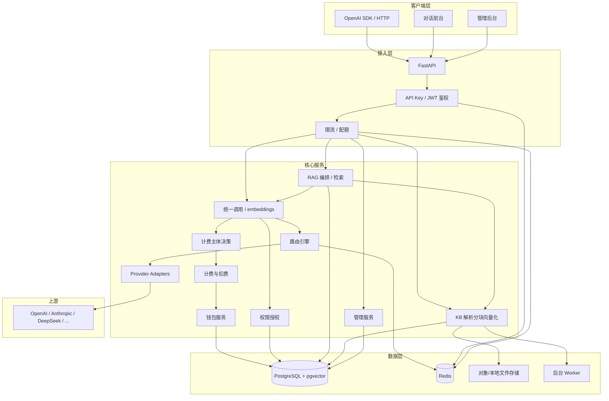
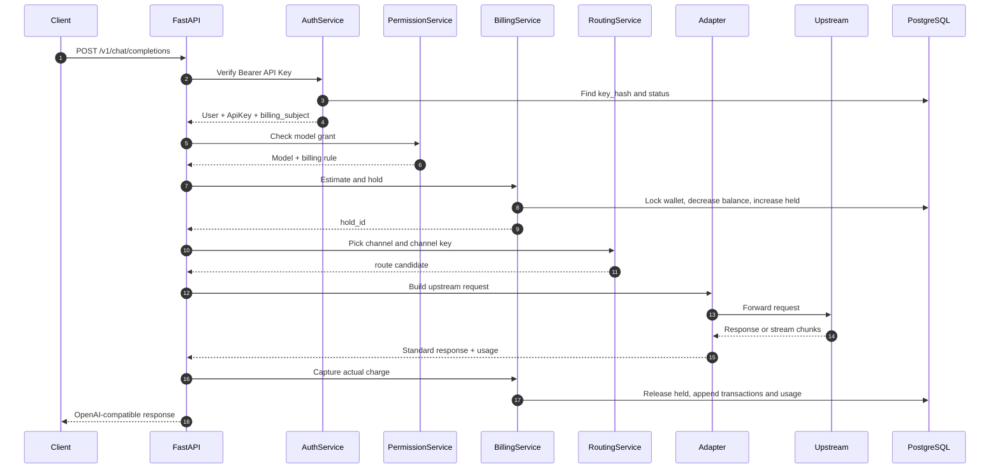
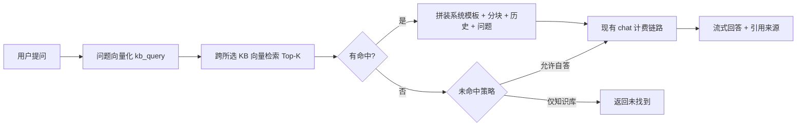

# 大模型聚合平台技术方案设计

| 项目 | 内容 |
| --- | --- |
| 文档名称 | LLM Gateway 技术方案设计 |
| 输入依据 | `docs/PRD.md`（索引）/`docs/prd/` |
| 版本 | v0.3 |
| 状态 | 待技术评审 |
| 修订日期 | 2026-07-28 |
| 关联文档 | [`MVP_SCOPE.md`](./MVP_SCOPE.md)、[`PHASE2_SCOPE.md`](./PHASE2_SCOPE.md)、[`DATABASE_DESIGN.md`](./DATABASE_DESIGN.md)、[`API_CONTRACT.md`](./API_CONTRACT.md)、[`AI_TASK_BREAKDOWN_KB.md`](./AI_TASK_BREAKDOWN_KB.md) |

---

## 1. 设计目标

本技术方案将 PRD 中的产品能力转化为可开发、可测试、可迭代的工程设计。按产品路线分阶段落地，但**共享同一套网关、计费、适配器与数据底座**，避免旁路实现。

### 1.1 核心闭环（一期基线）

```text
平台 API Key 鉴权 -> 模型权限校验 -> 计费预扣 -> 渠道路由 -> 上游适配转发 -> 响应返回 -> 实扣结算 -> 日志与流水
```

### 1.2 分阶段目标

| 阶段 | 工程目标 |
| --- | --- |
| 一期（MVP） | 跑通统一调用 + 个人钱包 + OpenAI 兼容主链路；后台可配置渠道/模型/计费 |
| 二期 | 组织钱包与成员额度、在线支付、embeddings、私有协议适配器、Key 限流、运营报表 |
| 知识库专项 | 文件解析分块、pgvector 检索、Chat RAG 编排；向量化复用网关内部链路计费 |
| 三期 | 多区域/多租户、智能路由、授信与预算、语义缓存、合规增强（架构预留） |

产品模块与 PRD 一一对应：渠道、模型、计费、用户权限、组织、钱包、网关、Chat、知识库、管理后台。详细需求以 `docs/prd/` 为准；DDL 以 `DATABASE_DESIGN.md` 为准；HTTP 契约以 `API_CONTRACT.md` 为准。

---

## 2. 分期范围摘要

### 2.1 一期（MVP）必做

| 模块 | 能力 |
| --- | --- |
| 统一调用 | `POST /v1/chat/completions`，非流式与流式（SSE） |
| 模型列表 | `GET /v1/models`，只返回当前 Key 可用模型 |
| 鉴权 | 平台 API Key Bearer；明文仅创建时展示，库内只存哈希 |
| 用户与权限 | 注册登录、RBAC、角色-模型授权矩阵、个人 API Key |
| 渠道 | Provider、Channel、Channel Key、Model-Channel Mapping |
| 路由 | 启用/健康/优先级/权重；有限故障转移 |
| 适配器 | OpenAI-compatible（DeepSeek 等可复用）；PRD 一期亦覆盖 Anthropic |
| 计费 | 按 Token 纯按量；输入/输出/缓存命中/按次；规则版本化 |
| 钱包 | 个人钱包、后台手工充值、预扣/实扣/释放、流水只追加；后续赠送专项拆现金/赠送两池 |
| 日志 | request log、usage log、wallet transaction、审计日志 |
| 前端 | 后台管理优先；前台 Chat / Key / 钱包可同期或紧随 |

### 2.2 二期

| 能力 | 说明 |
| --- | --- |
| 组织域 | `orgs` / `org_members` / `member_quotas`；组织钱包 |
| 计费主体 | Key 绑定默认主体；请求头 `X-Billing-Subject` 可覆盖 |
| 在线支付 | 支付单 + 回调验签幂等入账（抽象支付渠道，可 Stripe/Mock） |
| 对外扩展 | `POST /v1/embeddings`；至少 1 个私有协议适配器 |
| Key 管控 | 模型范围、RPM/TPM 限流（Redis）；`channel_keys` 限额参与路由 |
| 报表 | 渠道成本价、日聚合表、收入/成本/毛利看板（收入 = 现金口径） |

### 2.3 知识库专项（二期后）

| 里程碑 | 内容 |
| --- | --- |
| KB-M1 | 知识库/文档 CRUD、多类型解析、分块、向量化入库（含预扣实扣）、状态机、命中测试 |
| KB-M2 | 分块工作台、Chat 挂载知识库、RAG 编排与引用、用量来源标记 |
| KB-M3 | 后台配额与管控、混合检索/rerank（可选）、运营指标 |

约束：**不改动对外 `/v1/chat/completions` 协议**；RAG 由前台编排接口（如 `/chat/kb-completions`）完成。向量化必须走内部调用方标识，复用路由/适配器/钱包，禁止旁路直连上游。

### 2.4 赠送余额专项（知识库后）

现金池与赠送池物理隔离；扣减顺序 赠送 → 现金 → 授信；用量拆 `gift_charge_amount` / `cash_charge_amount`；收入口径改为现金部分。详见 `prd/wallet.md`、`GIFT_CALIBER_CHANGE.md`。

### 2.5 明确暂缓（三期或更后）

| 能力 | 原因 |
| --- | --- |
| 智能路由（延迟/成本/质量） | 需历史数据沉淀 |
| 多租户物理隔离 / 私有化交付 | 架构预留字段即可 |
| 套餐包 / 订阅 / 授信透支 | 与 D1 纯按量基线冲突，单独评估 |
| 组织共享知识库、OCR、GraphRAG、`/v1` 扩展 `kb_ids` | 见知识库 PRD「边界」 |
| Images / Assistants / Responses API | 协议与计费维度不同 |

---

## 3. 技术栈

| 层级 | 选型 | 说明 |
| --- | --- | --- |
| 后端框架 | FastAPI | 原生 async，适合网关转发与 SSE |
| ASGI | Uvicorn；生产可配 Gunicorn | 多 worker |
| ORM / 迁移 | SQLAlchemy 2.0 async + Alembic | 钱包行锁与版本迁移 |
| 数据库 | PostgreSQL | 强一致事务；JSONB 配置 |
| 向量扩展 | pgvector | 知识库向量列 + HNSW/IVFFlat；规模超阈值再评估独立向量库 |
| 缓存 | Redis | 鉴权缓存、路由缓存、限流、熔断状态 |
| HTTP 客户端 | httpx async | 连接池与流式转发 |
| 异步任务 | 后台 worker（APScheduler / 进程内队列起步，可迁 Celery） | 对账、健康检查、日聚合、KB 解析/向量化 |
| 文件存储 | 本地磁盘抽象，接口兼容 S3/OSS | 知识库原文件 |
| 支付 | 渠道抽象（Stripe / Mock 等） | 回调验签 + 幂等入账 |
| 配置 | Pydantic Settings | 环境变量驱动 |
| 测试 | pytest、pytest-asyncio、respx | 异步与上游 Mock |
| 前端 | React + TypeScript + Ant Design Pro | 后台；前台 Chat 用 SSE/fetch stream |
| 可观测性 | 结构化日志 + Prometheus + OpenTelemetry | 指标、链路、日志 |

---

## 4. 目标工程结构

与当前 `backend/app` 布局对齐；专项能力按目录隔离，核心服务保持可复用。

```text
backend/
  app/
    main.py
    core/                 # config、security、errors、logging、metrics
    db/
      session.py
      models/             # user、api_key、channel、billing、wallet、org、
                          # payment、chat、kb、log、usage_daily ...
    api/
      deps.py
      v1/                 # chat、models、embeddings
      admin/              # providers、channels、models、billing、wallets、
                          # orgs、payments、reports、kb、usage ...
      auth.py / keys.py / wallets.py / orgs.py / payments.py
      chat_sessions.py / chat_rag.py / kb.py / usage.py
    services/             # auth、permission、billing、wallet、routing、
                          # billing_subject、quota、rate_limit、org、
                          # payment、report、kb_*、rag_chat、retrieval、
                          # embedding_gateway、usage ...
    adapters/             # base、registry、openai_compatible、anthropic ...
    payments/             # base、stripe、mock
    kb/                   # parse、chunking、parsers、tokens、rag_prompts
    storage/              # base、local（S3 可后续）
    schemas/
    tasks/                # reconcile_holds、reconcile_payments、
                          # aggregate_usage_daily、kb_worker、health_check
  alembic/
  tests/
docs/
  PRD.md
  prd/                    # 按模块拆分的产品需求
  TECH_DESIGN.md
  DATABASE_DESIGN.md
  API_CONTRACT.md
  MVP_SCOPE.md / PHASE2_SCOPE.md
```

---

## 5. 分层架构



### 5.1 API 层

负责 HTTP 协议、OpenAI 兼容请求响应、JWT/API Key 依赖注入、错误格式统一。不直接处理钱包扣减、路由计算、厂商协议转换与分块向量化。

### 5.2 服务层

| 服务 | 职责 | 阶段 |
| --- | --- | --- |
| `AuthService` | 平台 API Key / 用户 JWT 校验 | 一期 |
| `PermissionService` | 角色-模型授权 | 一期 |
| `BillingService` | 估算、hold、capture、release | 一期 |
| `WalletService` | 行锁余额、流水追加、幂等 | 一期 |
| `RoutingService` | 映射、健康、优先级、权重、重试 | 一期 |
| `UsageService` | request/usage 日志与聚合查询 | 一期 |
| `BillingSubjectService` | 个人/组织主体决策与回退 | 二期 |
| `QuotaService` | 成员额度校验与累计、周期重置 | 二期 |
| `RateLimitService` | Key RPM/TPM（Redis） | 二期 |
| `OrgService` / `PaymentService` / `ReportService` | 组织、支付、报表 | 二期 |
| `EmbeddingGateway` | 内部向量化调用（服务身份 + 用户计费主体） | 二期/KB |
| `KbService` / `KbIngestService` / `RetrievalService` / `RagChatService` | 知识库 CRUD、流水线、检索、RAG | 知识库 |

### 5.3 适配器层

统一接口：`build_request`、`parse_response`、`parse_stream`、`parse_usage`、`normalize_error`。由 `adapters/registry` 按 Provider 类型选择实现。一期以 `OpenAICompatibleAdapter` 为主；二期起注册 Anthropic 等私有协议适配器，路由不再硬绑定单一实现。

### 5.4 知识库与存储

- 解析/分块引擎位于 `app/kb/`，与 HTTP 解耦，便于单测与替换解析器。
- `storage` 抽象原文件读写；删除知识库时物理清理文件 + 分块 + 向量。
- 异步流水线由 `kb_worker` 驱动，任务幂等（同文档同版本不重复计费）。

---

## 6. 核心调用流程

### 6.1 统一 Chat 调用（一期）



### 6.2 组织计费主体（二期）

在预扣前插入主体决策（见 `prd/wallet.md`）：

1. 请求头 `X-Billing-Subject`（若有）优先。
2. 否则 API Key 绑定默认主体。
3. 再否则账户默认策略（个人优先 / 组织优先）。
4. 组织路径：校验成员消费开关 + 组织余额 + 成员额度（取更严）；失败可按策略回退个人或 402。
5. 组织扣费流水与 `request_logs` 记录发起成员与 `org_id`。

### 6.3 Chat RAG（知识库专项）



- 编排接口：`POST /chat/kb-completions`（JWT 校验归属 + API Key 走 chat 计费）。
- 注入分块总 token 受上下文预算约束（默认 ≤ 40% 或 4000 token，取小）。
- 用量 `source`：`kb_query`（问题 embedding）、`chat`（对话）；注入分块计入输入 token，由既有规则计费。

### 6.4 失败处理原则

| 失败位置 | 是否计费 | 处理 |
| --- | --- | --- |
| API Key 无效 | 否 | 401，不创建 hold |
| 模型无权限 / 越权挂载 KB | 否 | 403 |
| 余额或成员额度不足 | 否 | 402，不调用上游 |
| Key RPM/TPM 超限 | 否 | 429，不预扣 |
| 无可用渠道 | 否 | 释放 hold，503 |
| 上游全部失败 | 否 | 释放 hold，502/503 |
| 流式已输出后中断 | 是 | 按已产出或估算 token 结算，`partial` |
| KB 向量化余额不足 | 否 | 文档停在 `insufficient_balance`，可重试 |

产品决策 **D3**：失败请求不计费，预扣全额释放。

---

## 7. 计费与钱包事务设计

### 7.1 金额单位

内部使用整数最小单位，建议 `1 元 = 10000 单位`（`MONEY_SCALE`）。禁止 float；API 展示可用 Decimal 字符串。

### 7.2 预扣 hold

须在数据库事务中完成（`SELECT ... FOR UPDATE`）：

```sql
BEGIN;
SELECT id, balance, held, gift_balance, gift_held, credit_limit
FROM wallets
WHERE id = :wallet_id
FOR UPDATE;

-- 可用额 = gift_balance + balance + credit_limit
-- 按 赠送 → 现金 拆分 estimate（整数减法，不做比例分摊）
UPDATE wallets
SET gift_balance = gift_balance - :gift_hold,
    gift_held    = gift_held + :gift_hold,
    balance      = balance - :cash_hold,
    held         = held + :cash_hold
WHERE id = :wallet_id;

INSERT INTO wallet_transactions (
  ... type='hold', amount=-:estimate_amount, gift_amount=-:gift_hold, ref_request_id=:request_id ...
);
COMMIT;
```

`gift_balance = 0` 时退化为改造前的纯现金 hold。两池必须在**同一行锁**内变更。hold 阶段不核销 `gift_grants.remaining`（capture 时 FIFO 核销）。

组织扣费时在同一事务或紧邻事务中校验并预占成员额度（金额维度，见决策 D2）。

### 7.3 实扣 capture

以 `request_id` 幂等。实扣小于预扣则差额释放；实扣大于预扣时默认不透支，最多扣到可用余额范围内，并标记异常供对账。

```text
actual <= estimate:
  退还 estimate - actual，逆序先退现金占用再退赠送占用
  归还 gift_held / held 后按实扣落账
  append capture（gift_amount = -赠送实扣）+ 必要时 release

actual > estimate:
  超出部分再按 赠送 → 现金 → 授信 补扣
  mark under_estimated when cannot fully capture
```

赠送实扣 > 0 时核销批次 `remaining`。失败请求 `release`：两池冻结原路退回，不改批次剩余。口径说明见 [`GIFT_CALIBER_CHANGE.md`](./GIFT_CALIBER_CHANGE.md)。

### 7.4 释放 release

以下场景必须释放全部预扣：

- 上游未成功且未向用户输出内容
- 无可用渠道 / 调用前参数错误
- 服务异常结束且未产生 usage

幂等键：`request_id + hold_id`。未结算 hold 由 `reconcile_holds` 任务按 `HOLD_EXPIRE_SECONDS` 兜底。

### 7.5 知识库向量化计费

- 解析完成后按分块 token 总量估算预扣；不足则 `pending_embedding → insufficient_balance`。
- 批量 embedding 经 `EmbeddingGateway`（内部调用方，计费主体为文档所属用户）。
- `usage_logs.source = kb_ingest`；单分块编辑仅增量重嵌入。
- 失败分块不计费；任务幂等防止重复扣费。

---

## 8. 路由与适配器

### 8.1 路由输入

| 输入 | 来源 |
| --- | --- |
| model alias | 请求体 `model` |
| model-channel mapping | 数据库 |
| channel / key 状态与健康 | DB + Redis |
| Key RPM/TPM 预算 | Redis 计数（二期） |
| retry budget | channel 或全局配置 |

### 8.2 路由规则

1. 过滤未启用模型、mapping、渠道、熔断渠道；二期跳过打满限额的 Key。
2. 按 `priority` 从高到低分组。
3. 同优先级内按 `weight` 加权随机。
4. 渠道内选启用且健康的 Channel Key。
5. 上游 401/403：标记 Key 异常或禁用。
6. 上游 429/5xx/timeout：在重试预算内换 Key 或换渠道。

### 8.3 适配器注册

```text
provider_type -> Adapter 实现
openai_compatible -> OpenAICompatibleAdapter
anthropic          -> AnthropicAdapter
（后续）gemini / aliyun / ...
```

新增厂商：实现 `BaseAdapter` + 注册 Provider 类型 + 配置渠道映射，不改核心计费与路由框架。

---

## 9. 数据模型设计

表级 DDL 与字段以 [`DATABASE_DESIGN.md`](./DATABASE_DESIGN.md) 为准。技术方案只定阶段与边界。

| 表 | 阶段 | 用途 |
| --- | --- | --- |
| `users` / `roles` / `user_roles` / `role_model_grants` | 一期 | 用户与授权 |
| `api_keys` | 一期；二期扩展范围与限额 | 平台 Key |
| `providers` / `channels` / `channel_keys` | 一期 | 上游接入 |
| `models` / `model_channel_map` / `billing_rules` | 一期 | 模型与定价 |
| `wallets` / `wallet_transactions` | 一期；二期 `owner_type=org` | 钱包 |
| `request_logs` / `usage_logs` / `audit_logs` | 一期；二期补 org；KB 补 source | 日志 |
| `chat_sessions` / `chat_session_messages` | 一期；KB 扩展挂载与引用 | Chat |
| `orgs` / `org_members` / `member_quotas` | 二期 | 组织 |
| `payment_orders` | 二期 | 支付 |
| `channel_costs` / `usage_daily_summary` | 二期 | 报表 |
| `knowledge_bases` / `kb_documents` / `kb_chunks` / `kb_ingest_jobs` | 知识库 | RAG |

一期可在 `wallets.owner_type`、`request_logs.billing_subject` 等字段预留，业务入口二期启用。

知识库文档状态机（摘要）：

```text
uploaded → parsing → chunking → pending_embedding → embedding → ready
                              ↘ insufficient_balance（充值后重试）
任意阶段 ↘ failed / partial（可重试）
```

---

## 10. API 契约摘要

完整 Schema 见 [`API_CONTRACT.md`](./API_CONTRACT.md)。

### 10.1 对外 OpenAI 兼容

| 方法 | 路径 | 阶段 | 说明 |
| --- | --- | --- | --- |
| `POST` | `/v1/chat/completions` | 一期 | Chat，支持流式 |
| `GET` | `/v1/models` | 一期 | 授权模型列表 |
| `POST` | `/v1/embeddings` | 二期 | 嵌入；KB 内部复用 |

### 10.2 用户端 / 管理端（节选）

| 资源 | 阶段 | 说明 |
| --- | --- | --- |
| Auth / Keys / Wallets / Usage | 一期 | JWT 用户端 |
| Admin：Provider/Channel/Model/Billing/Wallet/Role | 一期 | 管理 JWT |
| Orgs / Payments / Reports | 二期 | 组织、支付、报表 |
| `/kb/*`、分块、命中测试 | 知识库 | 用户端知识库 |
| `/chat/kb-completions` | 知识库 | RAG 编排（不动 `/v1`） |
| Admin KB / 配额配置 | 知识库 | 运营管控 |

### 10.3 鉴权分离

- `/v1/*`：仅平台 API Key。
- 用户控制台与 `/kb/*`：用户 JWT。
- `/admin/*`：管理员 JWT（与平台 Key 分离）。
- RAG：JWT（归属）+ API Key（计费链路），见 API 契约。

---

## 11. 错误码

| HTTP | 业务码 | 场景 |
| --- | --- | --- |
| 400 | `invalid_request` | 参数错误 |
| 401 | `invalid_api_key` | Key 无效 |
| 403 | `model_not_authorized` | 无权使用模型或资源 |
| 402 | `insufficient_balance` | 余额或成员额度不足 |
| 404 | `model_not_found` | 模型不存在或禁用 |
| 409 | `idempotency_conflict` | request_id 状态冲突 |
| 429 | `rate_limited` / `rate_limit_exceeded` | 限流 |
| 502 | `upstream_error` | 上游失败且重试耗尽 |
| 503 | `no_available_channel` | 无健康渠道 |
| 500 | `internal_error` | 未预期错误 |

错误体兼容 OpenAI：

```json
{
  "error": {
    "message": "Insufficient balance",
    "type": "billing_error",
    "code": "insufficient_balance"
  }
}
```

---

## 12. 配置项

| 配置 | 说明 |
| --- | --- |
| `DATABASE_URL` | PostgreSQL async 连接 |
| `REDIS_URL` | Redis（限流/缓存；可降级） |
| `API_KEY_PEPPER` | 平台 API Key 哈希 pepper |
| `CHANNEL_KEY_ENCRYPTION_KEY` | 上游 Key 加密；生产建议 KMS |
| `DEFAULT_REQUEST_TIMEOUT_MS` | 上游默认超时 |
| `DEFAULT_MAX_RETRIES` | 默认重试次数 |
| `ROUTE_CACHE_TTL_SECONDS` | 路由配置缓存 |
| `AUTH_CACHE_TTL_SECONDS` | 鉴权缓存 |
| `HOLD_EXPIRE_SECONDS` | 未结算 hold 对账超时 |
| `MONEY_SCALE` | 金额最小单位比例 |
| `PAYMENT_*` | 支付渠道密钥与回调配置 |
| `KB_STORAGE_ROOT` / 对象存储配置 | 知识库文件 |
| `KB_DEFAULT_EMBEDDING_MODEL` | 系统默认 embedding 模型 |
| `KB_MAX_FILE_SIZE` 等 | 上传与配额默认值 |
| `KB_CONTEXT_BUDGET_*` | RAG 上下文注入预算 |

---

## 13. 安全设计

- 平台 API Key：高熵随机；明文仅创建返回一次；库内 `key_hash` + `key_prefix`。
- 上游 Channel Key：AES-GCM 加密；接口脱敏。
- 管理端 JWT 与平台 API Key 分离。
- 资金、渠道、计费规则、组织敏感操作写入 `audit_logs`。
- 请求日志默认不把完整对话正文写入网关 access 路径；Chat 正文按产品决策持久化在会话表（合规策略见 MVP 变更控制）。
- 知识库：文件类型嗅探、大小限制、路径不可预测；正文/分块仅库主可见；后台默认不可见正文（特权查看需审计）。
- 支付回调：验签 + 支付单状态机幂等，同一外部单号只入账一次。

---

## 14. 可观测性

| 指标 | 维度 |
| --- | --- |
| 请求量 / 延迟 / 错误率 | model、channel、stream、status |
| 上游成功率 | provider、channel、key |
| 计费成功率 | billing_status |
| 预扣与实扣金额 | model、user、org |
| 渠道熔断 | channel、reason |
| Key 限流触发 | key、limit_type |
| 支付入账 | channel、status |
| KB 文档处理时长 / 失败率 | file_type、status |
| 向量化 token 吞吐 | model、source |
| 检索延迟 P95 / 命中率 | kb_id |

所有日志带 `request_id`，上游透传 `X-Request-ID`。用量来源维度：`chat` / `api` / `kb_ingest` / `kb_query`。

---

## 15. 测试策略

| 类型 | 覆盖 |
| --- | --- |
| 单元测试 | 费用计算、取整、路由权重、权限、Key 哈希、分块、主体决策 |
| 事务测试 | 预扣/释放/实扣幂等；组织余额与成员额度并发不超扣 |
| API 测试 | `/v1/models`、chat 流式/非流式、embeddings、错误码 |
| Mock 上游 | 200、401、429、5xx、timeout、流式中断 |
| 支付测试 | 回调重复送达只入账一次 |
| KB 测试 | 解析六类文件、状态机、余额不足停等、命中测试、RAG 引用、越权 403 |
| 回归 | PRD 计费示例金额一致；一/二期用例在 KB 改造后仍通过 |

---

## 16. 实施顺序建议

### 16.1 一期

1. 工程骨架、配置、DB、健康检查、测试框架  
2. 数据模型与 Alembic  
3. API Key 鉴权、用户、角色、模型授权  
4. Provider / Channel / Key / Model / Mapping / Billing 管理 API  
5. 钱包充值、预扣、实扣、释放、流水幂等  
6. OpenAI-compatible 适配器与路由  
7. `/v1/models` 与非流式 chat  
8. 流式转发与 partial 结算  
9. 用量、审计、对账任务  
10. 后台与前台 Chat  

### 16.2 二期

按 `PHASE2_SCOPE.md` 里程碑：M1 组织域 → M2 组织扣费闭环 → M3 支付 / M4 报表 / M5 embeddings·私有适配器·Key 限流（M3–M5 可并行）。

### 16.3 知识库专项

按 `AI_TASK_BREAKDOWN_KB.md`：基础设施（存储 + worker）→ 模型与 pgvector → 上传解析分块 → 向量化计费 → 检索命中测试 → 分块工作台与 RAG Chat → 配额与后台。

### 16.4 三期

多区域与租户隔离、智能路由、授信/预算告警、语义缓存与内容安全——在现有无状态网关 + 外置状态架构上扩展，不推翻一期底座。

---

## 17. 技术评审检查清单

- [ ] 是否坚持按阶段交付，且二期/KB 复用同一计费与适配器底座、无旁路扣费。  
- [ ] 钱包事务是否满足并发不超扣、流水只追加、结算幂等；组织路径是否同时约束余额与成员额度。  
- [ ] 失败请求是否不计费并释放冻结（含无渠道、上游全失败、限流拒绝）。  
- [ ] 流式中断是否能记录 partial 并按已产出内容结算。  
- [ ] 平台 Key 哈希与上游 Key 加密策略是否分离落实。  
- [ ] 适配器是否可注册扩展，路由是否按 Provider 类型选实现。  
- [ ] 知识库向量化是否走内部网关链路；RAG 是否不污染 `/v1` 协议。  
- [ ] 支付回调是否验签且幂等；报表收入是否与 capture 流水可对账。  
- [ ] 后台写操作与资金/组织敏感操作是否有审计。  
- [ ] 每批 AI 编码任务是否有可运行验证命令与退出标准。  

---

## 18. 文档维护约定

出现以下变更时，应先更新本技术方案（及对应的 `MVP_SCOPE` / `PHASE2_SCOPE` / `DATABASE_DESIGN` / `API_CONTRACT`），再继续大规模改代码：

- 计费模式偏离纯按量（套餐/订阅/授信）。  
- 新增计费主体类型或组织层级。  
- 适配器抽象不兼容的私有协议批量接入。  
- 向量库迁出 PostgreSQL，或对外 `/v1` 增加知识库参数。  
- Chat 正文保留/加密/导出合规策略变更。  
