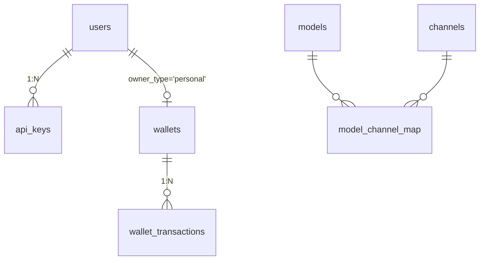

# 阶段 2 实施细则：数据层——模型与迁移

> 配套 `docs/learning_plan.md` 的「阶段 2」。阅读模式字母见 [README](./README.md#二四种读代码的方式后面每条读单都会标)。
> 前置：阶段 1 过关。
> 产出物：`docs/learning/notes/stage-2.md`，含 1 张 ER 图 + 1 条完整走通的「加字段 → 迁移 → 回滚」记录 + 阶段 0 那次调用的数据库取证截图/SQL 结果。

**本阶段一句话**：数据库是这个系统唯一「真的」存东西的地方，所有 service 都只是在搬运这几十张表里的数据。看懂表，业务就懂了一半。

---

## 一、怎么读

### 一个必须先建立的直觉：金额

在读任何模型之前先记住这条，否则你会看不懂一堆字段：

- **所有金额都是整数**，单位是「最小货币单位」，**不是元、不是分**。
- 换算关系：`1 元 = settings.money_scale 个最小单位`，默认 `money_scale = 10000`（`app/core/config.py:54-55`），即**精度到 0.0001 元**。
- 所以 `balance = 12340000` 表示 **1234 元**。
- 计费单价 `price_input` / `price_output` 是「**每 1M token** 的最小单位数」（`app/db/models/billing.py:27-33`）。

问题（读完 `app/db/models/wallet.py:28-58` 再回答）：**为什么金额不用 float，也不用 Decimal，而用 BigInteger？** 提示：`0.1 + 0.2 != 0.3`；以及跨语言/跨服务传输时 Decimal 的序列化问题。

### 读单总览

| # | 内容 | 模式 | 预算 | 核心问题 |
| --- | --- | --- | --- | --- |
| D1 | `app/db/base.py` + `models/__init__.py` | Q | 20 min | 所有模型的公共底座 |
| D2 | `docs/DATABASE_DESIGN.md` | S | 30 min | 全表目录，当字典用 |
| D3 | 核心四类模型 | Q | 60 min | user / api_key / wallet / channel |
| D4 | 其余模型 | S | 30 min | org / payment / log / chat / 聚合表 |
| D5 | `alembic.ini` + `alembic/env.py` | Q | 20 min | 迁移是怎么连上库和模型的 |
| D6 | `alembic/versions/001→014` | S+Q | 60 min | 表结构如何演进 |

---

### D1 · `backend/app/db/base.py` + `app/db/models/__init__.py`（模式 Q）

`base.py` 只有 47 行，三样东西：

| 名字 | 行号 | 作用 |
| --- | --- | --- |
| `Base` | `13-16` | 所有模型的父类（SQLAlchemy 2.0 `DeclarativeBase`） |
| `UUIDPrimaryKeyMixin` | `19-26` | `id` 为 UUID，`default=uuid4` |
| `TimestampMixin` | `29-47` | `created_at` / `updated_at` |

问题：

1. `created_at` 用 `server_default=func.now()`（数据库生成），`updated_at` 用 `onupdate=utc_now`（**Python 生成**）。为什么不一致？去看 `base.py:29-47` 的注释，关键词是 `MissingGreenlet`——异步 SQLAlchemy 里在 flush 时触发数据库函数会踩坑。
2. 打开 `app/db/models/__init__.py`，看它把 30+ 个模型全部显式 import 了一遍（`:3-18`，含后台 `AdminUser` / `AdminRole`）。**这不是为了好看**。去 `alembic/env.py:10-11` 看 `import app.db.models`，然后回答：如果你新建了一个模型文件但**忘了**在 `__init__.py` 里 import，`alembic revision --autogenerate` 会发生什么？（这是本阶段练习最容易踩的坑，先记住）

---

### D2 · `docs/DATABASE_DESIGN.md`（模式 S）

**不要通读**，36000 字。用法是：

1. 花 10 分钟只看目录和每张表的一句话说明，建立「有哪些表」的印象
2. 后面读 model 文件时，**并排打开**这个文档对照（Cursor 里 `Ctrl+\` 分屏）
3. 把它当字典，不当教材

---

### D3 · 核心四类模型（模式 Q，60 分钟）

按这个顺序读，每个文件读完在笔记里画出它的字段和外键指向。

#### 3.1 `app/db/models/user.py`

四张表，注意后两张是**关联表**：

| 表 | 行号 | 说明 |
| --- | --- | --- |
| `users` | `15-31` | `email` unique、`password_hash`、`default_billing_subject` |
| `roles` | `35-49` | `name` unique，另有 4 个 KB 配额字段（阶段 8 用） |
| `user_roles` | `52-66` | 用户 ↔ 角色，**复合主键** |
| `role_model_grants` | `69-83` | 角色 ↔ 模型，**复合主键** |

问题：为什么权限设计成「用户 → 角色 → 模型」三级，而不是直接「用户 → 模型」？（提示：一个平台有 500 个用户 10 个模型时，两种设计各要维护多少行授权数据）

#### 3.2 `app/db/models/api_key.py`（37 行，逐行读）

字段清单（练习要在这里加字段，先看熟）：

```
id, created_at, updated_at          ← mixin 带来的
user_id, key_hash, key_prefix, name
billing_subject                      ← 阶段 5 讲
allowed_models (JSONB)               ← 空数组=继承角色授权
rpm_limit, tpm_limit                 ← 阶段 4 讲
expires_at, status, last_used_at
```

问题：

1. `key_hash` 是 unique（`:19`），`key_prefix` 不是。为什么存了哈希还要存一个明文前缀？（提示：前端列表页要显示 `sk-abc123...` 给用户认）
2. 有一个联合索引 `ix_api_keys_user_id_status`（`:15`）。哪个查询会用到它？（去 `app/api/keys.py:55-59` 看 `list_keys` 的 where 条件）

#### 3.3 `app/db/models/wallet.py`（**本阶段最重要的文件**，逐行读）

三张表：

**`wallets`（`:33-67`）** —— 四个金额字段，先建立这张心智图：

```
现金池：balance（可用）   held（冻结中）
赠送池：gift_balance      gift_held      ← 阶段 6 才细看，现在当它恒为 0
授信：  credit_limit
```

注意 `CheckConstraint`（`:36-44`）：数据库层面强制 `balance >= 0`。**这是资金安全的最后一道防线**——就算应用层代码写错了，数据库也不让余额变负。

**`wallet_transactions`（`:73-118`）** —— 流水表，只追加不修改。重点看两组字段：

- `amount`（正=入账，负=出账）和 `gift_amount`（其中赠金的部分）
- `balance_after` / `held_after` / `gift_balance_after` / `gift_held_after` —— **变动后的余额快照**

问题（重要）：既然有了流水表，为什么 `wallets.balance` 还要单独存一个字段？直接 `SUM(amount)` 算不行吗？（提示：一个用户跑了 100 万次调用之后，每次鉴权都 SUM 一遍要多久）
再想：那么 `balance_after` 快照字段的价值是什么？（提示：对账时怎么发现「余额被人手工改过」）

**最关键的一行**：`:79-86` 那个**部分唯一索引**

```
UNIQUE (wallet_id, ref_request_id, type) WHERE ref_request_id IS NOT NULL
```

现在只要记住它存在。阶段 4 的「为什么重复结算不会重复扣钱」，答案就是这一行。

**`gift_grants`（`:128-170`）** —— 阶段 6 的内容，现在扫一眼字段名即可。

#### 3.4 `app/db/models/channel.py` + `llm_model.py` + `billing.py`

这三个文件构成「模型路由」这条线，一起读：

```
providers（厂商）
  └─ channels（渠道 = 一个上游接入点，有 priority / weight / health_status）
       └─ channel_keys（渠道下的多把上游 Key，加密存储）

models（平台对外的模型别名，如 "gpt-4o"）
  ├─ model_channel_map（别名 ↔ 渠道，带 upstream_model_name 和 weight）
  └─ billing_rules（计费规则，按 version 多版本）
```

问题：

1. 为什么要有 `model_channel_map` 这张中间表，而不是在 `models` 表上直接放一个 `channel_id`？（提示：同一个 `gpt-4o` 想同时接 Azure 和 OpenAI 官方）
2. `billing_rules` 有 `UniqueConstraint(model_id, version)`（`:19`）和 `effective_at`。为什么计费规则要做成多版本而不是直接改？（提示：改价之后，上个月的账单怎么重算）
3. `channel_keys.api_key_encrypted` 是 `BYTEA`（`:63`），去 `app/core/channel_key_crypto.py` 扫一眼加密方式。对比 `api_keys.key_hash` 存哈希——**为什么用户的 Key 存哈希，上游的 Key 却要存可解密的密文**？

---

### D4 · 其余模型（模式 S，30 分钟）

只需要知道「有这张表、大概干什么」，一句话一张：

| 文件 | 表 | 一句话 |
| --- | --- | --- |
| `org.py` | `orgs` / `org_members` / `member_quotas` | 组织、成员、成员消费额度（阶段 5） |
| `payment.py` | `payment_orders` | 在线充值订单（阶段 5） |
| `log.py` | `request_logs` / `usage_logs` / `audit_logs` | **每次请求一条 + 每次成功计费一条 + 后台操作审计** |
| `chat.py` | `chat_sessions` / `chat_session_messages` | 前台对话会话持久化 |
| `usage_daily.py` | `usage_daily_summary` | 日聚合表（阶段 7） |
| `channel_cost.py` | `channel_costs` | 渠道侧成本单价，用来算毛利 |
| `admin.py` | `admin_users` / `admin_roles` / `admin_user_roles` / `admin_role_permissions` | **后台**管理员与角色（阶段 3）。和前台 `users` / `roles` **不是同一套**，扫一眼表名即可 |

`log.py` 多花 10 分钟，看两个 unique：`request_logs.request_id` unique（`:22`）、`usage_logs.request_id` unique + 外键（`:76-77`）。这是阶段 4 幂等的另一半答案。

---

### D5 · `alembic.ini` + `alembic/env.py`（模式 Q，20 分钟）

`env.py` 只有 69 行，逐行读，回答：

1. `config.set_main_option("sqlalchemy.url", settings.database_url)`（`env.py:18`）—— 迁移用的连接串**不是**从 `alembic.ini` 读的（`alembic.ini:89` 里是个假的占位符），而是从 `.env` 走 `settings` 来的。这样做的好处是什么？
2. `target_metadata = Base.metadata`（`:20`）+ `import app.db.models`（`:11`）—— 连起来解释一遍：autogenerate 是拿什么和什么做对比？
3. `compare_type=True`（`:30`、`:41`）打开后，改字段类型（比如 `String(50)` → `String(100)`）会不会被 autogenerate 检测到？不打开呢？
4. `run_async_migrations()`（`:48-58`）用了 `connection.run_sync(do_run_migrations)`。为什么 Alembic 本身是同步的，却能跑在 asyncpg 上？

---

### D6 · `alembic/versions/` 001→014（模式 S + Q，60 分钟）

**读法**：先用 S 模式把 14 个文件的 **docstring**（每个文件开头都有中文说明）扫一遍，得到下面这张演进表；再用 Q 模式精读其中 3 个。

| Rev | 一句话 | 值得注意 |
| --- | --- | --- |
| `001_initial` | 初始全量 schema | 用的是 `Base.metadata.create_all`，不是逐条 `op.create_table` |
| `002_chat_sessions` | 加 chat 会话/消息表 | 同上 |
| `003_org_domain` | 组织域：orgs / org_members / member_quotas | 二期最大一次改造，还改了 wallets 外键 |
| `004_api_key_billing_subject_nullable` | `api_keys.billing_subject` 改可空 | 典型「改列约束」范例 |
| `005_payment_orders` | 支付订单表 | |
| `006_channel_costs_daily_summary` | 渠道成本 + 日聚合表 | |
| `007_provider_adapter_type` | 补 `adapter_type` 并**回填历史数据** | 精读：数据回填怎么写 |
| `008_api_key_scope_rate_limits` | api_keys 加 4 个字段 | **精读：这就是你练习的模板** |
| `009_kb_tables_pgvector` | 知识库四表 + pgvector | 阶段 8，扫一眼 |
| `010_reqlog_key_nullable` | `request_logs.api_key_id` 改可空 | |
| `011_chat_rag_fields` | chat 会话加 RAG 字段 | |
| `012_kb_global_settings` | KB 全局设置单例表 | |
| `013_gift_credit` | 赠送余额双池改造 | **阶段 6，现在只扫一眼** |
| `014_admin_rbac` | 后台管理员 + 角色 + 权限码授予 | **阶段 3，现在只扫一眼**：不预置账号，`.env` 兜底登录 |

链条：`001 → 002 → 003 → 004 → 005 → 006 → 007 → 008 → 009 → 010 → 011 → 012 → 013 → 014`

**必须精读 `008_api_key_scope_rate_limits.py`（54 行）**，它是你练习的直接模板：

- `revision` / `down_revision`（`:19-20`）—— 本项目的 revision id **不是随机 hex，而是有语义的 `008_xxx` 格式**。这很重要，autogenerate 生成的是随机 id，你要手工改。
- `upgrade()`（`:25-46`）：4 个 `op.add_column`
- 注意 `allowed_models` 加的是 `nullable=False` 但给了 `server_default`（`:31-32`）——**给已有数据的表加非空列必须这么写**，否则已存在的行没有值，迁移会失败。
- `downgrade()`（`:49-53`）：4 个 `op.drop_column`，**顺序和 upgrade 相反**。

再精读 `007_provider_adapter_type.py`，看**数据回填**（`op.execute` 写 UPDATE）怎么和 DDL 放在同一个迁移里。

问题：`001` 和 `002` 用 `create_all` 而不是逐条 `op.create_table`，这么写有什么代价？（提示：`downgrade` 还能精确写吗？如果一年后想回滚到 `001` 会怎样）

---

## 二、怎么做

### 任务 1 · 画 ER 图（必做，约 60 分钟）

范围：`users`、`api_keys`、`wallets`、`wallet_transactions`、`orgs`、`org_members`、`channels`、`models`、`model_channel_map`、`billing_rules`。

**不要用工具自动生成**，自动生成的图你不会看。手画或者o用 mermaid 手写，画的过程才是学习。

要求：

1. 每条连线标出**基数**（1:1 / 1:N / N:M）
2. 标出**外键在哪一侧**
3. 用不同颜色/分组圈出三个域：**身份域**（user/api_key/role）、**资金域**（wallet/transaction/org）、**路由域**（provider/channel/model）
4. 图上标注一个问题的答案：**`wallets` 表怎么同时表示「个人钱包」和「组织钱包」？**（去看 `wallet.py:35` 的 `UniqueConstraint("owner_type", "owner_id")`，这叫多态外键，注意它**没有**真正的 FK 约束，想想为什么）

mermaid 起手式（贴进笔记里补全）：



### 任务 2 · 加字段 + 迁移 + 回滚（必做，约 2 小时）

需求：给 `api_keys` 加一个 `note` 备注字段。

#### Step 0：开分支 + 记录当前状态

```powershell
cd d:\LLM_TokenHub
git checkout -b learn/stage2-apikey-note
cd backend
.\.venv\Scripts\Activate.ps1
alembic current          # 记下当前 head，应该是 014_admin_rbac
```

#### Step 1：先想清楚（写进笔记再动手）

1. `note` 应该 **nullable 还是 not null**？如果 not null，已有的 api_keys 行怎么办？（回看 `008` 里 `allowed_models` 的写法）
2. 类型选 `String(200)` 还是 `Text`？依据是什么？
3. 需不需要索引？（提示：会有人按备注搜 Key 吗）

#### Step 2：改 model

在 `app/db/models/api_key.py` 里加一行，**位置放在 `name` 附近，跟着现有风格写**：

```python
    note: Mapped[str | None] = mapped_column(String(200), nullable=True, comment="备注")
```

照抄现有字段的写法（看 `:22` 的 `name` 怎么写的），不要自创风格。

#### Step 3：autogenerate

```powershell
alembic revision --autogenerate -m "add api_key note"
```

**这一步的重点不是生成，是检查生成的东西。**打开新生成的文件（在 `alembic/versions/` 下，文件名是随机 hex 开头），逐条核对：

| 检查项 | 期望 | 如果不对说明什么 |
| --- | --- | --- |
| `upgrade()` 里只有一条 `op.add_column("api_keys", ...)` | ✅ | 多出来的语句 = 你的库和模型本来就不同步，**先搞清楚再继续** |
| `downgrade()` 里有 `op.drop_column` | ✅ | 空的 downgrade 是不可接受的 |
| `down_revision` | `"014_admin_rbac"` | 不对就是 head 没对齐 |
| `revision` | 随机 hex，如 `"a3f2b1c4d5e6"` | **需要你手工改** |

**必做的手工修整**（本项目约定，看 `008` 的写法）：

1. 把 `revision` 改成 `"015_api_key_note"`，文件名改成 `015_api_key_note.py`
2. 补一段中文 docstring 说明这次改了什么、为什么
3. 删掉 autogenerate 自动加的注释噪音（`# ### commands auto generated by Alembic ###`）

如果 autogenerate 生成了一堆你没预期的语句（比如要删某个索引），**不要直接跑**。那说明你本地库落后于模型，先 `alembic upgrade head` 再重新生成。

#### Step 4：升级 + 验证

```powershell
alembic upgrade head
psql -U postgres -h localhost -d tokenhub -c "\d api_keys"
```

在输出里确认 `note` 列存在、类型和可空性符合预期。

#### Step 5：**回滚 + 验证**（这一步最容易被跳过，不许跳）

```powershell
alembic downgrade -1
psql -U postgres -h localhost -d tokenhub -c "\d api_keys"     # note 列应该消失
alembic current                                                 # 应该回到 014_admin_rbac
alembic upgrade head                                            # 再升回去
```

**为什么这一步重要**：生产环境上线出问题时，能不能 5 分钟内回滚，取决于当初有没有人真的测过 downgrade。写了没测过的 `downgrade()` 等于没写。

在笔记里回答：如果这次改的不是「加列」而是「删列」，downgrade 能把数据恢复吗？那删列的迁移应该怎么做才安全？（提示：分两次发布，先停止写入再删）

#### Step 6（可选加分）：让字段真的能用

改 model 只是让数据库有这一列，接口还用不上。想完整走一遍就再做三处：

1. `app/schemas/auth.py`：`ApiKeyOut`（`:111-125`）加 `note` 字段，`ApiKeyCreate`（`:90-98`）/ `ApiKeyUpdate`（`:101-108`）加可选入参
2. `app/services/auth_service.py` 的 `create_api_key`（`:62-94`）/ `update_api_key` 加参数透传
3. `backend/tests/` 里加个测试：创建带 note 的 Key → 列表能读到 note → PATCH 改 note

注意 `update_api_key` 现有的写法用了 `update_xxx: bool` + `xxx: value` 的双参数模式（看 `app/api/keys.py:88-102`），这是为了区分「不改」和「改成 None」。跟着这个模式写，别自创。

#### Step 7：收工

```powershell
pytest -q            # 全绿
git checkout main
```

### 任务 3 · 数据库取证：找到阶段 0 那次调用（必做，约 40 分钟）

前提：你已经按阶段 0 完成过一次真实的 `/v1/chat/completions` 调用。如果数据被清了，重新调一次。

按这个顺序查，**每一步都把结果贴进笔记**：

```sql
-- 1. 从请求日志开始（这是你排障时唯一的入口）
SELECT request_id, status, http_status, model_id, channel_id, latency_ms, is_stream, created_at
FROM request_logs
ORDER BY created_at DESC
LIMIT 5;

-- 2. 拿上一步的 request_id 去查用量
SELECT request_id, input_tokens, output_tokens, charge_amount, cost_amount,
       gift_charge_amount, cash_charge_amount, is_estimated
FROM usage_logs
WHERE request_id = '<粘贴上面的 request_id>';

-- 3. 再去查钱包流水（注意这里会有 2~3 条：hold、capture，可能还有 release）
SELECT type, amount, gift_amount, balance_after, held_after, created_at
FROM wallet_transactions
WHERE ref_request_id = '<同一个 request_id>'
ORDER BY created_at;

-- 4. 最后看钱包当前状态
SELECT owner_type, owner_id, balance, held, gift_balance, gift_held, credit_limit
FROM wallets;
```

看着第 3 步的结果回答（**这是本阶段和阶段 4 的接头暗号**）：

1. 为什么同一个 `request_id` 会有 `hold` 和 `capture` 两条流水？
2. `hold` 那条的 `amount` 和 `capture` 那条的 `amount`，哪个大？差额去哪了？
3. `balance_after` 三条连起来看，能不能还原出这次调用完整的资金变化过程？
4. `usage_logs.charge_amount` 和 `capture` 流水的 `-amount`，两个数字对得上吗？

答不上来没关系，**把你的猜想写下来**，阶段 4 会逐条验证。

---

## 三、过关自测

1. 一次成功的 chat 调用会写哪几张表？每张各写几行？（D4 / 任务 3）
2. `balance = 12340000` 是多少钱？依据在哪个配置项？（金额直觉）
3. 独立说出「加字段 + 迁移 + 回滚」的完整命令序列，以及每一步要检查什么。（任务 2）
4. 我新建了一个模型文件 `app/db/models/coupon.py`，跑 autogenerate 却什么也没生成，为什么？（D1）
5. `wallets` 表怎么同时装下个人钱包和组织钱包？这种设计放弃了什么？（任务 1）
6. 计费规则为什么要有 `version` 而不是原地改价？（D3.4）
7. 给一张已有 100 万行的表加一个 `NOT NULL` 列，直接 `op.add_column(nullable=False)` 会发生什么？正确写法是什么？（D6 / `008`）

---

## 四、这个阶段常见的坑

- **autogenerate 生成一堆奇怪的 drop/create**：99% 是你本地库和 head 不同步，先 `alembic upgrade head`。**永远不要**在没看懂生成内容的情况下直接 `upgrade`。
- **忘了在 `models/__init__.py` 里 import 新模型** → autogenerate 检测不到，或者更糟：把你的新表当成「多余的表」要删。
- **revision id 用了随机 hex 就直接提交**：本项目约定是 `NNN_语义名`，破坏了后来人就看不出顺序。
- **`downgrade()` 留空**：这在本项目是明确禁止的（`docs/MVP_SCOPE.md` 第 6 节变更控制），也是阶段 9 的交付要求之一。
- **在 psql 里看不到测试插入的数据**：正常，`conftest.py:37` 会 rollback。想留数据就用真实 HTTP 调用。
