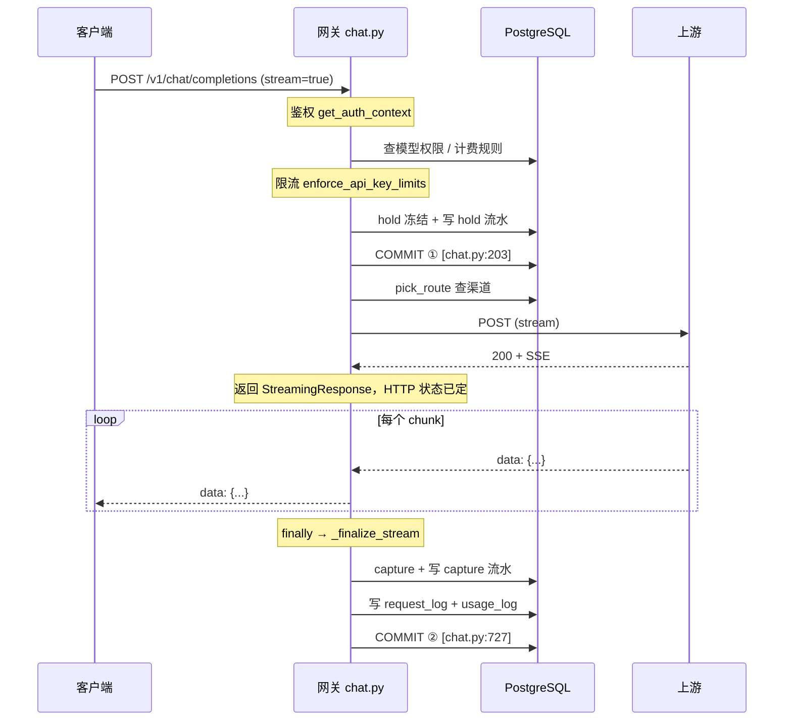

# 阶段 4 实施细则：核心网关链路——本项目的心脏

> 配套 `docs/learning_plan.md` 的「阶段 4」。阅读模式字母见 [README](./README.md#二四种读代码的方式后面每条读单都会标)。
> 前置：阶段 1–3 全部过关。**跳过前三阶段直接读这里会读不动**，`chat.py` 用到了前面每一层的东西。
> 预算：约 2 周 / 16–20 小时。这是全计划最重要的一个阶段，不要赶进度。
> 产出物：`docs/learning/notes/stage-4.md`，含 **1 张时序图（核心产出）** + 2 次断点跟踪记录 + 4 次故障演练记录。

**本阶段一句话**：`/v1/chat/completions` 一个接口串起了鉴权、限流、路由、计费、转发、流式、结算、日志八件事，而且**每一步失败都必须把钱退回去**。看懂它，这个项目就没有你看不懂的地方了。

---

## 零、先建立骨架（读代码之前先看这一节）

在打开任何文件之前，先把这张骨架抄进笔记。后面所有阅读都是在往这张骨架上挂细节。

```
                        ┌─── 失败 ────────────────────────────┐
                        │                                     ↓
鉴权 → 权限 → 计费规则 → 限流 → 预扣(hold) →【commit ①】→ 选渠道 → 调上游 →┬─ 成功 → 实扣(capture) → 写日志 →【commit ②】
                                                              ↑        │
                                                              └─ 重试 ─┘
                                                                       └─ 失败 → 释放(release) → 写日志 →【commit ③】
```

**三个 commit 点是全链路的骨骼**，先记住它们在哪：

| | 位置 | 为什么必须在这里 commit |
| --- | --- | --- |
| ① 预扣后 | `app/api/v1/chat.py:203` | 调上游可能要几十秒，期间必须让别的请求看到「这笔钱已经被冻结了」 |
| ② 成功结算后 | `chat.py:444`（非流式）/ `chat.py:727`（流式） | |
| ③ 失败释放后 | `chat.py:804` | |

还有一个数字要先记住：`chat.py:52` 的 `_DEFAULT_MAX_UPSTREAM_ATTEMPTS = 3`——**上游最多重试 3 次**。

---

## 一、怎么读

### 读单总览（严格按顺序）

| # | 内容 | 模式 | 预算 | 核心问题 |
| --- | --- | --- | --- | --- |
| D1 | `tests/test_openai_api.py` + `tests/test_stream_api.py` | T | 60 min | 先把「该是什么行为」搞清楚 |
| D2 | `chat.py` 骨架扫读 | S | 30 min | 建立地图，**不读函数体** |
| D3 | `chat.py` 非流式全链路 | Q | 90 min | 主干 |
| D4 | `chat.py` 流式全链路 | Q | 120 min | 最难的一段 |
| D5 | `app/services/routing_service.py` | Q | 60 min | 怎么选渠道 |
| D6 | `app/adapters/*` | Q | 60 min | 怎么抹平厂商差异 |
| D7 | `app/services/billing_service.py` | Q | 40 min | 钱怎么算 |
| D8 | `wallet_service.hold/capture/release` | Q | 60 min | 钱怎么动 |
| D9 | `app/services/usage_service.py` | S | 20 min | 日志写什么 |
| D10 | `app/services/rate_limit_service.py` | Q | 40 min | 限流 |

---

### D1 · 先读测试（模式 T，60 分钟）

**这一步不许跳。**`chat.py` 有 820 行，直接读会迷路；先读测试你就知道该在这 820 行里找什么。

`backend/tests/test_openai_api.py` —— 把这张表抄进笔记：

| 测试 | 场景 | 期望 | 你要在代码里找到的东西 |
| --- | --- | --- | --- |
| `test_chat_completions_no_auth_returns_401` | 无鉴权 | 401 | 此时**还没预扣**，为什么 |
| `test_chat_completions_model_not_found_returns_404` | 模型不存在 | 404 | 同上 |
| `test_chat_completions_model_not_authorized_returns_403` | 无权限 | 403 | 同上 |
| **`test_chat_completions_insufficient_balance_returns_402`** | 余额不足 | **402，且不调上游** | 预扣在调上游之前 |
| `test_chat_completions_success_produces_logs_and_transaction` | 成功 | request_log + usage_log + capture 流水 | commit ② |
| **`test_chat_completions_upstream_failure_no_usage_log`** | 上游挂 | **release 掉，不写 usage_log** | commit ③ |
| `test_chat_completions_response_model_is_platform_alias` | 成功 | 返回体里 `model` 是**平台别名**不是上游名 | 别名映射在哪一行 |
| `test_chat_completions_no_billing_rule_returns_400` | 没配计费规则 | 400 | |
| `test_chat_completions_no_channel_returns_503` | 没有可用渠道 | 503 且 release | |

`backend/tests/test_stream_api.py` —— 7 个用例，每个都很重要：

| 测试 | 期望 |
| --- | --- |
| `test_stream_returns_event_stream_content_type` | `text/event-stream` |
| `test_stream_chunks_passthrough_and_done` | chunk 透传 + 结尾 `[DONE]` |
| `test_stream_success_produces_capture_and_usage_log` | 流式成功也走 capture |
| **`test_stream_upstream_failure_before_output_releases_hold`** | 连接阶段就失败 → 全额释放 |
| **`test_stream_client_disconnect_partial_billing`** | **客户端断开 → 按已产出内容计费** |
| `test_stream_retry_on_429_then_success` | 429 会重试 |
| `test_non_stream_retry_on_500_then_success` | 500 会重试 |

读完这两张表，你应该能自己提出这个问题：**「已经流出去一半用户断开了，收多少钱？」**——带着它去读 D4。

---

### D2 · `chat.py` 骨架扫读（模式 S，30 分钟）

820 行，先只看函数签名和 docstring。在 Cursor 里 `Ctrl+Shift+O` 打开符号大纲，对照下表：

| 行号 | 函数 | 职责 | 阅读优先级 |
| --- | --- | --- | --- |
| `51-55` | 常量 | 重试次数 3、可重试状态码 `{401,403,429,500,502,503,504}` | ★★★ |
| `58-67` | `_record_chat_metrics` | Prometheus 打点 | ☆ |
| `70-86` | `_estimate_input_tokens` / `_estimate_output_tokens_from_text` | **4 字符 ≈ 1 token** 的粗估 | ★★ |
| `89-107` | `_advance_retry_exclusion` | 失败的 Key 加进黑名单，没备用 Key 就清空重来 | ★★★ |
| `110-113` | `_should_retry_upstream` | 什么错误值得重试 | ★★★ |
| `116-127` | `_build_upstream_payload` | 交给 adapter 构造上游请求体 | ★★ |
| `130-145` | `_PreparedChatContext` | 预处理产物，**一次请求的全部上下文都在这个 dataclass 里** | ★★★ |
| `148-221` | `_prepare_chat_context` | **权限 → 计费规则 → 限流 → 主体 → 预扣 → commit ①** | ★★★ |
| `224-245` | `_settle_charge` | capture + 组织额度累计 | ★★★ |
| `248-269` | `chat_completions` | 入口，只做「准备 + 分流」 | ★★★ |
| `272-460` | `_chat_completions_non_stream` | 非流式全链路 | ★★★ |
| `463-652` | `_chat_completions_stream` | 流式全链路 | ★★★ |
| `655-758` | `_finalize_stream` | 流结束后结算 | ★★★ |
| `761-819` | `_on_failure` | **失败统一出口：release + 写 failed 日志** | ★★★ |

注意入口 `chat_completions`（`:248-269`）只有 20 行——它把所有共用逻辑抽进了 `_prepare_chat_context`，然后按 `body.stream` 分流。**这个结构本身就值得学**：流式和非流式的差异只在「怎么拿上游数据、什么时候结算」，前面的准备工作完全一样。

---

### D3 · 非流式全链路（模式 Q，90 分钟）

#### 3.1 先读 `_prepare_chat_context`（`:148-221`）

逐行读这 74 行，它决定了后面一切。按顺序：

| 步骤 | 行号 | 想清楚 |
| --- | --- | --- |
| 模型权限 | `162-167` | 阶段 3 学过，`check_model_access` |
| 取计费规则 | `169` | 没规则直接 400，**在花任何钱之前** |
| 估算 token | `171-173` | `input_tokens_est + (body.max_tokens or 2048)` |
| **限流** | `175-180` | 注意 docstring（`:158`）：「限流在预扣之前执行：超限直接 429，**无资金变动、无上游调用**」 |
| 估算预扣金额 | `182-184` | `estimate_hold_amount` |
| 决策计费主体 | `186-192` | 个人还是组织钱包，阶段 5 细看 |
| **预扣** | `195-202` | `hold_amount > 0` 才扣 |
| **commit ①** | `203` | |

**这一段的核心问题**：为什么顺序是「限流 → 估价 → 主体 → 预扣」而不是别的顺序？

自己推演一遍：如果把限流放到预扣之后会怎样？（答案：超限的请求也会去动钱包，产生一次 hold 又一次 release，白白写两条流水，还占了行锁）
再推演：如果不 commit ①，直接带着未提交的事务去调上游会怎样？（答案：数据库事务会开着几十秒不放，而且**别的并发请求看不到这笔冻结**，同一个钱包可以被超额预扣）

#### 3.2 再读重试循环（`:285-373`）

这是全项目最值得学的一段控制流。结构是：

```python
for attempt in range(_DEFAULT_MAX_UPSTREAM_ATTEMPTS):   # :285
    route = await routing_service.pick_route(...)        # :287-292  每次都重新选！
    adapter = get_adapter(...)                           # :299-305
    payload = _build_upstream_payload(...)               # :307-312  AppError 直接放弃，不重试
    try:
        resp = await client.post(...)                    # :316-322
        if resp.status_code == 200: break                # :324-326
        err = adapter.normalize_error(...)               # :328-342
        if _should_retry_upstream(...): _advance_retry_exclusion(...); continue
        raise / break
    except httpx.TimeoutException: ...                   # :344-358  重试
    except Exception: ...                                # :359-373  重试
```

问题（一个个想清楚，写进笔记）：

1. `pick_route` 在**循环里面**（`:287`），每次重试都重新选路。如果放在循环外面会怎样？
2. `_advance_retry_exclusion`（`:89-107`）把失败的 **channel_key_id** 加进 `exclude_key_ids`。为什么排除的是 Key 而不是整个渠道？（提示：一个渠道下挂了 5 把上游 Key，其中 1 把额度用完了）
3. 同一个函数里还有一句「没有备用 Key 就把排除集合清空」（`:100-107`）——这是在做什么？不清空会怎样？
4. `_build_upstream_payload` 抛 `AppError` 时**不重试**（`:307-312`）。为什么？（提示：构造请求体失败是我方的问题，重试 100 次也是同样的结果。这叫**区分可重试错误和确定性错误**，是重试逻辑的第一原则）
5. `_RETRYABLE_STATUS_CODES`（`:54-55`）里居然有 **401 和 403**。上游返回 401 明明是「Key 不对」，为什么值得重试？（提示：结合第 2 点想——换一把 Key 试试）
6. **一个坑**：`RouteCandidate` 从数据库带出了 `max_retries` 字段（`routing_service.py:139`），但 `chat.py` 用的是硬编码的 3（`:52`）。也就是说**数据库里配的 `channels.max_retries` 当前不生效**。这是 bug 还是有意为之？（把你的判断写下来，这是阶段 9 可选的改进题）

#### 3.3 成功路径（`:397-444`）

```
adapter.parse_response(raw)                 :397-404   拿 usage，上游没给就估
calculate_charge_amount / cost_amount       :406-411   算用户该付多少 / 我们成本多少
_settle_charge                              :413       capture + 组织额度
write_request_log(status="success")         :415-430
write_usage_log                             :431-443
commit ②                                    :444
```

注意 `:397-404`：**上游可能不返回 usage**。此时用估算值，并且 `usage_log.is_estimated = True`。想想这个字段的价值——月底对账发现数字对不上时，你怎么知道哪些数据是估的？

#### 3.4 失败路径 `_on_failure`（`:761-819`）

45 行，逐行读。三件事：

1. `hold_amount > 0` 就 `release`（`:778-785`）——**把冻结的钱原路退回**
2. 写 `request_log`，`status="failed"`，`error_code` 从异常上取（`:787-803`）
3. commit ③（`:804`）

**关键**：docstring 明说「**不写 usage_log，不累计额度**」（`:777`）。为什么失败不写 usage_log？（提示：`usage_logs` 是账单的数据源，失败的请求不该出现在账单里；而 `request_logs` 是排障的数据源，失败的必须记）

这就是你在阶段 2 任务 3 看到的「一次调用为什么在 `request_logs` 里有、在 `usage_logs` 里可能没有」的答案。

---

### D4 · 流式全链路（模式 Q，120 分钟）

**这是全项目最难的一段。**预留完整的两小时，分三块读。

#### 4.1 连接阶段（`:463-582`）

和非流式的重试循环几乎一样，只有两处差别：

- 用 `client.stream(...)`（`:515-523`）而不是 `client.post(...)`
- `httpx.AsyncClient()` 在循环外创建（`:477`），因为流还没读完不能关

**关键理解**：这一段发生在返回 `StreamingResponse` **之前**。也就是说，「连不上上游」这种错误还能正常返回 HTTP 错误码（`:563-582` 走 `_on_failure` 然后 raise）。一旦开始流式输出，HTTP 状态码就已经是 200 了，再出错也改不了——这就是为什么要分成「连接阶段」和「传输阶段」。

#### 4.2 传输阶段：`event_generator`（`:584-642`）

59 行，是一个异步生成器。逐行读，注意四个变量在整个过程中的累积：

```python
collected_usage    # 上游在最后一个 chunk 里给的 usage（可能没有）
output_text_parts  # 累积所有输出文本，上游不给 usage 时用来估算
chunks_sent        # 发出去了几个 chunk —— 决定收不收钱的开关
stream_error       # 中途出的错
```

循环体的逻辑（`:592-618`）：

| 行号 | 做什么 |
| --- | --- |
| `593-594` | **每一行都检查客户端是否断开**，断了就 break |
| `596-599` | 只处理 `data:` 开头的行 |
| `600-602` | 收到 `[DONE]` 就转发并结束 |
| `604-606` | `adapter.parse_stream_chunk` 归一化 |
| `608-609` | 拿到 usage 就记下来 |
| `611-614` | 累积输出文本 |
| `616-617` | **把 `model` 字段换成平台别名**再发给客户端 |
| `618` | `chunks_sent += 1` |

然后是 `finally`（`:624-642`）——**这才是重点**：

```python
finally:
    await stream_ctx.__aexit__(...)      # :625-626  关上游流
    await client.aclose()                # :627      关 http client
    client_disconnected = await request.is_disconnected()   # :630
    await _finalize_stream(...)          # :631-642  结算
```

问题：

1. 为什么结算要放在 `finally` 里？（提示：`try` 里 `break` 了、抛异常了、正常结束了——三条路都要结算）
2. `:640` 传的是 `last_error=stream_error if chunks_sent > 0 else None`。为什么 `chunks_sent == 0` 时要把错误吞掉？
3. 客户端断开的检测**只用了 `request.is_disconnected()`**（`:593`、`:630`），没有处理 `GeneratorExit` / `asyncio.CancelledError`。这够吗？想一想什么情况下会漏检。（这是个开放问题，写下你的判断）

#### 4.3 结算：`_finalize_stream`（`:655-758`）

**回答你在 D1 提出的那个问题：「流到一半断开，收多少钱？」**

```python
if chunks_sent == 0:
    return                                          # :671-672  一个字都没发出去 → 不收钱、不写日志

is_partial = client_disconnected or (last_error is not None and chunks_sent > 0)   # :674
is_estimated = collected_usage is None              # :675

if collected_usage is not None:                     # :677-680
    用上游给的真实 token 数
else:                                               # :681-684
    input  = ctx.input_tokens_est                   # 用请求时的估算
    output = _estimate_output_tokens_from_text(已发出的文本)   # 按已产出内容估

charge = calculate_charge_amount(...)               # :686-688
await _settle_charge(session, charge_amount=charge) # :693   ← 照样 capture

status = "partial"; http_status = 499               # :695-696
write_request_log(error_code="client_disconnected") # :698-713
write_usage_log(is_estimated=...)                   # :714-726
commit ②                                            # :727
```

所以完整答案是：**按已经产出的内容计费**。用户断开不等于白嫖——上游那部分 token 我们已经付过钱了。

三个细节值得停下来想：

1. `chunks_sent == 0` 就直接 return（`:671-672`），意味着 hold 的钱**既不 capture 也不 release**——钱就一直冻结着！这是 bug 吗？
   **不是**，但它是一个**有意的简化**：这种悬挂的 hold 由定时任务 `app/tasks/reconcile_holds.py` 兜底（阶段 5 会读）。找到这个「代码里没写完、靠另一个进程补」的设计，是你读大项目的一个重要能力。
2. `http_status = 499`（`:696`）——499 不是标准 HTTP 状态码，是 nginx 定义的「客户端主动关闭连接」。记这个数字，排障时看到 499 就知道是用户自己断的。
3. `_finalize_stream` 的最后（`:744-758`）有两条路：传了 `db` 就用它，没传就**自己开一个新 session**（`get_session_factory()`）。为什么需要这个后备？（提示：阶段 1 学的 `get_db` 在请求结束时就把 session 关了，而流式生成器可能在那之后还在跑）

---

### D5 · `backend/app/services/routing_service.py`（模式 Q，60 分钟）

选渠道的完整算法：

```
1. 找到这个模型别名下所有 model_channel_map（_load_candidates :167-193）
2. 过滤：mapping 启用 + channel 启用且健康 + channel 至少有一把可用 Key
                                       （:195-200、:202-214）
3. 取 priority 最大的那一组                （_select_channel :245-269）
4. 组内按 mapping.weight 加权随机          （同上）
5. 组内选 Key：按 key.weight 加权随机 + 检查渠道 Key 的 RPM/TPM
                                       （_select_and_consume_key :271-303）
6. Key 被限流打满 → 排除该渠道所有 Key，回到 3 重选（最多 16 次，:114-130、:37）
```

问题：

1. 为什么是「优先级分组 + 组内加权随机」两级，而不是直接一个权重？（提示：priority 表达「主用/备用」，weight 表达「主用里面怎么分流量」——这是两个不同的运维意图）
2. `health_status` 有三个值：`OK=0` / `BROKEN=1` / `HALF_OPEN=2`（`:31-36`），路由只放行 `{0, 2}`。这是熔断器的经典三态。**但是**——去 grep 一下谁会把 `health_status` 改成 `1`。（答案：**没有人**。chat 链路失败后不会写回健康状态，`fail_count` 也不会累加。这意味着熔断只有数据结构没有实现，靠人工 SQL 改。这是又一个「读出项目真实状态」的收获，写进笔记）
3. `settings.route_cache_ttl_seconds`（`config.py:50`）——同样 grep 一下，**没有任何地方用它**。所以每次请求都要查一遍数据库选路。这是性能问题吗？

---

### D6 · 适配器（模式 Q，60 分钟）

按 `base.py` → `registry.py` → `openai_compatible.py` → `anthropic.py` 顺序读。

`app/adapters/base.py` 定义了 5 个必须实现的方法（`:76-98`）：

| 方法 | 干什么 |
| --- | --- |
| `build_request(std_req, upstream_model)` | 标准请求 → 上游格式 |
| `parse_response(raw)` | 上游响应 → 标准格式 |
| `parse_stream_chunk(data)` | 上游 SSE 片段 → 标准 chunk |
| `parse_usage(raw)` | 提取 token 用量 |
| `normalize_error(status_code, raw)` | **上游错误 → 项目异常** |

加 4 个可选覆盖（`:107-126`）：`build_url` / `build_headers` / `apply_stream_options` 等。

**一个必须注意的事实**：`base.py` 的 docstring 提到了 `forward` / `forward_stream`（`:67-69`），但**没有实现**。实际的 HTTP 调用在 `chat.py` 里用 httpx 直接发（`:316-322`、`:515-523`）。

所以本项目的适配器**只做协议翻译，不做网络 IO**。问题：这样分层好不好？好处是适配器可以纯函数式地单测（去看 `tests/test_routing_adapter.py` 里那 18 个 adapter 单测，一个 mock 都不用）；坏处是什么？

`registry.py`（`:43-85`）有两种注册方式：

- `register_adapter` —— 单例，`openai_compatible` 用这个（`:84`）
- `register_adapter_factory` —— 每次新建，`anthropic` 用这个（`:85`）

**为什么 anthropic 要用工厂？**去看 `anthropic.py:216-285` 的 `parse_stream_chunk`——它**带实例状态**。Anthropic 的流式协议是有状态的（`message_start` / `content_block_delta` / `message_delta` 分开发），解析时必须记住前面收到过什么。单例的话，两个并发请求会互相污染状态。

**这是本阶段最值得学的一个设计教训**：无状态的东西可以共享，有状态的必须每次新建。

错误归一化对照表（`openai_compatible.py:206-235`）：

| 上游状态码 | 转成 |
| --- | --- |
| 401 | `InvalidApiKeyError` |
| 404 | `ModelNotFoundError` |
| 402 | `InsufficientBalanceError` |
| 429 / 5xx | `AppError(code="upstream_error")` |

---

### D7 · `backend/app/services/billing_service.py`（模式 Q，40 分钟）

**计费规则怎么选**（`get_active_rule`，`:105-129`）：`status=0` 且 `effective_at <= now`，按 **version 倒序取第一条**。回想阶段 2 的问题「为什么规则要多版本」——现在你看到答案了。

**三个金额怎么算**：

```
估算预扣（hold）    estimate_hold_amount :145-156 → BillingCalculator.estimate :61-75
    = input 实际估算 + max_output 上界        ← 按最坏情况预扣
实扣（capture）     calculate_charge_amount :158-171 → calculate :34-59
    = (input×price_input + output×price_output + cached×price_cached_input + price_per_call)
      / 1_000_000 × multiplier
      然后 ROUND_UP 到 min_charge_unit 的整数倍
我方成本           calculate_cost_amount :173-186
    = 同样公式，但用 cost_input / cost_output
```

问题：

1. 预扣按 `max_tokens` 上界估（`:61-75`），而不是按预期输出。为什么要按最坏情况？（提示：预扣少了会怎样）
2. `ROUND_UP` 到 `min_charge_unit`（`:56-59`）——为什么向上取整而不是四舍五入？（提示：站在平台的角度想，以及：一次调用算出 0.3 个最小单位，不取整会怎样）
3. 为什么要同时算 `charge_amount`（收用户的）和 `cost_amount`（付上游的）？（提示：阶段 7 的毛利报表）
4. `multiplier` 是 `Numeric(8,3)`（`billing.py:34`），是全场景唯一的小数。它在什么时候用？为什么这里可以用小数而金额不行？

---

### D8 · `wallet_service` 的 hold / capture / release（模式 Q，60 分钟）

**只看现金这条线**，凡是遇到 `gift_*` 的分支，先当它恒为 0 跳过（阶段 6 专门学）。

三个函数结构完全一样，都是四步：

```
1. 幂等检查：_find_transaction(wallet_id, request_id, type) 已存在？→ 直接返回
2. 行锁：    _get_wallet_for_update → SELECT ... FOR UPDATE     (:45-53)
3. 改余额字段
4. _append_transaction 追加流水（带 balance_after 快照）
```

| 函数 | 行号 | 现金部分做了什么 |
| --- | --- | --- |
| `hold` | `288-351` | 校验 `available >= amount`；`balance -= x`，`held += x` |
| `capture` | `353-461` | 按实扣结算；预扣有剩余则**再追加一条 release 流水**（`:443-455`） |
| `release` | `463-510` | `held -= x`，`balance += x` |

**必须搞清楚的三件事**：

1. **幂等**（过关标准第 3 条）：
   - 应用层：`_find_transaction`（`:571-585`）先查，查到就直接返回，`hold:308-312` / `capture:374-378` / `release:481-485`
   - 数据库层：`wallet.py:79-86` 的部分唯一索引 `(wallet_id, ref_request_id, type) WHERE ref_request_id IS NOT NULL`
   - 并发兜底：`hold:342-346` 捕获 `IntegrityError`
   **三层防护，为什么需要三层？**先查后写在并发下有什么问题？（关键词：check-then-act 竞态）
2. **行锁**：`with_for_update()`（`:49-52`）。它锁的是**一行**（这个钱包）还是整张表？两个用户同时调用会互相阻塞吗？同一个用户的两个并发请求呢？
   去跑一下 `pytest tests/test_wallet_billing.py -k concurrent -v`（`test_concurrent_hold_no_negative_balance`，`:674`），看它是怎么验证的。
3. **`available` 的口径**（`:316-317`）：

```python
available = wallet.gift_balance + wallet.balance + wallet.credit_limit
```

   注意 `credit_limit` 也算进去了——**授信额度让余额可以「透支」**。但阶段 2 你看过数据库有 `CheckConstraint balance >= 0`。这两个怎么共存？去看 `capture:403-409`。

---

### D9 · `backend/app/services/usage_service.py`（模式 S，20 分钟）

两个函数，看清楚各自写什么、什么时候写：

| 函数 | 行号 | 什么时候调 |
| --- | --- | --- |
| `write_request_log` | `28-65` | **成功、失败、partial 都写** |
| `write_usage_log` | `112-155` | **只有成功和 partial 写** |

`status` 三个取值：`success` / `failed` / `partial`。

注意 `write_usage_log` 里的 `_resolve_charge_split`（`:132-137`）——它去读 capture 流水,把这次扣费拆成赠金部分和现金部分。阶段 6 的内容，现在跳过。

---

### D10 · `backend/app/services/rate_limit_service.py`（模式 Q，40 分钟）

**算法**：Redis + Lua 脚本实现的**滑动窗口**（60 秒），不是固定窗口也不是令牌桶。看 `:24-101` 的 Lua 和 `:110-174` 的内存实现。

**两处限流**：

| 限谁 | 调用点 | Redis key |
| --- | --- | --- |
| 平台 API Key | `chat.py:175-180` | `rl:api:{api_key_id}:rpm` / `:tpm` |
| 渠道上游 Key | `routing_service.py:219-224`（探测）、`:295-300`（消费） | `rl:ch:{channel_key_id}:rpm` / `:tpm` |

**降级机制**（`_ensure_backend`，`:199-227`）：Redis 连不上就**自动降级成进程内滑动窗口**，只打一条 warning（`:229-236`）。

这是本阶段最值得讨论的一个设计权衡，认真想：

1. 降级到进程内意味着什么？如果部署了 3 个实例，配置的 60 RPM 实际会变成多少？
2. 「Redis 挂了就限流失效」和「Redis 挂了就全部拒绝请求」，哪个更好？（没有标准答案，但你要能说出各自的风险）
3. `_backend` 一旦确定就缓存了（`:200-201`）。Redis 恢复之后会自动切回来吗？（不会——除非重启。这是个什么级别的问题？）

TPM 限流有个细节：它是在**请求前**用估算的 token 数扣的（`chat.py:179` 传 `estimated_tokens=tokens_est`）。估多了会怎样、估少了会怎样？

---

## 二、怎么做

### 任务 1 · 画时序图（**本阶段最重要的产出**，约 2 小时）

要求：一次**流式** chat 请求的完整时序，画出四条泳道：

```
客户端  │  网关(chat.py)  │  数据库  │  上游
```

图上必须标出（缺一项就算没画完）：

- [ ] 每一次**数据库写入**发生的时刻和写的是哪张表
- [ ] 三个 **commit 点**的位置
- [ ] 上游 HTTP 调用的开始和结束
- [ ] 第一个 chunk 流出去的时刻（相对于 commit ① 在哪）
- [ ] 结算发生在**流结束之后**这个事实

mermaid 起手式（自己补全，别复制答案）：



画完之后**再画一张失败版本**：上游第一次返回 500、重试第二次成功。标出重试发生在哪、这期间钱是什么状态。

### 任务 2 · 断点跟踪验证你的图（约 2 小时）

#### 2.1 非流式

断点位置（一次全打上）：

```
chat.py:203     commit ①
chat.py:287     pick_route
chat.py:316     发上游请求
chat.py:398     parse_response
chat.py:413     _settle_charge
chat.py:444     commit ②
wallet_service.py:314    hold 拿行锁
wallet_service.py:380    capture 拿行锁
```

发请求：

```powershell
curl.exe -X POST http://localhost:8000/v1/chat/completions `
  -H "Authorization: Bearer sk-你的key" `
  -H "Content-Type: application/json" `
  -d '{\"model\":\"你的模型别名\",\"messages\":[{\"role\":\"user\",\"content\":\"用一句话介绍你自己\"}]}'
```

在每个断点抄下这些值（**抄真实数字，不要写"一个整数"**）：

| 断点 | 抄什么 |
| --- | --- |
| `chat.py:203` | `ctx.hold_amount`、`ctx.input_tokens_est` |
| `chat.py:287` | `route.channel_id`、`route.upstream_model_name`、`route.base_url` |
| `chat.py:398` | `usage.prompt_tokens`、`usage.completion_tokens` |
| `chat.py:413` | `charge_amount`（对比 hold_amount，哪个大？） |

然后立刻去数据库对照：

```sql
SELECT type, amount, balance_after, held_after FROM wallet_transactions
WHERE ref_request_id = '<从响应头 X-Request-ID 拿>' ORDER BY created_at;
```

**你应该看到 2 或 3 条**：`hold`、`capture`，如果预扣大于实扣还有一条 `release`。这三条流水连起来就是你画的图。

#### 2.2 流式

断点位置：

```
chat.py:618     chunks_sent += 1        ← 每个 chunk 都会命中，看它累加
chat.py:631     调 _finalize_stream
chat.py:674     is_partial 计算
chat.py:693     _settle_charge
chat.py:727     commit ②
```

发请求时加 `"stream": true`。

**重点观察**：`chat.py:618` 命中很多次之后，才轮到 `chat.py:631`。这就是「流式先输出、后结算」——**在结算之前，钱一直只是冻结状态**。

### 任务 3 · 四次故障演练（约 3 小时）

每次演练的固定动作：**改 → 调 → 看响应 → 看数据库 → 在代码里找到对应逻辑行号 → 恢复**。

#### 演练 A：上游地址不存在（验证重试 + 释放）

```powershell
# 1. 记下原地址
psql -U postgres -h localhost -d tokenhub -c "SELECT id, name, base_url FROM channels;"

# 2. 改成一个不存在的地址
psql -U postgres -h localhost -d tokenhub -c "UPDATE channels SET base_url='http://127.0.0.1:9/v1' WHERE id='<channel_id>';"

# 3. 调用（用上面 2.1 的 curl）
```

记录并回答：

- [ ] 返回什么 HTTP 状态码和 error code？
- [ ] **重试了几次？**（看日志里 `chat_failed` 之前有几条上游错误；或在 `chat.py:285` 打断点数）
- [ ] `wallet_transactions` 里有 `hold` 吗？有 `release` 吗？金额相等吗？
- [ ] `request_logs` 里 status 是什么？`usage_logs` 里有记录吗？
- [ ] 在代码里指出：释放发生在第几行？（`chat.py:778-785`）

```powershell
# 4. 恢复
psql -U postgres -h localhost -d tokenhub -c "UPDATE channels SET base_url='<原地址>' WHERE id='<channel_id>';"
```

#### 演练 B：余额清零（验证 402 不调上游）

```powershell
# 1. 看当前余额
psql -U postgres -h localhost -d tokenhub -c "SELECT id, owner_type, balance, held, gift_balance, credit_limit FROM wallets;"

# 2. 通过管理 API 调账清零（推荐，会留下流水；amount 填负的当前余额）
curl.exe -X POST http://localhost:8000/admin/wallets/users/<user_id>/adjust `
  -H "Authorization: Bearer <admin JWT>" -H "Content-Type: application/json" `
  -d '{\"amount\":-<当前balance>,\"remark\":\"learn stage4 drill\"}'

# 3. 调用
```

记录并回答：

- [ ] 返回 402 吗？error code 是什么？
- [ ] **上游被调用了吗？**怎么证明？（提示：`request_logs` 里 `channel_id` 是不是 NULL；或者看上游日志/断点）
- [ ] `wallet_transactions` 里有新增流水吗？（应该**一条都没有**）
- [ ] 在代码里指出 402 是从哪一行抛出来的（`wallet_service.py:316-322`），以及它为什么发生在 `pick_route` 之前
- [ ] **额外思考**：如果这个钱包有 `credit_limit`，还会 402 吗？

恢复：再 adjust 一笔正数回去。

#### 演练 C：限流（验证 429 不动钱）

```powershell
# 1. 把 Key 的 rpm_limit 改成 1
curl.exe -X PATCH http://localhost:8000/keys/<key_id> `
  -H "Authorization: Bearer <你的JWT>" -H "Content-Type: application/json" `
  -d '{\"rpm_limit\":1}'

# 2. 连发两次 chat 请求
```

记录：第二次返回什么？响应头里有 `Retry-After` 吗（`errors.py` 里 `RateLimitExceededError` 带的）？**有没有产生 hold 流水**？（应该没有——因为 `chat.py:175-180` 在 `:195` 之前）

改回 `{"rpm_limit": null}`。

#### 演练 D：流式中途断开（验证 partial 计费）

```powershell
# 发起流式请求，2 秒后 Ctrl+C 掐断
curl.exe -N -X POST http://localhost:8000/v1/chat/completions `
  -H "Authorization: Bearer sk-你的key" -H "Content-Type: application/json" `
  -d '{\"model\":\"你的别名\",\"messages\":[{\"role\":\"user\",\"content\":\"写一篇2000字的散文\"}],\"stream\":true}'
```

记录并回答：

- [ ] `request_logs.status` 是 `partial` 吗？`http_status` 是 **499** 吗？`error_code` 是 `client_disconnected` 吗？
- [ ] `usage_logs` 有记录吗？`is_estimated` 是 true 还是 false？（取决于上游有没有在断开前给 usage）
- [ ] `capture` 流水的金额，和你手工按「已输出文本 ÷ 4 个字符」估算的结果对得上吗？
- [ ] 代码依据：`chat.py:674`（is_partial）、`:681-684`（估算）、`:695-696`（499）

**加分演练**：如果在**第一个 chunk 到达之前**就断开会怎样？（`chat.py:671-672` 直接 return）去数据库看——`hold` 流水还在，`capture` 和 `release` 都没有。**这笔钱现在悬在半空**。这就是 `app/tasks/reconcile_holds.py` 存在的理由，阶段 5 你会亲手运行它把这笔钱收回来。

---

## 三、过关自测

前三题必须能**不看代码**完整复述。

1. 复述完整链路，每一步说清「失败时系统怎么兜底」。（全部）
2. 流式响应中途断开，用户被扣多少钱？三条代码依据分别在哪一行？（D4.3）
3. 同一个 `request_id` 重复结算为什么不会重复扣费？说出三层防护。（D8）
4. 为什么预扣要在 commit ① 之后才调上游？不 commit 会出什么事？（D3.1）
5. `_RETRYABLE_STATUS_CODES` 里为什么有 401？重试的时候换的是渠道还是 Key？（D3.2）
6. Anthropic 适配器为什么必须用工厂注册而不能用单例？（D6）
7. 失败的请求，`request_logs` 和 `usage_logs` 里分别有没有记录？为什么这样设计？（D3.4 / D9）
8. Redis 挂了，限流还生效吗？会变成什么行为？（D10）
9. 一个 chunk 都没发出去就断开的流式请求，冻结的钱去哪了？谁负责收拾？（D4.3）
10. 说出本阶段你发现的**三个「配置/字段存在但代码没实现」**的地方。（D5 × 2、D3.2 × 1）

---

## 四、这个阶段常见的坑

- **想一次读完 `chat.py`**：820 行，一次读完必迷路。严格按 D1→D2→D3→D4 走，D1 那一步（先读测试）省不得。
- **把非流式的理解直接套到流式**：两者最大的区别是「HTTP 状态码什么时候定死」和「结算在什么时候」。
- **在流式生成器里打断点导致客户端超时**：断点停久了 curl 会自己断开，然后你观察到的就是 partial 路径。**这其实正好可以用来做演练 D**，但要知道自己在观察什么。
- **演练时直接改数据库忘了改回来**：改之前先 `SELECT` 记下原值。
- **看到 `gift_*` 就想深究**：忍住，阶段 6 专门学。这个阶段把它们当 0。
- **以为熔断/路由缓存已经实现了**：都没有。发现这个不是你读错了，是项目的真实状态。
