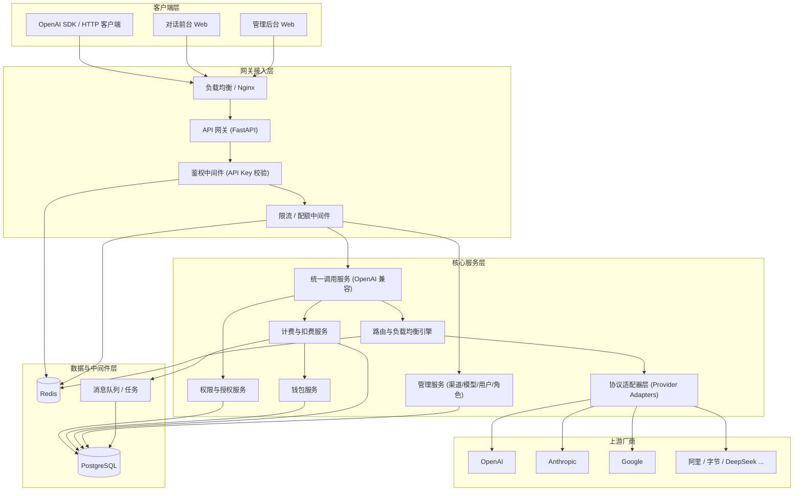
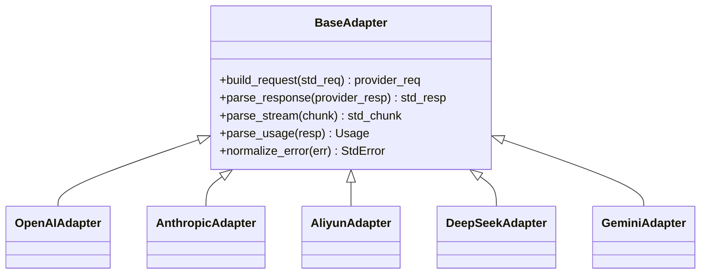

# 系统架构

> 返回 [PRD 索引](../PRD.md)

---

## 技术选型与理由

| 层 | 选型 | 理由 |
| --- | --- | --- |
| Web 框架 | **FastAPI** | 原生 `async/await` 适配高并发 IO 密集（转发上游）；对 **SSE/streaming** 支持友好（`StreamingResponse`）；Pydantic 强类型校验；自动生成 OpenAPI 文档便于联调。对比：Django 偏重、同步为主，DRF 适合 CRUD 但流式弱；Flask 生态成熟但异步与类型校验需大量手工。**推荐 FastAPI**。 |
| ASGI 服务器 | Uvicorn + Gunicorn（多 worker） | 生产环境多进程 + 异步事件循环，充分利用多核。 |
| 数据库 | **PostgreSQL** | 事务能力强（计费/扣费需强一致）；JSONB 存灵活配置；丰富索引；`SELECT ... FOR UPDATE` 行锁满足钱包并发扣费。 |
| ORM | SQLAlchemy 2.0（async）+ Alembic | 异步 ORM + 迁移管理。 |
| 缓存/限流/分布式锁 | Redis | 渠道健康状态、限流计数、API Key 鉴权缓存、预扣冻结的分布式锁。 |
| 异步任务 | Celery / APScheduler | 健康检查、用量聚合报表、对账。 |
| HTTP 客户端 | httpx（async，连接池） | 转发上游请求，支持流式。 |
| 前端-后台 | **React + TypeScript + Ant Design Pro** | 中后台组件齐全，开发效率高。 |
| 前端-对话前台 | React + TS + SSE/fetch stream | 流式渲染对话。 |
| 可观测性 | Prometheus + Grafana + OpenTelemetry + 结构化日志 | 指标、链路、日志三位一体。 |

## 分层架构图

## 核心数据流（统一调用，简述）

## 厂商接入可扩展性（适配器插件化）

每个 Provider 实现统一适配器接口（如 `BaseAdapter`），包含：请求转换、响应/流式转换、错误码归一、用量解析。新增厂商只需新增一个适配器实现并在数据库注册 Provider 类型，无需改动核心路由与计费逻辑。

