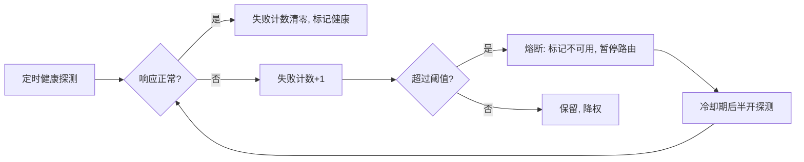

# 渠道管理

> 模块 / 菜单：后台 · 渠道管理  
> 返回 [PRD 索引](../PRD.md)

---

## 功能点

- Provider（厂商类型）维护：名称、适配器类型（决定协议转换实现）、默认 Base URL。
- 渠道（Channel）CRUD：所属 Provider、名称、Base URL、适配器类型、优先级、权重、状态（启用/禁用）、超时与重试配置。
- 渠道多 Key 管理：一个渠道下挂载多个上游 API Key，每个 Key 可独立启用/禁用、设置权重、单独限额（RPM/TPM）。
- 负载均衡与故障转移策略：渠道间按「优先级 + 权重」，渠道内 Key 按「加权轮询」。
- 健康检查：定时探活（轻量请求或 `/models`），记录连续失败次数、自动熔断与恢复。
- 渠道分组/标签（可选）：便于按业务线/环境隔离。

## 业务流程（健康检查与熔断）

## 关键规则

- 渠道选择顺序：仅在「启用 + 健康」渠道中，按优先级降序、同优先级按权重随机加权选择。
- Key 选择：渠道内仅在「启用 + 未超限额 + 未熔断」的 Key 中加权轮询。
- 熔断阈值与冷却时间可配置（默认连续失败 5 次熔断，冷却 60s 后半开）。
- 上游 Key 在数据库中**加密存储**（应用层 AES-GCM + KMS 主密钥），返回前端时脱敏（仅显示后 4 位）。

## 边界与异常

- 全部渠道不可用：返回 503，并记录告警事件。
- 单 Key 鉴权失败（401/403）：自动禁用该 Key 并告警，切换其他 Key。
- 上游限流（429）：降权该 Key/渠道，按退避策略重试其他可用资源。
- 配置变更：渠道/Key 配置更新需即时生效（通过 Redis 发布订阅或缓存失效）。
