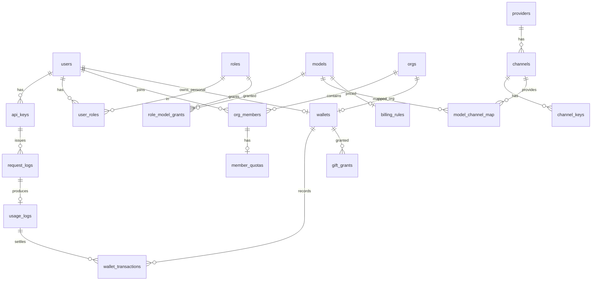

# 数据库设计

> 返回 [PRD 索引](../PRD.md)

> 落地 DDL 以 `DATABASE_DESIGN.md` 为准。

---

## ER 概览

## 核心数据表

> 通用约定：所有表含 `id (UUID/bigserial)`、`created_at`、`updated_at`；逻辑删除用 `deleted_at`/`status`；金额字段以**最小货币单位（整数，如厘=0.001元 或更细）**存储，避免浮点误差。

### users（用户）
| 字段 | 类型 | 说明 |
| --- | --- | --- |
| id | uuid PK | 用户ID |
| email | varchar unique | 登录邮箱 |
| password_hash | varchar | 密码哈希(bcrypt/argon2) |
| nickname | varchar | 昵称 |
| status | smallint | 0正常/1禁用 |
| default_billing_subject | varchar | 默认计费主体: personal / org:{id} |

### orgs（组织）
| 字段 | 类型 | 说明 |
| --- | --- | --- |
| id | uuid PK | 组织ID |
| name | varchar | 组织名 |
| owner_user_id | uuid FK | 创建者 |
| status | smallint | 状态 |

### org_members（组织成员）
| 字段 | 类型 | 说明 |
| --- | --- | --- |
| id | uuid PK | |
| org_id | uuid FK | 组织 |
| user_id | uuid FK | 用户 |
| org_role | varchar | owner/admin/member |
| can_consume_org_wallet | bool | 是否允许消费组织余额 |
| status | smallint | 状态 |
| | | 唯一约束(org_id,user_id) |

### member_quotas（成员额度）
| 字段 | 类型 | 说明 |
| --- | --- | --- |
| id | uuid PK | |
| org_member_id | uuid FK | 成员 |
| quota_period | varchar | none/daily/monthly |
| quota_limit | bigint | 周期额度上限(最小货币单位) |
| quota_used | bigint | 当期已用 |
| period_reset_at | timestamptz | 下次重置时间 |

### roles（角色，模型授权用）
| 字段 | 类型 | 说明 |
| --- | --- | --- |
| id | uuid PK | |
| name | varchar unique | 角色名 free/pro/internal |
| description | text | 描述 |

### user_roles（用户-角色）
| 字段 | 类型 | 说明 |
| --- | --- | --- |
| user_id | uuid FK | |
| role_id | uuid FK | |
| | | 联合主键(user_id, role_id) |

### role_model_grants（角色-模型授权矩阵）
| 字段 | 类型 | 说明 |
| --- | --- | --- |
| role_id | uuid FK | 角色 |
| model_id | uuid FK | 模型 |
| | | 联合主键(role_id, model_id) |

### api_keys（平台 API Key）
| 字段 | 类型 | 说明 |
| --- | --- | --- |
| id | uuid PK | |
| user_id | uuid FK | 所属用户 |
| key_hash | varchar unique | Key哈希(明文不存) |
| key_prefix | varchar | 前缀(展示用,如 sk-abc...) |
| name | varchar | 名称 |
| billing_subject | varchar | 绑定计费主体 personal/org:{id} |
| status | smallint | 启用/禁用 |
| last_used_at | timestamptz | 最后使用 |

### providers（厂商类型）
| 字段 | 类型 | 说明 |
| --- | --- | --- |
| id | uuid PK | |
| name | varchar | OpenAI/Anthropic/Aliyun... |
| adapter_type | varchar | 适配器标识 openai/anthropic/... |
| default_base_url | varchar | 默认地址 |

### channels（渠道）
| 字段 | 类型 | 说明 |
| --- | --- | --- |
| id | uuid PK | |
| provider_id | uuid FK | 所属厂商 |
| name | varchar | 渠道名 |
| base_url | varchar | 接入地址 |
| adapter_type | varchar | 协议适配器 |
| priority | int | 优先级(越大越优先) |
| weight | int | 权重 |
| status | smallint | 启用/禁用 |
| health_status | smallint | 健康/熔断/半开 |
| fail_count | int | 连续失败计数 |
| timeout_ms | int | 超时 |
| max_retries | int | 重试次数 |

### channel_keys（渠道上游密钥）
| 字段 | 类型 | 说明 |
| --- | --- | --- |
| id | uuid PK | |
| channel_id | uuid FK | 所属渠道 |
| api_key_encrypted | bytea | 上游Key密文(AES-GCM) |
| key_masked | varchar | 脱敏展示(后4位) |
| weight | int | 权重 |
| rpm_limit | int | 每分钟请求上限 |
| tpm_limit | int | 每分钟token上限 |
| status | smallint | 启用/禁用 |
| health_status | smallint | 健康/熔断 |

### models（模型）
| 字段 | 类型 | 说明 |
| --- | --- | --- |
| id | uuid PK | |
| alias | varchar unique | 对外模型名 |
| display_name | varchar | 展示名 |
| model_type | varchar | chat/embedding/rerank/image |
| capabilities | jsonb | 流式/函数调用/视觉/最大上下文 |
| visibility | varchar | public/role_restricted |
| status | smallint | 启用/禁用 |

### model_channel_map（模型-渠道映射）
| 字段 | 类型 | 说明 |
| --- | --- | --- |
| id | uuid PK | |
| model_id | uuid FK | 对外模型 |
| channel_id | uuid FK | 渠道 |
| upstream_model_name | varchar | 上游真实模型名 |
| weight | int | 该映射权重 |
| status | smallint | 启用/禁用 |

### billing_rules（计费规则，带版本）
| 字段 | 类型 | 说明 |
| --- | --- | --- |
| id | uuid PK | |
| model_id | uuid FK | 模型 |
| version | int | 版本号 |
| price_input | bigint | 输入单价(每1M token,最小货币单位) |
| price_output | bigint | 输出单价(每1M token) |
| price_cached_input | bigint | 缓存命中输入单价 |
| price_per_call | bigint | 按次价(可选) |
| cost_input | bigint | 上游成本输入单价(利润核算用) |
| cost_output | bigint | 上游成本输出单价 |
| multiplier | numeric(6,3) | 倍率 |
| min_charge_unit | bigint | 最小计费单位 |
| currency | varchar | 币种 |
| effective_at | timestamptz | 生效时间 |
| status | smallint | 启用/作废 |

### wallets（钱包）
| 字段 | 类型 | 说明 |
| --- | --- | --- |
| id | uuid PK | |
| owner_type | varchar | personal/org |
| owner_id | uuid | 用户ID或组织ID |
| balance | bigint | **现金池**可用余额(最小货币单位)，可退可提 |
| held | bigint | 现金池冻结额度 |
| gift_balance | bigint | **赠送池**可用余额，不可退不可提 |
| gift_held | bigint | 赠送池冻结额度 |
| currency | varchar | 币种 |
| credit_limit | bigint | 授信额度(默认0) |
| | | 唯一(owner_type, owner_id)；四个金额字段均 CHECK >= 0 |

### gift_grants（赠送批次，赠金账本）
| 字段 | 类型 | 说明 |
| --- | --- | --- |
| id | uuid PK | |
| wallet_id | uuid FK | 目标钱包(个人或组织) |
| amount | bigint | 发放金额 |
| remaining | bigint | 未消耗剩余(CHECK 0 <= remaining <= amount) |
| reason | varchar | promotion/compensation/internal/partnership/other |
| expires_at | timestamptz null | 到期时间；NULL=永久有效 |
| status | varchar | active/used_up/expired/revoked |
| granted_by | uuid FK | 发放操作人(管理员) |
| revoked_by | uuid FK null | 撤回操作人 |
| revoked_at | timestamptz null | 撤回时间 |
| idempotency_key | varchar | 发放幂等键，唯一(wallet_id, idempotency_key) |
| remark | text | 备注 |
| | | 索引(wallet_id, status, expires_at) 支撑 FIFO 取用与过期扫描 |

### wallet_transactions（钱包流水，仅追加）
| 字段 | 类型 | 说明 |
| --- | --- | --- |
| id | uuid PK | |
| wallet_id | uuid FK | 钱包 |
| type | varchar | recharge/hold/capture/release/refund/adjust/**gift_grant/gift_revoke/gift_expire** |
| amount | bigint | 变动总额(正负) |
| gift_amount | bigint | 其中赠送池部分(符号同 amount)；纯现金变动为 0 |
| balance_after | bigint | 变动后现金池余额 |
| held_after | bigint | 变动后现金池冻结 |
| gift_balance_after | bigint | 变动后赠送池余额 |
| gift_held_after | bigint | 变动后赠送池冻结 |
| gift_grant_id | uuid FK null | 关联赠送批次(gift_* 类型必填) |
| ref_request_id | varchar | 关联请求/幂等键 |
| operator_user_id | uuid | 实际发起成员(组织扣费分摊用) / 后台操作人 |
| remark | text | 备注 |
| | | 幂等：部分唯一索引(wallet_id, ref_request_id, type) |

### request_logs（请求日志）
| 字段 | 类型 | 说明 |
| --- | --- | --- |
| id | uuid PK | |
| request_id | varchar unique | 幂等/追踪ID |
| api_key_id | uuid FK | 调用Key |
| user_id | uuid FK | 用户 |
| billing_subject | varchar | 计费主体 |
| model_id | uuid FK | 模型 |
| channel_id | uuid FK | 实际命中渠道 |
| status | varchar | success/failed/partial |
| http_status | int | 返回码 |
| latency_ms | int | 时延 |
| is_stream | bool | 是否流式 |
| error_code | varchar | 错误码 |
| created_at | timestamptz | |

### usage_logs（用量与费用明细）
| 字段 | 类型 | 说明 |
| --- | --- | --- |
| id | uuid PK | |
| request_id | varchar FK | 关联请求 |
| input_tokens | int | 输入token |
| output_tokens | int | 输出token |
| cached_tokens | int | 缓存命中token |
| billing_rule_version | int | 命中的计费规则版本 |
| cost_amount | bigint | 上游成本 |
| charge_amount | bigint | 实际计费金额(总额) |
| gift_charge_amount | bigint | 其中赠送池抵扣部分(**不计入收入**) |
| cash_charge_amount | bigint | 其中现金池支付部分(**真实收入**) |
| is_estimated | bool | 是否估算(上游无usage) |
| created_at | timestamptz | |

> 约束：`gift_charge_amount + cash_charge_amount = charge_amount`。存量数据迁移时回填 `cash_charge_amount = charge_amount`、`gift_charge_amount = 0`。日聚合表 `usage_daily_summary` 同步新增 `gift_revenue_amount` / `cash_revenue_amount`。

### audit_logs（后台审计，可选）
| 字段 | 类型 | 说明 |
| --- | --- | --- |
| id | uuid PK | |
| actor_user_id | uuid | 操作人 |
| action | varchar | 操作类型 |
| target | varchar | 操作对象 |
| detail | jsonb | 变更详情 |
| created_at | timestamptz | |

## 关键索引与一致性
- `wallet_transactions(ref_request_id)`、`request_logs(request_id)` 唯一索引保证幂等。
- `request_logs(created_at)`、`usage_logs(created_at)` 分区/索引支撑报表聚合（数据量大可按月分区）。
- 钱包扣减事务内使用行级锁；流水表只追加不更新。
- 赠送池与现金池在**同一次 `SELECT ... FOR UPDATE` 事务内**一起变更，不引入第二把锁。
- 赠金账本不变式（每日对账任务校验）：`Σ gift_grants.remaining (status=active) == wallets.gift_balance + wallets.gift_held`。

---
