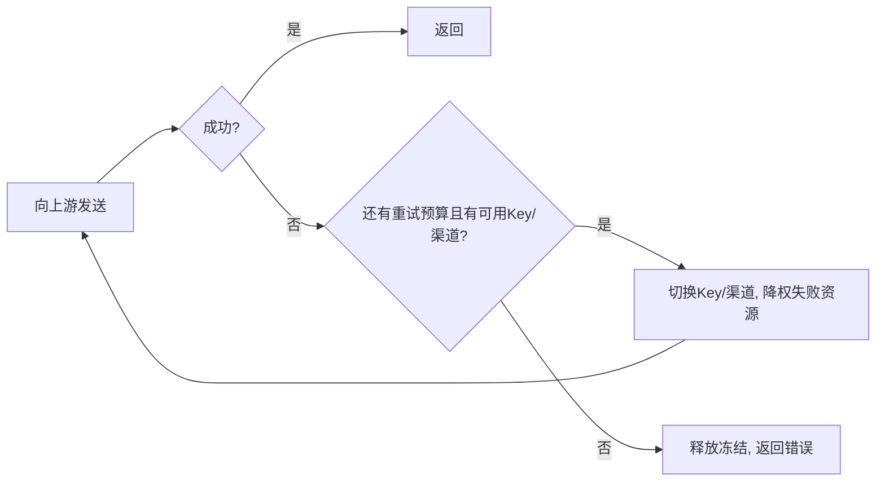

# 统一调用网关

> 模块：对外 OpenAI 兼容 API（非后台菜单，核心能力）  
> 返回 [PRD 索引](../PRD.md)

> 详细时序见 [核心业务流程](./workflows.md)；接口示例见 [关键 API](./api.md)。

---

## 能力范围

- 统一 Base URL + 平台 API Key，兼容 OpenAI 协议。
- 一期：`POST /v1/chat/completions`（流式 + 非流式）、`GET /v1/models`。
- 后续：`embeddings` / `rerank` / `images` 等按需扩展。

## 调用链路（简述）

1. API Key 鉴权 + 限流 / 配额  
2. 解析模型别名 + 角色授权校验  
3. 计费预扣（冻结）  
4. 按优先级 / 权重 / 健康度选渠道与 Key  
5. 适配器转换并转发上游  
6. 流式 / 非流式返回  
7. 按真实用量实扣 + 写用量与流水  

## 路由与故障转移

- 仅在「启用 + 健康」的映射渠道中选择。
- 上游失败（超时 / 5xx / 429 / Key 失效）时，在重试预算内切换同渠道其他 Key 或其他渠道。
- 全部失败：释放冻结并返回错误（失败不计费）。

## 关键规则

- 对外模型名决定候选渠道集合（见 [模型管理](./models.md)）。
- 错误码与 OpenAI 习惯对齐，并补充业务码（余额不足、无渠道等），见 [关键 API](./api.md)。
