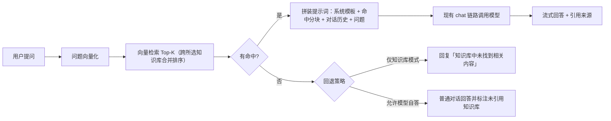
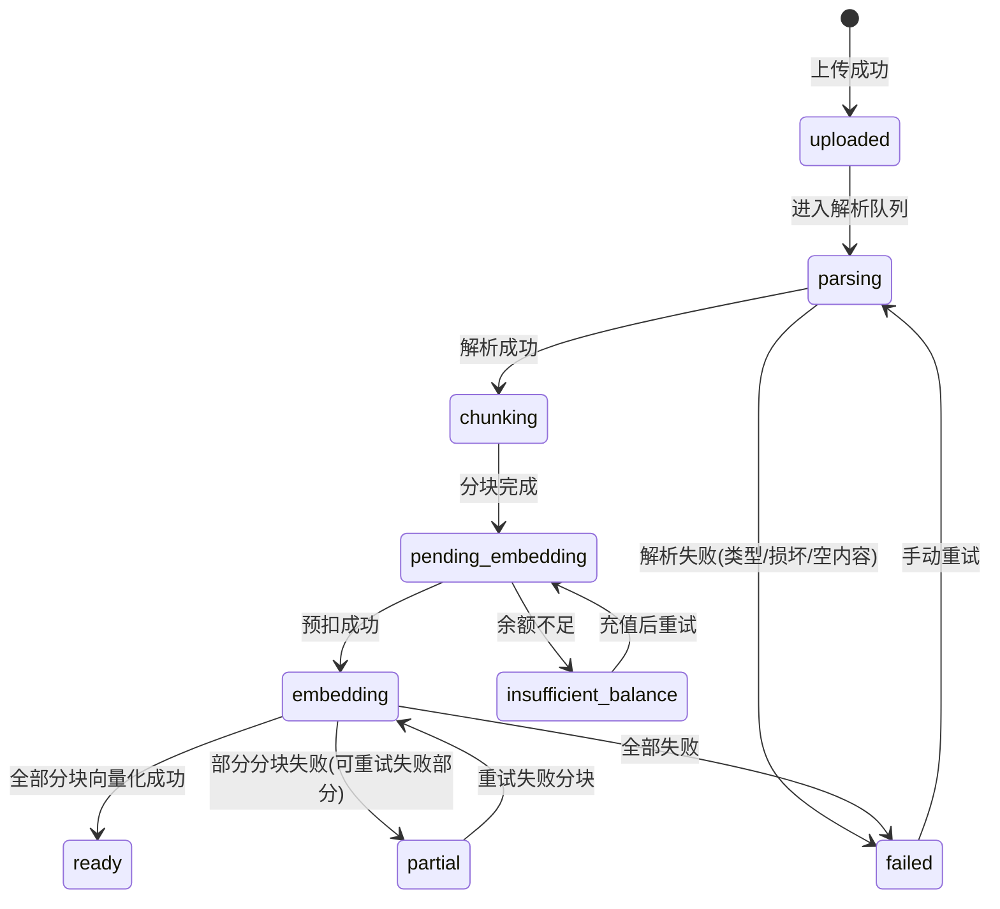

# 知识库（RAG 问答）

> 模块 / 菜单：前台 · 知识库；后台 · 知识库管理  
> 返回 [PRD 索引](../PRD.md)

> 状态：**已落地**（知识库专项，位于二期之后）。开发任务拆分见 [`AI_TASK_BREAKDOWN_KB.md`](../AI_TASK_BREAKDOWN_KB.md)；部署与验收见 [`DEPLOYMENT.md`](../DEPLOYMENT.md)、[`VALIDATION_PLAN.md`](../VALIDATION_PLAN.md)。

---

## 背景与目标

平台已完成「统一调用 + 计费 + 个人/组织钱包」闭环，前台 Chat 仅能基于模型自身知识回答。用户存在大量私有资料（产品手册、内部制度、技术文档等），希望让模型基于这些资料回答问题。

本模块为前台用户提供**知识库（Knowledge Base, KB）**能力：

```text
用户上传文件 → 平台解析、分块、向量化入库 → 用户可人工调整分块以提高检索质量
→ Chat 对话时选择知识库，平台检索相关内容注入上下文 → 模型基于知识回答并标注引用来源。
```

产品目标：

| 维度 | 目标 |
| --- | --- |
| 易用性 | 上传即用：拖拽上传 → 自动解析分块向量化 → 对话可选，全程无需理解 RAG 概念 |
| 可调优 | 分块可视、可编辑、可禁用，配合命中测试，让用户能自助提升检索准确率 |
| 商业化 | 向量化与问答均走现有计费链路（embedding / chat token 计费），带来新的用量增长 |
| 复用性 | 向量化调用复用平台自身网关（路由、适配器、预扣实扣），不另建旁路 |

## 用户故事

| 编号 | 用户故事 | 验收标准 |
| --- | --- | --- |
| KB-U1 | 作为用户，我可以创建/编辑/删除自己的知识库 | 知识库按用户隔离；删除需二次确认并级联清理文档与向量 |
| KB-U2 | 作为用户，我可以向知识库上传多种类型的文件 | 支持 TXT / Markdown / PDF / Word(docx) / HTML / CSV·Excel；超类型或超大小时明确报错 |
| KB-U3 | 作为用户，我可以看到每个文档的处理进度和结果 | 文档状态机可见（解析中/分块中/向量化中/就绪/失败）；失败可见原因并可重试 |
| KB-U4 | 作为用户，我可以查看并调整文档的分块内容 | 分块可分页浏览、搜索；可编辑内容、启用/禁用、删除、手动新增；编辑后自动重新向量化 |
| KB-U5 | 作为用户，我可以调整分块策略并重新分块 | 分块参数（大小/重叠/分隔符）文档级可改；重新分块前提示将覆盖人工编辑 |
| KB-U6 | 作为用户，我可以用命中测试验证检索效果 | 输入问题返回 Top-K 分块及相似度分数，可定位到所属文档 |
| KB-U7 | 作为用户，我在 Chat 页可以选择知识库进行问答 | 会话可挂载 1..N 个知识库；回答附引用来源；未命中时按配置的策略处理 |
| KB-U8 | 作为用户，我的向量化与问答费用清晰可查 | 向量化按 embedding 计费规则扣个人钱包；用量明细可区分「知识库处理」来源 |
| KB-U9 | 作为运营，我可以查看和管控知识库使用情况 | 后台可查各用户知识库数/文档数/存储量/向量化用量；可禁用违规知识库 |
| KB-U10 | 作为管理员，我可以配置知识库全局参数 | 可配默认 embedding 模型、文件大小上限、角色级配额 |

## 功能设计

### 1. 知识库管理（前台菜单：知识库）

- 知识库 CRUD：名称、描述、（可选）封面图标。
- 归属：本期仅**个人知识库**（按用户隔离）；组织共享知识库列入后续增强（见「边界」）。
- 库级配置（创建时默认值即可用，进阶用户可改）：
  - **embedding 模型**：默认取系统配置的默认嵌入模型；创建后不可更换（更换意味着全量重嵌入，后续以「重建索引」功能支持）。
  - **默认分块参数**：分块大小（token 数，默认 500）、重叠（默认 50）、分隔符优先级（默认按标题/段落/句子）。新上传文档继承库默认，文档级可覆盖。
  - **默认检索参数**：Top-K（默认 5）、相似度阈值（默认 0.35）、是否启用重排（后续）。
- 列表页展示：文档数、分块数、存储占用、最近更新时间、状态。

### 2. 文档上传与解析

- 上传方式：单文件 / 批量拖拽上传；后续支持粘贴纯文本直接建文档。
- 支持类型（首期）：

| 类型 | 扩展名 | 解析要点 |
| --- | --- | --- |
| 纯文本 | .txt | 直接读取，自动识别编码（UTF-8 优先） |
| Markdown | .md | 保留标题层级，供结构化分块 |
| PDF | .pdf | 文本层提取；纯扫描件（无文本层）报「暂不支持」，OCR 列入后续 |
| Word | .docx | 提取正文与标题层级；.doc 老格式不支持 |
| 网页 | .html | 去标签提取正文 |
| 表格 | .csv / .xlsx | 按行转文本（表头 + 行值拼接），每若干行一个分块 |

- 限制（默认值，后台可配）：单文件 ≤ 20MB；单次批量 ≤ 10 个文件；文件名/内容做基础安全校验（真实类型嗅探，不只看扩展名）。
- 上传后进入**异步处理流水线**（解析 → 分块 → 向量化），前台轮询/推送进度；处理不阻塞页面。
- 同名文件重复上传：默认作为新文档并存，用户可手动删除旧版；「覆盖更新」列入后续。

### 3. 分块（Chunking）

- 默认策略：**结构优先 + 长度约束**——先按标题/段落等结构切分，超过分块大小上限再按句子二次切分，相邻分块保留重叠区。
- 文档级参数可调：分块大小（100–2000 token）、重叠（0–200 token）、自定义分隔符。
- 每个分块记录：序号、内容、token 数、来源位置（页码/标题路径，尽力而为）、启用状态、是否人工编辑过。
- **重新分块**：调整参数后可对单文档重新分块；执行前明确提示「将删除该文档现有分块及人工编辑，并重新计费向量化」。

### 4. 向量化（Embedding）与索引

- 向量存储：PostgreSQL + **pgvector** 扩展（复用现有主库，降低运维成本；量级见「非功能性需求」）。
- 向量化调用**复用平台网关内部链路**（模型解析 → 路由选渠道 → 适配器 → 用量记录），即平台「吃自己的狗粮」：
  - 使用 `models.model_type = 'embedding'` 的模型，走既有 embedding 计费规则。
  - 批量分块合并请求（每批 ≤ N 条），控制并发，避免打爆上游与触发限流。
- 费用从**文档所属用户的个人钱包**扣除，复用预扣/实扣/释放：
  - 上传解析完成后按分块 token 总量**估算预扣**；余额不足则文档停在「待向量化-余额不足」状态，充值后可重试。
  - 向量化完成按实际用量实扣，多余释放；失败分块不计费。
- 单个分块编辑后仅重嵌入该分块（增量计费，费用极小）。

### 5. 分块管理与人工调整（核心差异化能力）

文档详情页 = 分块工作台：

- **浏览**：分页展示分块（序号、内容摘要、token 数、状态），支持按关键词搜索分块。
- **编辑**：修改分块内容（修正解析错误、补充上下文关键词）；保存后该分块自动重新向量化，并标记「人工编辑」。
- **启用/禁用**：噪音分块（页眉页脚、目录、免责声明等）可一键禁用，不参与检索但保留可恢复。
- **删除**：物理删除分块及其向量。
- **手动新增**：在任意位置插入自定义分块（如 FAQ 问答对），等同上传内容的补丁。
- 批量操作：多选禁用/启用/删除。

### 6. 检索与命中测试

- 检索方式（首期）：**向量相似度检索**（cosine），过滤禁用分块，按分数排序取 Top-K，低于阈值丢弃。
- 混合检索（向量 + 关键词/BM25）与 rerank 重排列入后续增强（见「里程碑」KB-M3）。
- **命中测试页**（库级工具）：输入模拟问题 → 展示 Top-K 命中分块、相似度分数、所属文档；用于用户调优分块与阈值。命中测试的 query 向量化按 embedding 计费（费用极小，页面明示）。

### 7. Chat 知识库问答（RAG）

- 会话级开关：Chat 页新增「知识库」选择器，可为当前会话挂载 1..N 个自己的知识库（会话设置随会话持久化）。
- 问答链路（由前台 BFF/编排服务完成，**不改动对外 `/v1/chat/completions` 协议**）：



- **上下文预算**：注入分块总 token 不超过模型上下文的可配比例（默认 ≤ 40% 或 4000 token，取小），超出按分数截断，保证历史对话与回答空间。
- **引用来源**：回答下方展示引用的分块列表（文档名 + 分块摘要 + 分数），点击可跳转到该文档分块详情；引用信息随会话历史持久化。
- **未命中策略**（会话可配，默认「允许模型自答」）：仅知识库模式（严格）/ 允许模型自答（宽松）。
- 计费：问题向量化按 embedding 计费 + 对话按现有 chat 计费；注入的分块计入输入 token，由现有链路自然计费，无需新计费维度。

### 8. 计费与配额

- **不新增计费维度**：向量化/检索 query = embedding token 计费；问答 = chat token 计费；均复用 [billing.md](./billing.md) 规则与钱包链路。
- **存储配额制（首期不按存储计费）**，角色级配额（默认值，后台可按角色配置）：

| 配额项 | 默认值 |
| --- | --- |
| 知识库数量 / 用户 | 5 |
| 文档数 / 知识库 | 100 |
| 原文件存储总量 / 用户 | 1GB |
| 单文件大小 | 20MB |

- 超配额时前台明确提示，不产生任何扣费。
- 后续可评估：存储按月计费、向量化打包套餐（与 D1 纯按量基线冲突，暂不实施）。

### 9. 权限

- 知识库严格按用户隔离；命中测试、分块管理仅库主可见。
- Chat 挂载知识库时校验归属，越权返回 403。
- embedding 模型是否可用受现有「角色-模型授权矩阵」约束；若用户无任何可用 embedding 模型授权，则无法创建知识库（前台提示联系管理员）。
- 后台管理员可查看知识库元数据（名称/统计/状态）与审计，**默认不可见文档正文与分块内容**（合规），特权查看需审计留痕。

## 文档处理状态机



- `ready` / `partial` 状态的文档中，已向量化且启用的分块即参与检索（partial 不阻塞可用性）。
- 每次状态流转记录时间与错误信息，前台可见。

## 数据库设计概览

> 详细 DDL 落地到 `DATABASE_DESIGN.md` 后再开发；此处仅定口径。

| 表 | 说明 |
| --- | --- |
| `knowledge_bases` | 知识库：owner_user_id、名称、描述、embedding 模型、默认分块/检索参数、统计冗余（文档数/分块数/存储量）、状态 |
| `kb_documents` | 文档：所属库、文件名、类型、大小、原文件存储地址、分块参数快照、状态机字段、错误信息、token 统计 |
| `kb_chunks` | 分块：所属文档/库、序号、内容、token 数、来源位置、启用状态、人工编辑标记、`embedding vector(n)`（pgvector，建 HNSW/IVFFlat 索引） |
| `kb_ingest_jobs` | 处理任务：类型（解析/分块/向量化/重建）、状态、进度、关联预扣 hold、幂等键 |

修改表：

- `usage_logs` / `request_logs`：增加来源标记（`source = chat / api / kb_ingest / kb_query`），用量页可按来源区分。
- `chat_sessions`（会话表）：增加会话挂载的知识库列表与未命中策略；消息记录增加引用分块快照。
- `roles` 或角色配置：增加知识库配额字段组。

## 关键 API 概览

> 前台 REST（JWT 鉴权），详细契约落地到 `API_CONTRACT.md`。**对外 `/v1/*` 网关协议本期不变。**

| 方法与路径 | 说明 |
| --- | --- |
| `GET/POST/PATCH/DELETE /kb` | 知识库 CRUD |
| `POST /kb/{id}/documents`（multipart） | 上传文档（批量） |
| `GET /kb/{id}/documents` / `GET /kb/documents/{doc_id}` | 文档列表 / 详情（含状态与进度） |
| `POST /kb/documents/{doc_id}/retry` | 失败/部分失败重试 |
| `POST /kb/documents/{doc_id}/rechunk` | 按新参数重新分块（含确认语义） |
| `GET /kb/documents/{doc_id}/chunks` | 分块分页查询（支持关键词过滤） |
| `PATCH /kb/chunks/{chunk_id}` | 编辑内容 / 启用禁用 |
| `DELETE /kb/chunks/{chunk_id}` / `POST /kb/documents/{doc_id}/chunks` | 删除 / 手动新增分块 |
| `POST /kb/{id}/hit-test` | 命中测试 |
| `POST /chat/kb-completions`（或现有会话接口扩展参数） | 带知识库的对话（检索编排 + 流式返回 + 引用） |

## 对历史功能的优化与改动

> 本节即「历史功能优化」清单：知识库落地所需对既有模块的增强，按模块列出。

| 模块 | 改动 | 类型 |
| --- | --- | --- |
| 用户端 Chat（[chat.md](./chat.md)） | 会话知识库选择器、引用来源展示、未命中策略设置；会话历史持久化引用信息 | 功能增强 |
| 用户端 Chat | 会话设置面板重构：模型参数与知识库设置统一收纳，为后续更多会话级能力（系统提示词等）留位 | 体验优化 |
| 模型管理（[models.md](./models.md)） | 后台增加「系统默认 embedding 模型」配置；embedding 模型在授权矩阵、`/v1/models` 中的展示口径明确（前台 Chat 模型选择器不展示 embedding 模型） | 功能增强 |
| 计费规则（[billing.md](./billing.md)） | embedding 模型未配置计费规则时禁止被设为知识库模型（沿用「无规则拒绝调用」原则）；大批量向量化的预扣估算策略（按解析后 token 总量）补充进结算口径 | 规则补充 |
| 统一调用网关（[gateway.md](./gateway.md)） | 内部向量化流量复用路由/适配器/用量链路，需支持「内部调用方」标识（不占用用户 API Key，鉴权走服务内部身份，计费主体为文档所属用户） | 架构增强 |
| 限流 | 向量化批处理纳入渠道 Key RPM/TPM 预算，采用低优先级队列，避免与在线 chat 争抢；用户级向量化并发上限（默认 2 个文档并行） | 稳定性优化 |
| 用量与钱包（[wallet.md](./wallet.md)） | 用量明细与流水增加来源维度（chat / api / kb_ingest / kb_query），前台用量页支持按来源筛选 | 功能增强 |
| 管理后台（[admin.md](./admin.md)） | 新增「知识库管理」菜单：全局参数配置、用户维度统计（库数/文档数/存储/向量化用量）、违规禁用；运营看板增加向量化用量指标 | 功能增强 |
| 角色权限（[users-permissions.md](./users-permissions.md)） | 角色增加知识库配额字段组（库数/文档数/存储/单文件上限） | 功能增强 |
| 基础设施 | 文件存储抽象（本地磁盘起步，接口兼容 S3/OSS）；异步任务从「进程内定时任务」升级为可靠后台 worker（含重试与幂等），现有对账任务可一并迁移 | 架构优化 |
| 可观测性（[nfr.md](./nfr.md)） | 新增指标:文档处理时长/失败率、向量化 token 吞吐、检索延迟 P95、命中率（有命中的问答占比） | 运维增强 |

## 非功能性需求

- **性能**：单库 10 万分块内，向量检索 P95 ≤ 500ms（HNSW 索引）；20MB PDF 端到端处理（解析→就绪）P95 ≤ 5 分钟。
- **规模假设**：首期按 单用户 ≤ 50 万向量、全平台 ≤ 5000 万向量设计；超出后评估独立向量库（Qdrant/Milvus），表结构预留 `embedding_model` 与维度字段以便迁移。
- **安全**：上传文件真实类型嗅探与大小校验；原文件与分块内容仅库主可访问；文件存储路径不可预测；删除即物理清理（原文件 + 分块 + 向量）。
- **一致性**：向量化任务幂等（同文档同版本不重复计费）；文档删除与向量删除最终一致，残留由对账任务清理。
- **合规**：知识库内容属用户数据，遵循与会话正文相同的保留与导出策略（见 `MVP_SCOPE.md` 变更控制第 5 条口径）。

## 边界（本期不做）

| 能力 | 暂缓理由 |
| --- | --- |
| 组织共享知识库 | 需组织内知识库角色/可见性设计，待个人链路稳定后作为组织域增强 |
| 网页 URL 抓取、第三方数据源同步（Notion/飞书等） | 抓取合规与增量同步复杂度高 |
| 扫描件 OCR、图片/音视频理解 | 依赖多模态解析能力，成本与质量待评估 |
| GraphRAG、父子分块、语义分块等高级策略 | 先用「结构优先分块 + 人工调整」验证价值 |
| 知识库对外 API（`/v1` 扩展 `kb_ids` 参数） | 避免破坏 OpenAI 兼容性；待前台验证后再定对外协议 |
| 知识库公开分享 / 市场 | 涉及内容审核与分成，超出当前商业模型 |

## 里程碑与交付顺序

| 里程碑 | 内容 | 出口标准 |
| --- | --- | --- |
| KB-M1 处理流水线 | 知识库/文档 CRUD、上传解析（6 类文件）、自动分块、向量化入库（含预扣实扣）、状态机与重试、命中测试 | 上传一份 PDF 后可在命中测试中检索到正确分块，钱包产生对应 embedding 扣费流水 |
| KB-M2 调优与问答闭环 | 分块工作台（编辑/禁用/删除/新增/重新分块）、Chat 挂载知识库、RAG 编排、引用来源展示、未命中策略、用量来源标记 | Chat 中基于知识库提问可得到带引用的正确回答；编辑分块后检索结果随之改善 |
| KB-M3 增强与运营 | 后台知识库管理与配额、混合检索/rerank（可选）、批量操作、覆盖更新、运营指标看板 | 后台可管控配额与违规库；检索准确率相对 KB-M1 有可量化提升 |

KB-M1 → KB-M2 串行；KB-M3 内各项可独立排期。基础设施改造（文件存储抽象、后台 worker）随 KB-M1 先行。

## 验收口径

- 上传 TXT/MD/PDF/DOCX/HTML/XLSX 各一份，全部到达 `ready`，分块与向量数量一致。
- 向量化产生 usage log（`source=kb_ingest`）与钱包 hold/capture 流水；余额不足时文档停在待处理状态且无任何扣费。
- 禁用某分块后，命中测试与 Chat 检索均不再返回该分块；重新启用后恢复。
- 编辑分块内容后，用与新内容强相关的问题做命中测试，该分块排名提升。
- Chat 挂载知识库提问：回答包含引用来源且可定位分块；卸载知识库后同一问题回退普通回答。
- 「仅知识库模式」下提问库外问题，返回「未找到相关内容」且不注入无关分块。
- 挂载他人知识库 ID 请求返回 403，无任何检索与扣费。
- 删除知识库后，原文件、分块、向量全部清理，钱包与用量历史保留。
- 触达角色配额上限（库数/文档数/存储）时被拒绝且提示明确。

## 风险与决策点

| 风险 / 决策 | 说明 | 倾向 |
| --- | --- | --- |
| 向量库选型 | pgvector（复用主库、运维简单） vs 独立向量库（性能上限高） | 首期 pgvector，规模阈值见 NFR，超出再迁移 |
| RAG 编排位置 | 前台编排服务（不动 `/v1` 协议） vs 网关扩展参数 | 首期前台编排，保住 OpenAI 兼容纯净性 |
| 向量化计费主体 | 用户个人钱包 vs 平台补贴 | 用户付费（透明、防滥用），费用页面明示预估 |
| 解析质量 | PDF 复杂版式（双栏/表格）解析质量不可控 | 分块工作台人工调整兜底 + 解析器可替换设计 |
| 大文件滥用 | 超大文件反复上传消耗上游额度 | 配额 + 单文件上限 + 向量化低优先级队列 |
| embedding 模型更换 | 换模型需全量重嵌入 | 库级锁定模型；「重建索引」作为独立后续功能 |
