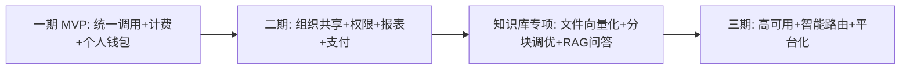

# MVP 范围与迭代规划

> 返回 [PRD 索引](../PRD.md)

> 一期落地范围以 `MVP_SCOPE.md` 为准；二期落地范围以 `PHASE2_SCOPE.md` 为准。

---

## 一期（MVP）：跑通「统一调用 + 计费 + 个人钱包」
- 渠道管理：Provider/渠道/多 Key CRUD、启用禁用、基础健康检查、优先级权重路由、故障转移。
- 模型管理：模型 CRUD、模型-渠道映射、别名、`/v1/models`。
- 适配器：OpenAI、Anthropic、DeepSeek（覆盖主流，含流式）。
- 统一调用：`/v1/chat/completions`（流式+非流式）、OpenAI 兼容鉴权与错误码。
- 计费规则：按 Token（输入/输出/缓存）+ 倍率 + 最小计费单位；版本化。
- 钱包：个人钱包充值（后台手动）、预扣/实扣、流水、用量查询。
- 用户与权限：注册登录、API Key 管理、角色与模型授权矩阵。
- 后台：上述模块的管理界面 + 基础运营数据。
- 前台：Chat 对话（流式、模型选择）、个人钱包、Key 管理、用量查看。

## 二期：组织与商业化增强
- 组织钱包、组织成员、成员额度/消费开关、个人/组织余额共享与扣费主体选择。
- 角色权限矩阵增强、数据权限隔离。
- 在线支付充值、运营报表（成本/收入/利润、Top 维度）。
- 更多厂商适配器（阿里、字节、Google 等）、embeddings/rerank。
- 请求头动态指定计费主体、Key 级模型范围与限额。

## 知识库专项（二期后）：RAG 知识库问答
> 详见 [知识库模块 PRD](./knowledge-base.md)。
- KB-M1 处理流水线：知识库/文档管理、多类型文件上传解析（TXT/MD/PDF/DOCX/HTML/XLSX）、自动分块、向量化入库（pgvector、复用 embedding 计费）、状态机与重试、命中测试。
- KB-M2 调优与问答闭环：分块工作台（编辑/禁用/删除/新增/重新分块）、Chat 会话挂载知识库、RAG 检索编排、引用来源展示、未命中策略、用量来源标记。
- KB-M3 增强与运营：后台知识库管理与角色配额、混合检索/rerank（可选）、批量操作、运营指标看板。
- 历史功能配套优化：Chat 会话设置面板、默认 embedding 模型配置、内部调用方标识、向量化低优先级限流、用量来源维度、文件存储抽象与后台 worker。

## 三期：高可用与平台化
- 多区域部署、租户隔离、私有化交付。
- 高级路由（按延迟/成本/质量智能路由）、灰度与 A/B。
- 授信额度、预算告警、自动充值。
- 缓存（语义缓存）、内容安全审核、合规审计增强。

---
