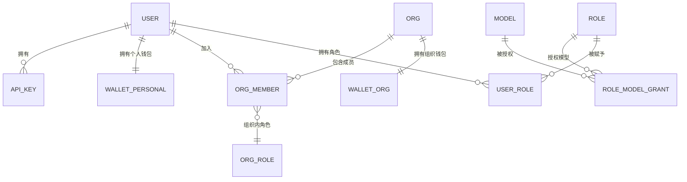
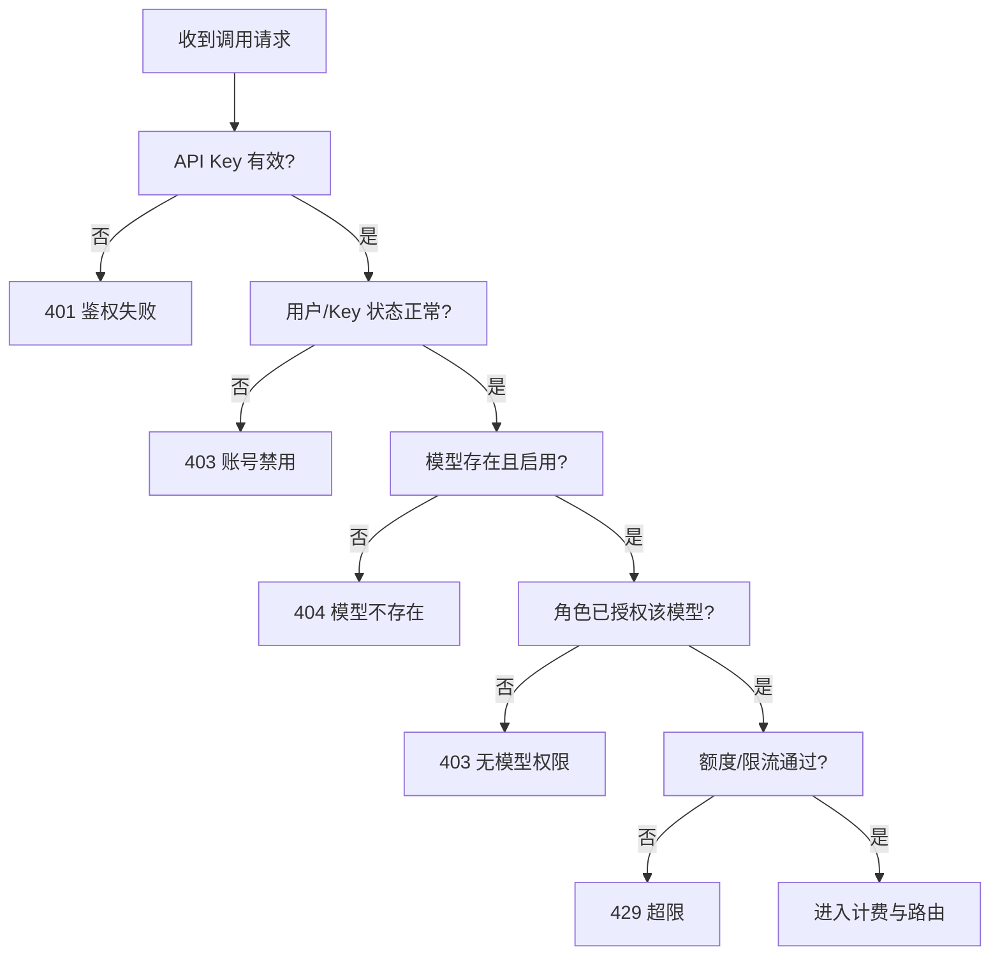

# 用户与权限

> 模块 / 菜单：后台 · 用户管理 / 角色权限；前台 · 账号与 API Key  
> 返回 [PRD 索引](../PRD.md)

> 组织成员与组织内角色见 [组织管理](./organizations.md)。  
> **Role（模型授权角色）** 与 **组织角色** 是两套正交概念：前者控制「能调用哪些模型」，后者控制「在组织内能做什么管理操作」。

---

## 主体与关系

平台存在两类「身份」维度：

- **资金 / 归属维度**：个人（User）与组织（Organization）。
- **权限维度**：平台管理员（运营方）、组织角色、模型授权角色（Role）。

## 角色类型定义

| 角色 | 范围 | 职责 | 说明 |
| --- | --- | --- | --- |
| 平台超级管理员 | 全平台 | 系统配置、渠道/计费/全局运营 | 运营方使用，最高权限 |
| 平台运营/财务 | 全平台 | 计费规则、对账、报表、退款 | 可拆分细粒度后台角色 |
| 组织 Owner | 单组织 | 组织钱包充值、成员管理、额度分配 | 见组织管理 |
| 组织 Admin | 单组织 | 成员/额度管理（不含资金提现） | 见组织管理 |
| 组织 Member | 单组织 | 在配额内消费组织余额、调用模型 | 见组织管理 |
| 注册用户（个人） | 个人 | 个人钱包、个人 Key、调用模型 | 默认身份 |

## 功能点

- 注册/登录：邮箱+密码、邮箱验证；支持 OAuth/SSO。
- 身份认证：前台会话用 JWT；API 调用用平台 API Key（`Authorization: Bearer sk-xxx`）。
- API Key 管理：创建/命名/查看（仅创建时全量展示一次）/禁用/删除/轮换；可设置 Key 级别限额与可用模型范围（可选，二期）。
- 角色管理：角色 CRUD、角色绑定可用模型（授权矩阵）、用户-角色分配。

## 模型授权矩阵（Role ↔ Model）

通过 `role_model_grants` 实现「角色 → 可用模型集合」的多对多绑定。用户可被赋予一个或多个 Role，其可用模型 = 所有 Role 授权模型的并集。

示例授权矩阵：

| 角色 \ 模型 | gpt-4o | gpt-4o-mini | claude-3.7 | deepseek-chat | gemini-2.0 |
| --- | :---: | :---: | :---: | :---: | :---: |
| free（免费） | ✗ | ✓ | ✗ | ✓ | ✗ |
| pro（付费） | ✓ | ✓ | ✓ | ✓ | ✓ |
| internal（内部） | ✓ | ✓ | ✗ | ✓ | ✗ |

## 权限校验顺序（调用链）

## 关键规则

- API Key 仅存哈希（如 SHA-256）+ 前缀展示，明文不落库。
- API Key 维度可绑定**模型白名单子集**与**消费主体（个人/组织）**，实现细粒度控制。
- 一个用户可属于多个组织；调用时可指定使用哪个主体计费（见 [钱包](./wallet.md)）。
- 用户可用模型 = 个人角色授权 ∪（若以组织身份调用）组织侧相关授权。
- 超级管理员操作敏感资源（渠道密钥、计费规则）需记录审计日志。
- 权限模型采用 RBAC；更细粒度 ABAC（按 Key / 时间段）二期评估。

## 边界与异常

- Key 泄露/轮换：旧 Key 立即失效，正在进行的请求不受影响。
- 删除用户：软删除，保留历史用量与流水以供审计/对账。
