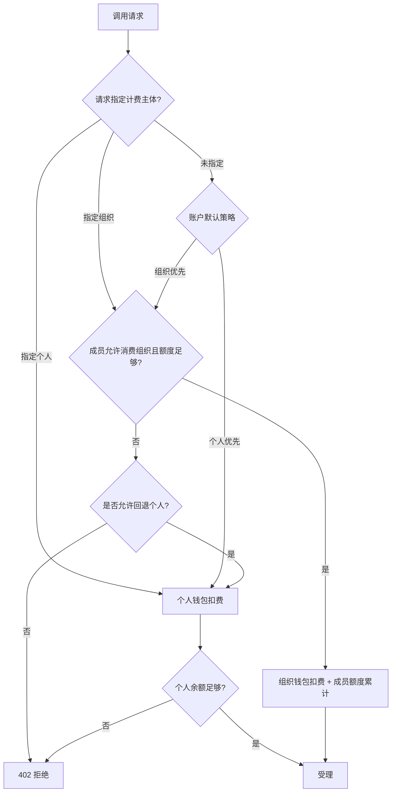
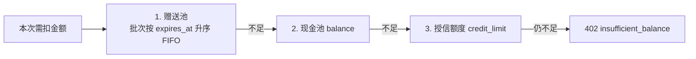

# 钱包与流水

> 模块 / 菜单：后台 · 钱包管理；前台 · 个人钱包 / 组织钱包  
> 返回 [PRD 索引](../PRD.md)

> 计费单价与公式见 [计费规则](./billing.md)；组织额度见 [组织管理](./organizations.md)；预扣实扣时序见 [核心业务流程](./workflows.md)。

---

## 功能点

- 钱包主体：**个人钱包**（每用户一个）与**组织钱包**（每组织一个）。
- 每个钱包内含两个**资金池**：**现金池**（用户充值/后台调账，可退可提）与**赠送池**（平台赠送，不可退不可提，见下方「赠送余额」）。
- 充值：个人/组织充值（对接支付，MVP 可后台手动充值）。
- 赠送：后台向个人/组织钱包发放赠送余额，支持有效期、撤回、过期作废。
- 扣费主体选择：
  - 方式一：从**个人余额**扣费。
  - 方式二：消费**所属组织余额**（共享组织钱包）。
- 财务记录：余额流水（充值/赠送/扣费/冻结/释放/退款/过期）、消费明细（按模型/用户/组织/资金来源维度）、用量统计与报表。
- 后台：充值 / 赠送 / 撤回赠送 / 调账 / 冻结钱包。

## 扣费主体决策

---

## 赠送余额（Gift Credit）

> 场景：营销拉新 / 活动发放、客诉补偿、内部测试与商务试用、渠道合作。  
> 相关决策：[D4–D7](./risks.md#已确认的产品决策)。

### 为什么必须与充值余额**物理隔离**（而不是只加一条备注流水）

| 维度 | 充值余额（现金池） | 赠送余额（赠送池） |
| --- | --- | --- |
| 资金性质 | 用户预付款，会计上是**负债** | 平台**营销费用**，非用户资产 |
| 可退款 / 可提现 | 是 | **否**（不可退、不可提、不可转移、不可跨钱包划转） |
| 有效期 | 无 | **有**（可配置，到期作废） |
| 计入平台收入 | 是 | **否**（消费时确认为费用，不是收入） |
| 可撤回 | 否（只能反向调账） | 是（仅未消耗部分） |

结论：赠金若与现金混在同一个 `balance` 里，会同时破坏**退款上限计算**、**收入/毛利口径**与**过期作废能力**，因此必须分池记账。

### 数据结构（概念）

- 钱包新增赠送池字段：`gift_balance`（赠送可用）、`gift_held`（赠送冻结中）；原 `balance` / `held` 语义收敛为**现金池**。
- 赠金按**批次（Grant）**发放，`gift_grants` 表记录：金额、剩余、有效期、发放原因、操作人、状态（`active` / `used_up` / `expired` / `revoked`）。
- 不变式：`Σ(active 批次 remaining) == wallets.gift_balance + wallets.gift_held`（对账任务每日校验）。

> 为什么要批次表而不是单一 `gift_balance` 字段：多次赠送有不同有效期，必须能按批次分别到期与撤回；财务也需要核销「发出多少 / 用掉多少 / 过期多少」。

### 扣减优先级

- 可用额判定统一为：`available = gift_balance + balance + credit_limit`。
- 赠送池内部按 `expires_at` 升序（**先过期的先花**），同到期时间按 `created_at` 升序；永久有效批次排最后。

### 预扣（Hold）与实扣（Capture）的跨池分摊

两阶段计费下一次调用可能**同时占用两个池**，规则如下：

1. **Hold**：按上述优先级把预估金额**顺序**拆成 `gift_hold` + `cash_hold`，分别从两池冻结；hold 流水记录拆分结果。
2. **Capture（`actual ≤ hold`）**：退还 `hold - actual`，按占用的**逆序**退回（先退现金部分，再退赠送部分）。这与「直接用 `actual` 按优先级重新分摊」结果完全等价，保证「赠金优先消耗」的承诺不被差额退还破坏。
3. **Capture（`actual > hold`，估算偏低）**：超出部分再按 `赠送 → 现金 → 授信` 顺序补扣。
4. **批次核销**：赠送部分在 capture 时按 FIFO 扣减 `gift_grants.remaining`；hold 阶段只动 `wallets.gift_balance`，不动批次剩余（见「简化取舍」）。
5. **Release（失败请求）**：`gift_hold` / `cash_hold` 原路各自退回，不改变批次剩余。

> **示例**：赠送池 30，现金池 1000。预扣 100 → 冻结 `gift 30 + cash 70`。实扣 60 → 退还 40：先退现金 40（现金实扣 30），赠送实扣 30。最终 `gift_charge=30, cash_charge=30`。

### 后台赠送操作

| 操作 | 说明 |
| --- | --- |
| 赠送 | 指定钱包（个人 / 组织）、金额、有效期、原因分类、备注、幂等键；生成一条 `gift_grants` 记录 + `gift_grant` 流水 |
| 撤回 | 仅能撤回批次**未消耗的 `remaining`**，已消费部分不追回；写 `gift_revoke` 流水，批次置 `revoked` |
| 查询 | 按用户 / 组织 / 时间 / 原因分类查询批次与消耗进度 |
| 过期 | 定时任务自动执行，写 `gift_expire` 流水，批次置 `expired` |

- **有效期**：支持「N 天后到期」「指定日期到期」「永久有效」；默认 **30 天**（可配置）。到期时刻统一取业务时区当日 `23:59:59` 后的 UTC 时间点，避免跨时区提前失效。
- **原因分类（必填）**：`promotion`（营销活动）/ `compensation`（客诉补偿）/ `internal`（内部测试）/ `partnership`（商务合作）/ `other`。用于财务归集与活动 ROI 分析。
- **权限**：仅**超级管理员 / 财务角色**可操作；每次操作写 `audit_logs`（`action=wallet.gift_grant` / `wallet.gift_revoke`）。
- **风控**：单笔上限、单操作人日累计上限（配置项）；超限直接拒绝并告警。审批流二期评估。
- **幂等**：赠送接口要求携带幂等键（`ref_request_id = gift:{idempotency_key}`），重复提交返回同一批次，避免后台重复点击造成重复赠送。
- 批量赠送（按用户列表 / 用户标签）**二期**再做，一期先支持单钱包发放。

### 过期回收

- 定时任务（每日一次 + 服务启动补跑）扫描 `status=active AND remaining > 0 AND expires_at <= now()`。
- 回收动作：`gift_balance -= remaining` → `remaining = 0` → `status = expired`，写 `gift_expire` 流水。
- **简化取舍**：若该钱包 `gift_held > 0`（有请求正在进行），本轮**跳过该钱包**，下一轮再收。这样过期回收永远不会与进行中的冻结抢钱；代价是过期回收最长延迟一个任务周期，可接受。挂起的 hold 由既有的 hold 对账任务兜底释放。
- 到期前 3 天站内 / 邮件提醒：**二期**。

## 关键规则

- 余额扣减使用数据库行级锁 / 原子更新，保证并发下不超扣；两池在**同一行锁内**一起变更。
- 组织消费需同时校验：组织钱包余额 + 成员个人额度（取更严约束）。成员额度 `quota_used` 按**总消费金额**累计，**不区分**资金来源（赠金消费同样占用成员额度）。
- 所有资金变动写流水，流水不可变（仅追加）。
- 主体选择优先级：请求显式指定 > 账户默认策略（个人优先 / 组织优先）。MVP 用 Key 绑定主体，二期支持请求头动态指定（如 `X-Billing-Subject: org:{org_id}`）。
- 资金池优先级：赠送 → 现金 → 授信。默认不允许透支；企业授信额度二期评估。
- 退款 / 提现的上限只看**现金池**：`可退金额 ≤ 现金池余额`。历史消费中使用过的赠金不参与退款计算。
- 钱包被冻结时，两个池同时不可用。

## 边界与异常

- 并发请求同时预扣导致余额竞争：以原子扣减 + 失败回退保证一致性。
- 退款 / 对账：实扣金额与预扣不一致时，结算阶段释放差额；异常中断的请求由对账任务兜底释放冻结。
- 失败请求：全额释放冻结，不计费（见计费规则 D3）；两池冻结各自原路退回。
- 赠金在 hold 期间到期：视为已锁定，按上述「跳过该钱包」规则处理，本次调用仍可使用该笔赠金。
- 撤回时批次已被消耗完（`remaining = 0`）：返回 409，提示「无可撤回余额」。
- 存量数据迁移：已有钱包 `gift_balance = gift_held = 0`；已有 `usage_logs` 回填 `cash_charge_amount = charge_amount`、`gift_charge_amount = 0`。
- 对外 API 兼容：`balance` 字段语义由「全部余额」收敛为「现金余额」，新增 `gift_balance` / `total_available`。前端与用户文档需同步更新，否则用户会误以为余额变少。
