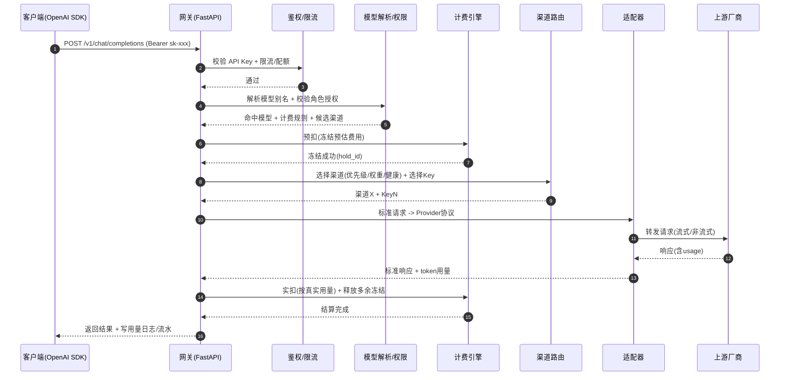
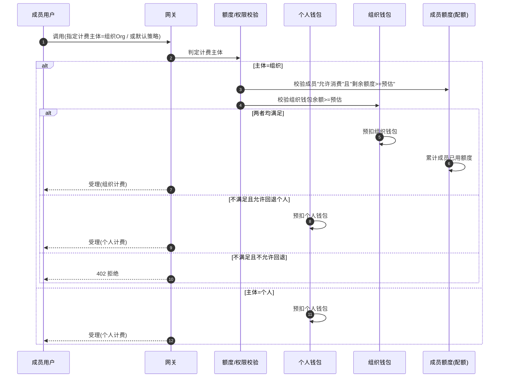

# 核心业务流程

> 返回 [PRD 索引](../PRD.md)

> 模块职责拆分见 [统一调用网关](./gateway.md)、[钱包与流水](./wallet.md)、[组织管理](./organizations.md)。

---

## 统一调用与路由



故障转移：若转发失败（超时/5xx/429/Key 失效），路由层在重试预算内切换同渠道其他 Key 或其他渠道；全部失败则释放冻结并返回错误。

## 计费与扣费（预扣 → 流式 → 实扣）

为兼顾**高并发**与**流式输出**（请求开始时无法预知输出 token），采用两阶段计费：

- **预扣（Hold）**：受理时按 `输入tokens(本地估算) + max_tokens(或历史均值)` 估算费用，原子冻结相应余额。
- **实扣（Capture）**：响应结束拿到真实 usage 后按实际计算费用，扣除并释放「冻结 - 实扣」的差额。

```mermaid
sequenceDiagram
    autonumber
    participant GW as 网关
    participant B as 计费引擎
    participant DB as PostgreSQL(钱包)
    participant UP as 上游

    GW->>B: 预估费用 estimate
    B->>DB: BEGIN; SELECT balance FOR UPDATE
    alt 余额 >= estimate
        B->>DB: balance -= estimate; held += estimate; 写冻结流水
        DB-->>B: COMMIT (hold_id)
        B-->>GW: 预扣成功
    else 余额不足
        B-->>GW: 402 余额不足 (拒绝)
    end

    GW->>UP: 调用(流式逐块返回)
    UP-->>GW: 完成, 真实 usage

    GW->>B: 结算(hold_id, real_usage)
    B->>DB: BEGIN; held -= estimate
    alt 实扣 <= 预扣
        B->>DB: balance += (estimate - actual); 写扣费流水(actual)
    else 实扣 > 预扣(估算偏低)
        B->>DB: balance -= (actual - estimate) [允许至0/授信]; 写扣费流水(actual)
    end
    DB-->>B: COMMIT
    B-->>GW: 结算完成
```

关键规则：

- 余额操作使用 `SELECT ... FOR UPDATE` 行级锁或原子 `UPDATE ... WHERE balance >= x`，杜绝并发超扣。
- 预扣金额 `estimate` 取保守上界；若实扣 > 预扣，按策略扣至余额下限（默认不透支）。
- 流式中途断开：仍按已产生的真实/可估算用量结算。
- 异常未结算的 `hold`：由对账定时任务在超时后释放或补结算（幂等，依据 `request_id`）。

## 个人 / 组织余额共享与扣费主体选择



关键规则：

- **双重约束**：组织身份消费时同时满足组织余额与成员配额。
- **额度周期**：支持总额度或周期额度，到期自动重置。
- **审计可追溯**：组织扣费流水记录实际发起成员。
- **主体选择优先级**：请求显式指定 > 账户默认策略。MVP 用 Key 绑定主体，二期支持请求头动态指定。
